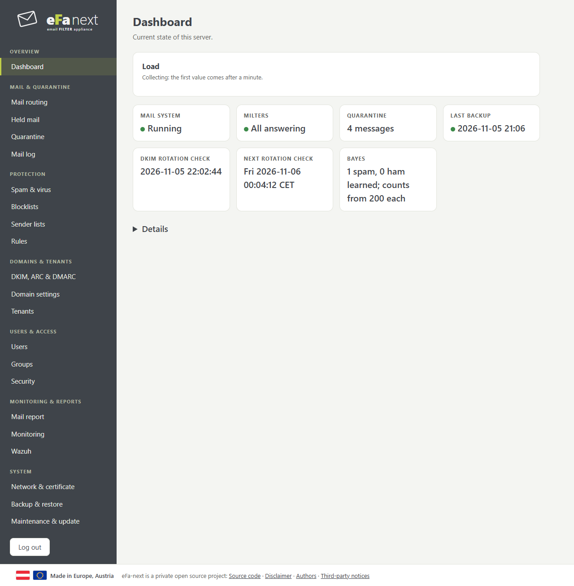

# eFa-next documentation

eFa-next is a mail filter appliance: it takes mail for your domains, checks it with rspamd and ClamAV, and passes it on to your mail server.

## Start here

- **[Manual](manual/README.md)** ([Handbuch, Deutsch](manual/README.de.md)): the whole of eFa-next, chapter by chapter, with screenshots.
- [All features](FEATURES.md) ([Deutsch](FEATURES.de.md)): what eFa-next contains, grouped, with a link to each page.
- [Install](install.md): a fresh EL9 host.
- [Migrate from eFa 5](migration.md): an existing eFa 5.0 host.
- [Upgrade](upgrade.md): what stays, and the first login after an upgrade or a migration.
- [First steps](first-steps.md): what to set after the install.

## The web interface, by menu

| Menu | Page |
|---|---|
| Overview | [Dashboard](dashboard.md) |
| Mail & quarantine | [Mail routing, held mail, quarantine, mail log](mail-and-quarantine.md) |
| Protection | [Spam & virus, blocklists, sender lists, rules](protection.md) |
| Domains & tenants | [DKIM, ARC & DMARC, domain settings, tenants](domains-and-tenants.md) |
| Users & access | [Users, groups and permissions, security](users-and-access.md) |
| Monitoring & reports | [Mail report, monitoring, Wazuh](monitoring-and-reports.md) |
| System | [Network, backup & restore, maintenance & update](system.md) |

Everything on these pages is also a command of `efactl` on the console, with the same checks and the same audit log: `efactl --help` lists them.

How the pages look and behave, for those who change them: [UI guidelines](ui-guidelines.md).

## With a mail platform

- [Microsoft 365](guide-microsoft-365.md), [Google Workspace](guide-google-workspace.md), [Exchange Server](guide-exchange.md):
  incoming and outgoing mail through eFa-next, SPF, DKIM (signed once) and DMARC.

## Protection, by feature

- [Attachments & content disarm](attachments-and-cdr.md), [Impersonation & BEC](bec.md), [Link check on click](link-check.md),
  [Phishing reports & warning banner](phishing-and-banner.md), [Address harvesting](address-harvesting.md), [Failed logins: lockout](login-lockout.md), [Audit anchors](audit-anchor.md), [Signed backups](backup-signature.md), [TLS with partners](tls-partners.md), [Header privacy](header-privacy.md), [Own blocks](own-blocks.md), [GDPR requests](gdpr-requests.md), [Backup targets in the EU](backup-eu.md), [EU relation](eu-relation.md), [EVE export](eve-export.md), [EU conformity](compliance/EU.md), [Frameworks of the guided setup](compliance/frameworks.md), [NIS2 incidents](nis2-incident.md), [Two-factor login](two-factor.md), [Taken-over accounts](hijacked-accounts.md), [Threat feeds](threat-feeds.md), [Job applications](job-applications.md)
- [DMARC reports, DANE & MTA-STS](dmarc-dane-mta-sts.md)
- [Domain check](domain-check.md)
- [Role addresses](role-addresses.md)
- [Configuration history and four eyes](config-history.md)
- [Operation without internet](offline.md)
- [S/MIME and PGP at the gateway](smime-pgp.md)
- [Keys in a hardware module](hsm.md)

## Outbound & delivery

- [Spooling & destination reachability](spooling.md), [Newsletter-friendly sending](bulk.md),
  [Archive forwarding](archive.md), [External backup targets](backup-targets.md), [More network interfaces](interfaces.md)

## More

- [FAQ and troubleshooting](faq.md)
- [Privacy defaults & a reason for content](privacy-and-reason.md)
- [Hardening report as PDF](hardening-report-pdf.md), [Fuzzing the parsers](fuzzing.md)
- [Encryption and TLS profiles](tls-profiles.md): only modern encryption, per service
- [Security model](security-model.md): user portal apart from the admin interface, admin access by address
- [DKIM provisioning API](api-dkim-provisioning.md): DKIM keys and rotation from another signing system
- [Data protection templates (German)](datenschutz/README.md): VVT, TOMs, AVV outline: templates, adapt them to your organisation
- [Wazuh](WAZUH.md)
- [Release checklist](RELEASE-CHECKLIST.md)
