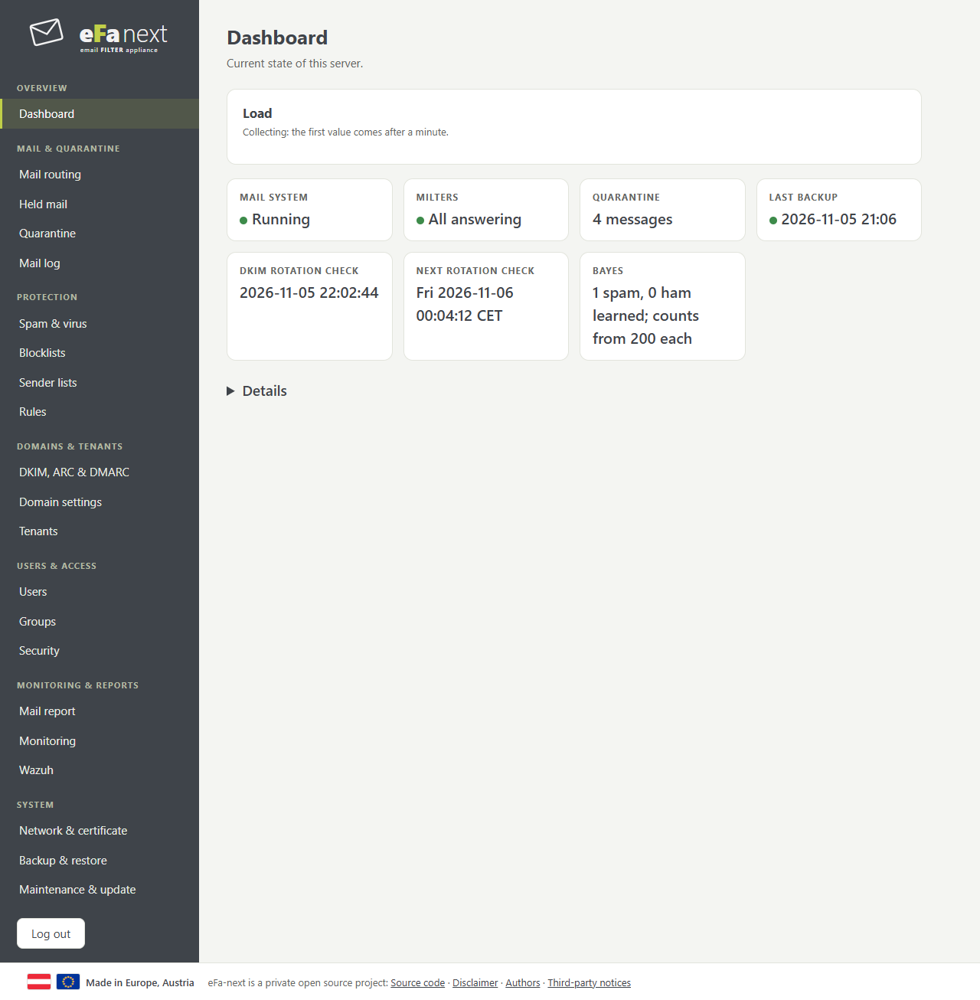
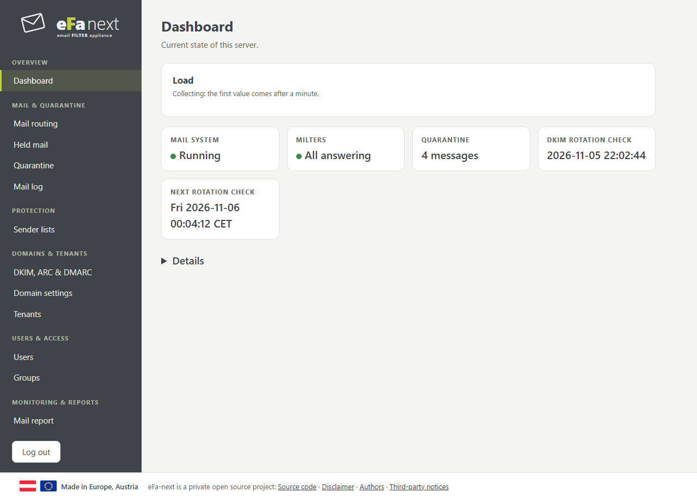
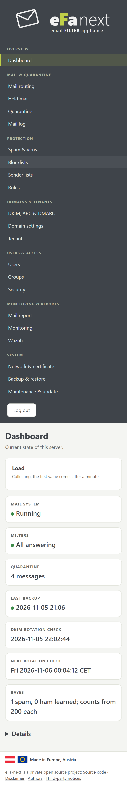

# Dashboard

The state of the server at a glance: mail system, milters, quarantine, last backup, DKIM rotation, Bayes. *Needs attention* lists what to do, with a link to the page. *Details* opens the full status and settings.

## Status at a glance

The first card of the dashboard. Each lamp is green when all is normal, amber when something is unusual and red for an attack
or a fault; grey means no current value. Lamps: mail server (Postfix), spam filter (rspamd), virus scanner (ClamAV), database,
cache, DNS resolver, web server, Fail2Ban, firewall, milters, and four from the attack check: attacks, spam and viruses, mail
queue, resources. The gauges show CPU, RAM and disk in use, mails and the spam share of the last 10 minutes, SMTP connections
per minute and failed logins of the last 10 minutes; the coloured band of each gauge shows where amber and red begin.

## Attack alert on every page

Once a minute eFa-next checks the host. When it finds something, every admin page shows a banner right under the top bar:

| Kind | Amber from (normal sensitivity) | Red from |
|------|------|------|
| SMTP connection flood | 120 connections per minute and 4 times the normal value of the last hour | 300 and 8 times |
| SYN flood | 50 dropped or SYN cookie connections per minute | 200 |
| Password guessing (SMTP AUTH, web login) | 30 failures in 10 minutes | 100 |
| Spam wave (at least half of the mail is spam) | 60 spam mails in 10 minutes and 3 times the normal value | 150 and 6 times |
| Virus wave | 5 viruses in 10 minutes and 3 times the normal value | 20 and 6 times |
| Many rejects / Fail2Ban bans | 300 rejects per minute and 8 times normal / 30 bans in 10 minutes | – |
| Mail queue | 100 mails | 1000 |
| Disk / memory / load | 90 % / 92 % / load 2 per CPU | 95 % / 97 % / 4 per CPU |
| Service down | – | any |

*Security > Attack alert* sets the sensitivity: high halves the limits, low doubles them (disk, memory and load stay the same).
An alert stays five minutes after its value fell back, marked as easing. The banner names since when, links to the page that
helps (firewall, failed logins, spam settings, queue, load) and shows super admins the addresses that caused most of it.
Tenant admins see the alert without addresses; the user portal shows none.

The check needs no service of its own: efa-web runs `efactl threat-run` once a minute. It reads the new journal lines of
Postfix, Fail2Ban and efa-web, the TCP counters of the kernel, the mail log and the queue folders, nothing from the network.

A tenant admin sees only what belongs to the tenant:

On a phone the menu comes first, then the page:

