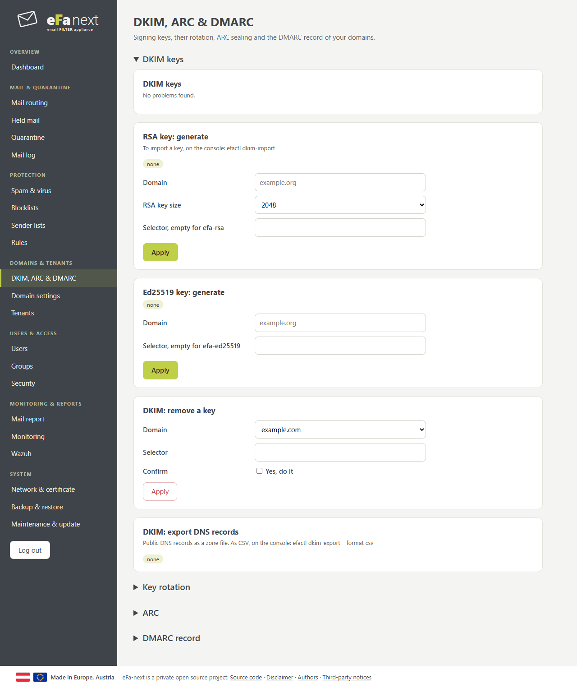
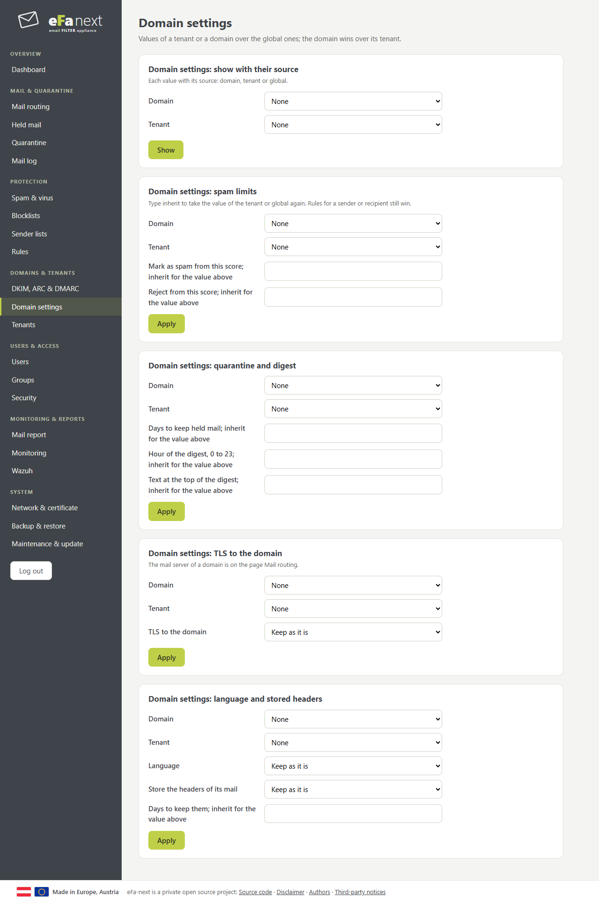
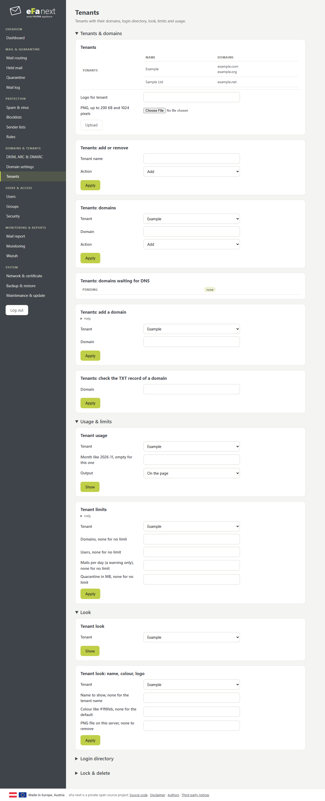

# Domains & tenants

## DKIM, ARC & DMARC

- **DKIM keys**: *RSA key: generate* or *Ed25519 key: generate* per domain, then publish the record from *DKIM: export DNS records*.
- **Key rotation**: new keys are made in advance; a key rotates from its date on once enough DNS servers show its record. Publish the records of future keys early: the export contains them.
- **ARC**: seals mail eFa passes on, so the next server can trust its checks.
- **DMARC record**: the generator builds the `_dmarc` record; eFa stores it, you publish it. Start with `p=none`, read the reports, then go to quarantine and reject.

## Domain settings

Values of a tenant or a domain over the global ones: spam limits, how long held mail is kept, digest hour and text, TLS to the domain, language, stored headers. The domain wins over its tenant. *Show with their source* tells for each value whether it comes from the domain, the tenant or global. *Inherit* takes an own value away again.

## Tenants

A tenant is one customer with its domains, users, look and limits.

- **Domains**: a super admin adds them at once. A tenant admin uses *Tenants: add a domain*, publishes the TXT record `_efa-verify.<domain>` it shows, then *check the TXT record*.
- **Usage & limits**: domains, users, mails per day, quarantine in MB. From 80 % the admin gets a mail; at 100 % nothing new can be added, mail still flows.
- **Look**: name, colour and a PNG logo for the web interface, the digest and the reports.
- **Login directory**: the own LDAP or OIDC of a tenant, for the addresses of its domains.
- **Lock & delete**: a locked tenant cannot log in; its mail flows on or waits in the queue. Delete removes all its data; type its name again.

