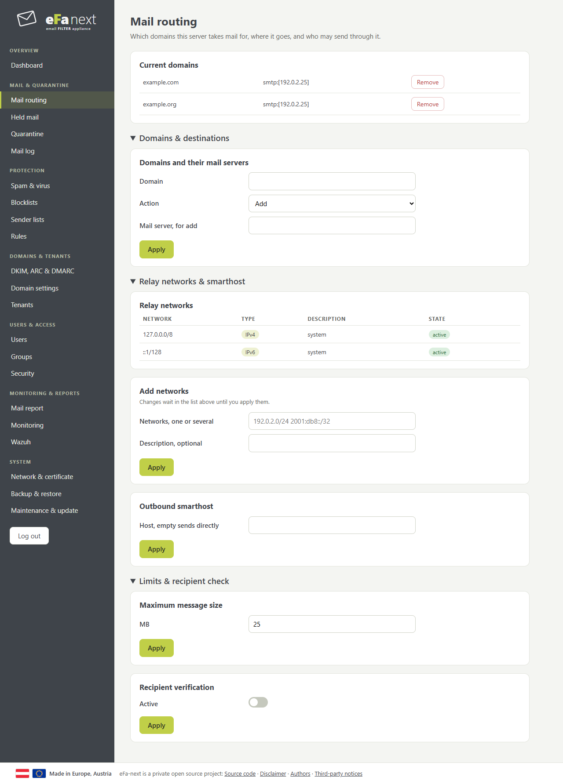

# First steps

After the install, in this order. Each step names the page.

1. **Domains and their mail server**: Mail & quarantine › [Mail routing](mail-and-quarantine.md). One line per domain, with the server that receives its mail.
2. **Who may send through eFa**: the same page, *Relay networks & smarthost*. Add the networks of your own mail servers; apply the change.
3. **DKIM keys**: Domains & tenants › [DKIM, ARC & DMARC](domains-and-tenants.md). Make a key per domain, publish its DNS record from the export, turn on the rotation.
4. **Backups**: System › [Backup & restore](system.md). Set a password for the automatic backups, then make one with *Back up now*.
5. **Admin access**: Users & access › [Security](users-and-access.md). Limit SSH and web to your admin networks; the change reverts after 5 minutes unless you confirm it.
6. **Other admins**: Users & access › [Users](users-and-access.md), each with their own login and the groups they need.
7. **Test**: send a mail from outside, then find it under Mail & quarantine › Mail log, and open its details.

