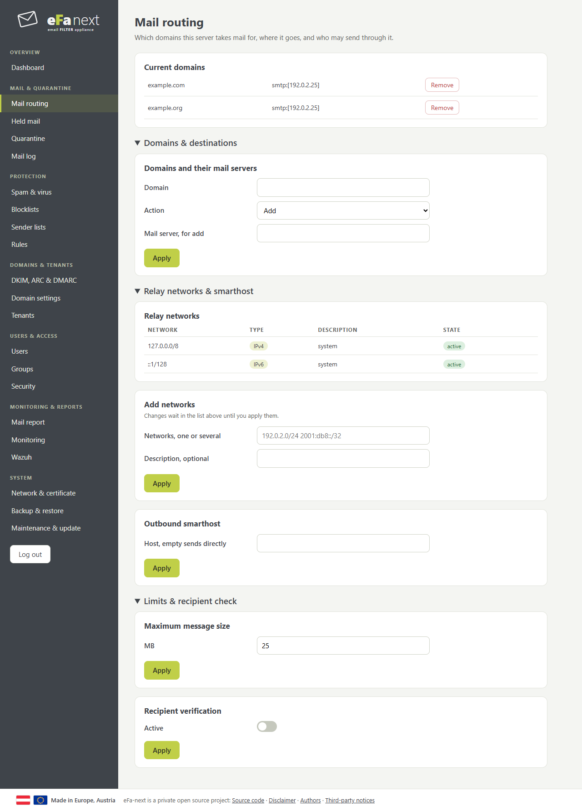
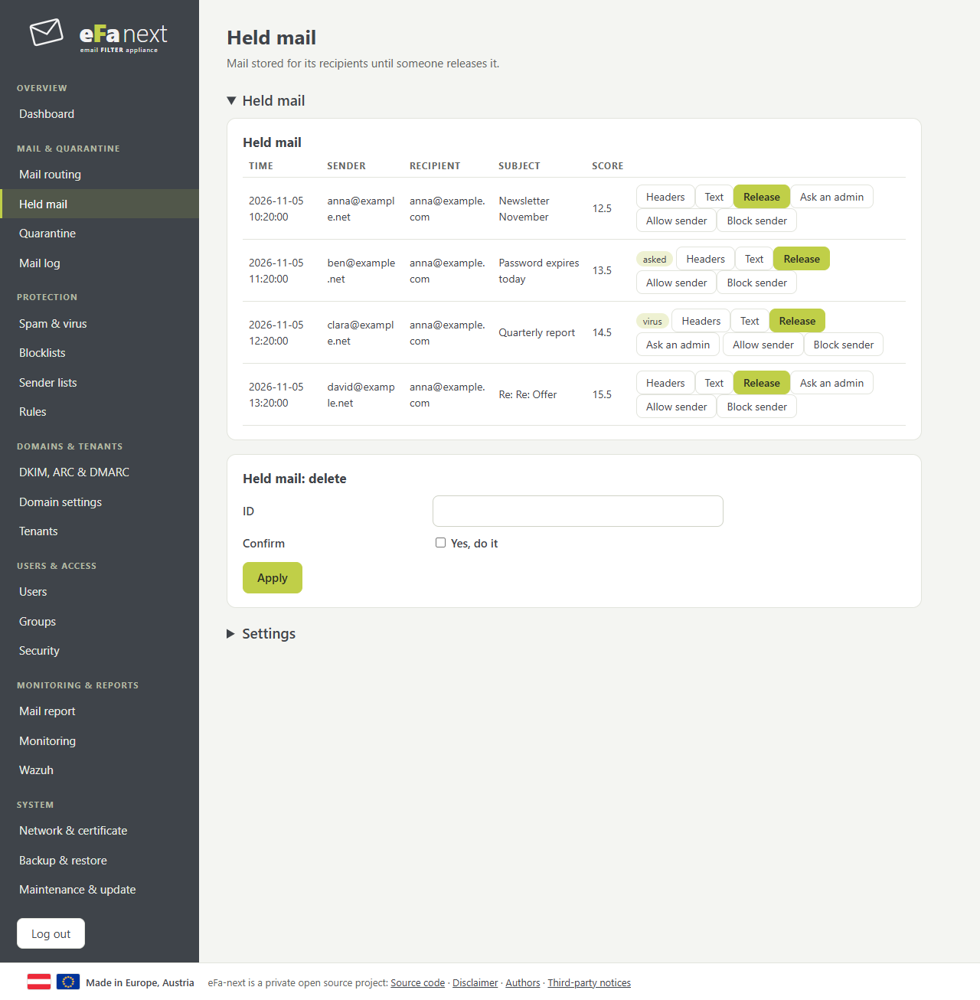
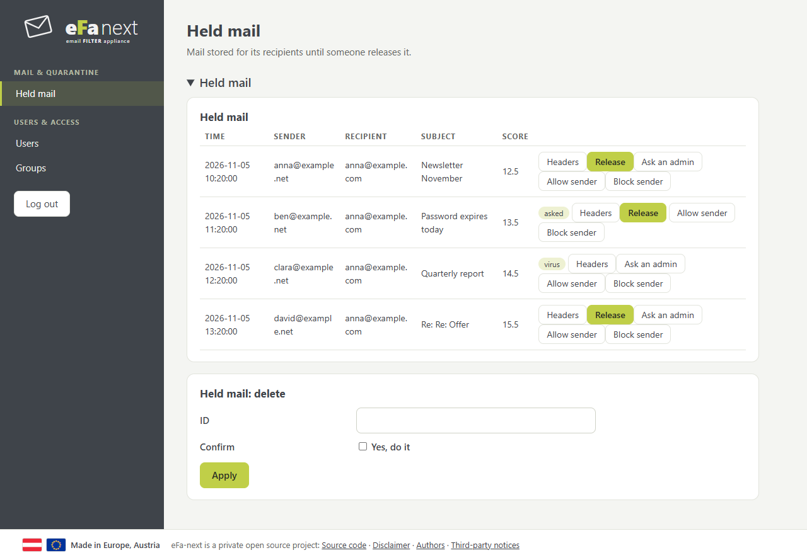
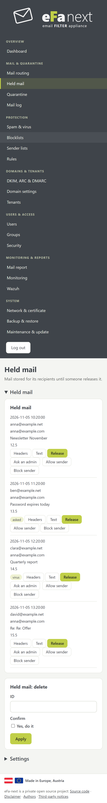
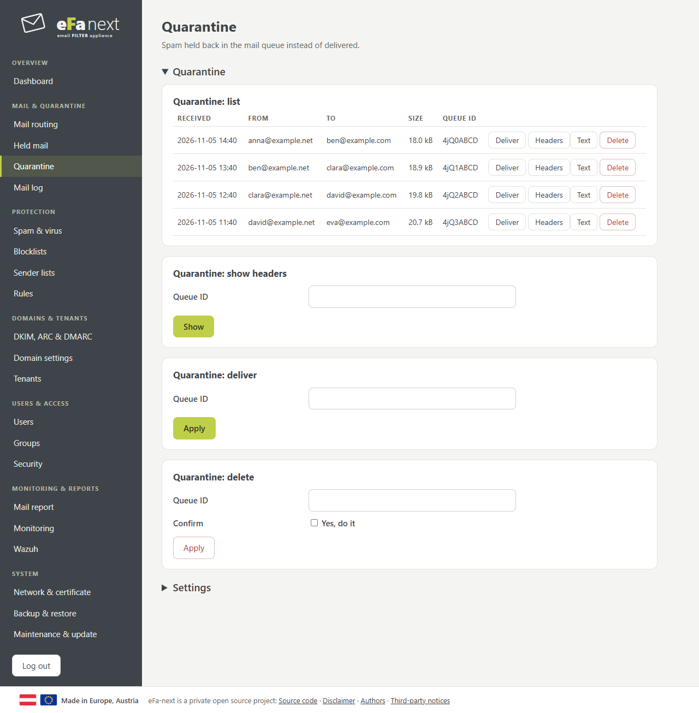
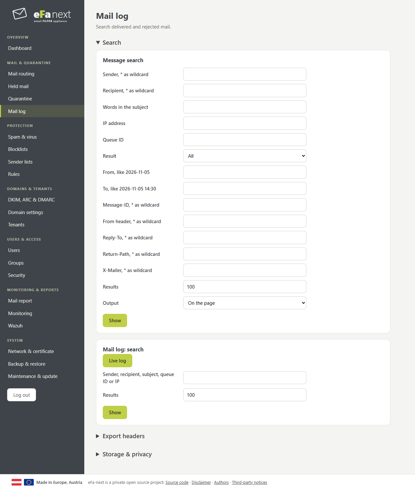
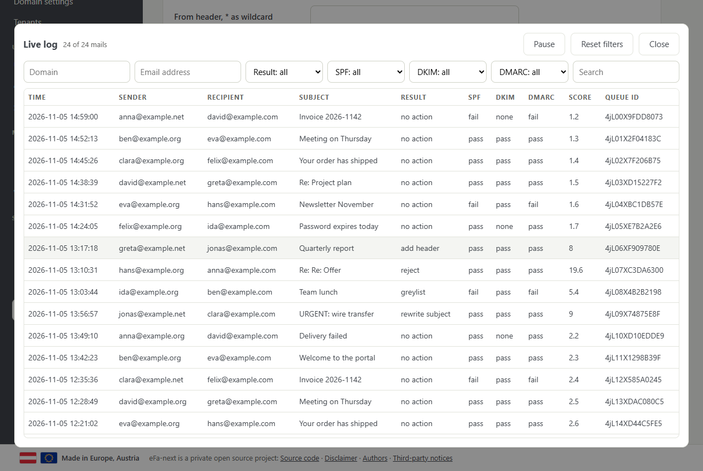
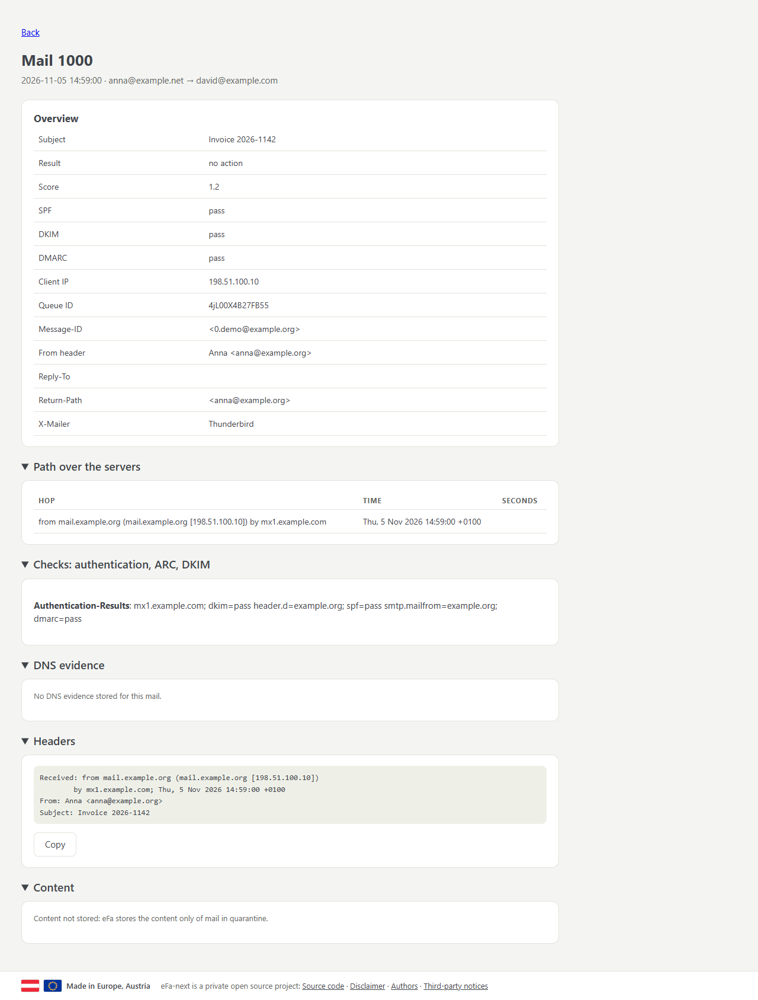

# Mail & quarantine

## Mail routing

Which domains eFa-next takes mail for and where it delivers it; who may send through eFa-next; size limit and recipient check.

- Add a domain: *Domains and their mail servers*, domain and mail server (`host` or `host:port`).
- Allow your own mail servers to send out: *Add networks*, then *Apply* in the list above.



## Held mail

Mail eFa-next keeps for its recipients instead of rejecting it. Off by default (Settings, at the end of the page). Users get a daily digest with links, or log in with their address.

- *Release* delivers it, *Ask an admin* when the user may not release alone, *Allow sender* / *Block sender* add the sender to the user's lists.
- *Text* shows the mail as plain text: links are not clickable and nothing is loaded. Attachments are only listed.
- A virus only gets out through a super admin.



A user sees only their own mail:



On a phone each mail is one block:



## Quarantine

Spam held back in the mail queue: deliver, headers, text, delete.



## Mail log

Search all mail by sender, recipient, subject, result, date and the header fields From, Reply-To, Return-Path, X-Mailer. *Output: CSV file* downloads the result.



*Live log* shows new mail as it comes, with filters. A click on a row shows its details.



### Details of a mail

Overview, the path over the servers with the time per hop, the authentication results, the DNS evidence (the records the checks used, with TTL and DNSSEC), and the raw headers. With the permission *export*: download the headers as `.txt` or the evidence as JSON.



### Export headers

*Export headers* (under the search) writes a ZIP with one file per mail and `index.csv`, for the same filters. Above 5,000 mails it runs in the background; the link works when it is done, for 24 hours. On the console:

```bash
efactl headers-export --rcpt '*@example.com' --date_from 2026-11-01 --out /var/lib/eFa/exports/november.zip
```

Headers of all mail are stored for 30 days by default (*Storage & privacy* on this page, and per tenant or domain under Domain settings).

## Held mail encrypted at rest (D3)

`efactl uq-encrypt-set --mode on` (Held mail, Settings) stores every held mail encrypted: one AES-256-GCM key per mail, wrapped
with X25519 for each tenant of its recipients (and a global key for domains without tenant). The service that stores held mail
(efa-maillog) has only the public keys; the private keys are in `/etc/eFa/quarantine-keys` for root, so only efactl, through
the checks of rights, opens a held mail. Switching on also seals the mails held so far. Off stores new mail as before; sealed
mail stays readable. A new tenant gets its key pair within the hour or when its first domain is added. The keys are part of
every backup: keep backups encrypted (backup password), and keep them, or the sealed mail cannot be read. On for a new install,
off after an upgrade.

## Newsletters (graymail) and the own spam limit (items 2 and 3)

- Graymail: mail with List-Unsubscribe, List-Id or Precedence bulk/list that is not spam. `efactl graymail-set --mode on
  --default mark --subject "[Newsletter]"`; each user chooses in the portal (Held mail, Newsletters): deliver, mark (header
  `X-eFa-Graymail: yes` and the prefix) or keep in the own quarantine (needs the quarantine for users; a mail with recipients
  that chose otherwise is marked). Off by default.
- Own spam limit: `efactl user-spam-set --mode on --low 4 --high 10` opens it; a user then sets in the portal from which score
  on mail to the own address is marked as spam (and goes to the own quarantine where that is on). It is a rule of rspamd for the
  address, below the rules of the admins and above the limits of the domain. Off by default.

## Recall window (P6) and confirmation of attachments to new recipients (P1)

Both hold outgoing mail in the Postfix hold queue for its sender. They are set per domain or tenant and are off by default:

    efactl outbound-hold-set --kind recall --level domain --target example.com --value 2
    efactl outbound-hold-set --kind confirm --level tenant --target customer1 --value 4
    efactl outbound-hold-status

**Recall window (P6).** Each mail of a logged-in user of the domain waits 1 to 5 minutes. In that time the user sees it in the
portal (Recall my mail) and can withdraw it; it is then deleted and never sent. After the window it goes out by itself.

**Confirmation (P1).** A mail with an attachment to a recipient outside the own domains that the sender never wrote to (the pairs
of the BEC check) waits for the sender.

1. Within a minute the sender gets a mail with a link (`/q/...`). Opening the link only asks; the button sends the mail.
2. Without a confirmation within 1, 4 or 24 hours, the mail comes back to the sender as an attachment and is not sent. The pair
   of sender and recipient that the held mail made is forgotten again.
3. If Redis does not answer, every outside recipient counts as new (fail closed). If the hold cannot be noted, the mail gets a
   temporary error and the sending program tries again.

The job `efa-outbound-hold.timer` runs every minute. It does not even start a process while nothing waits. Each confirmation,
return and withdrawal goes into the audit log.

## Emergency access (5n)

When the mail servers behind eFa-next are down, users and admins can still read the mail that came in. There are two sources:

1. **The queue:** mail that waits in the queue of Postfix because its mail server does not answer. This needs no setting.
2. **The emergency copy:** a copy of each delivered mail of a domain or tenant, kept for 1, 3, 7, 14 or 30 days. It is off by
   default:

       efactl emergency-set --level domain --target example.com --days 7

   The copies are sealed with the key of the tenant (the key of the encrypted quarantine, D3); only root can open them. They go
   after their days, daily. Setting the days to 0 switches the copy off and deletes the copies. When the copies take more than a
   quarter of the free disk, the dashboard says so. A mail larger than 15 MB gets no copy.

**Who can read what:**
- A user sees the mail to their own address in the portal (Emergency access to my mail).
- An admin needs the right `mail.emergency.read` and gives a reason. The admin sees only the own domains.
- Every list, read and download goes into the audit log, with the reason.

**How it is shown:** a mail is shown as text only, never as HTML, and nothing is loaded from outside. Attachments and the whole
mail (`.eml`) are only saved as files. A file of a kind that can run code needs a typed `yes`. There are no replies: this is no
webmail.

