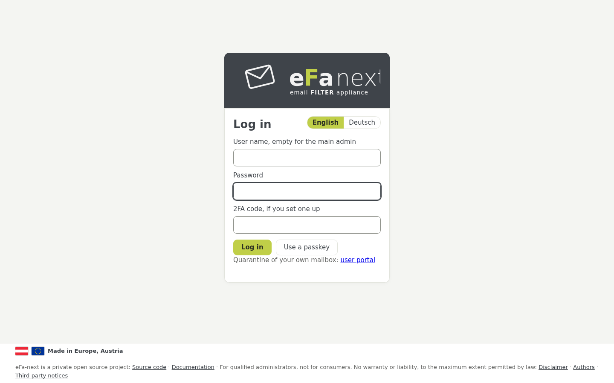
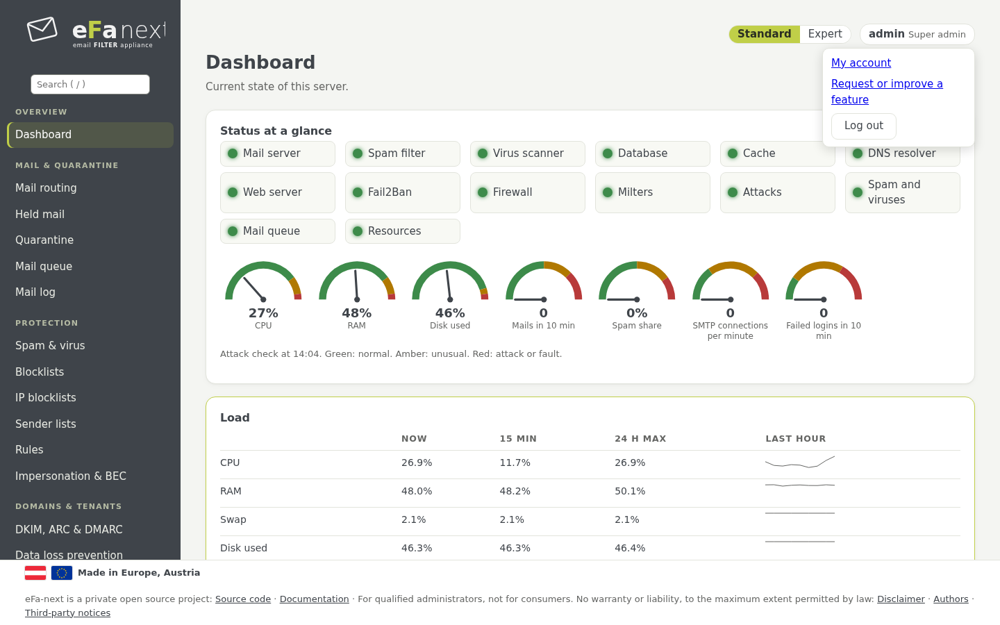
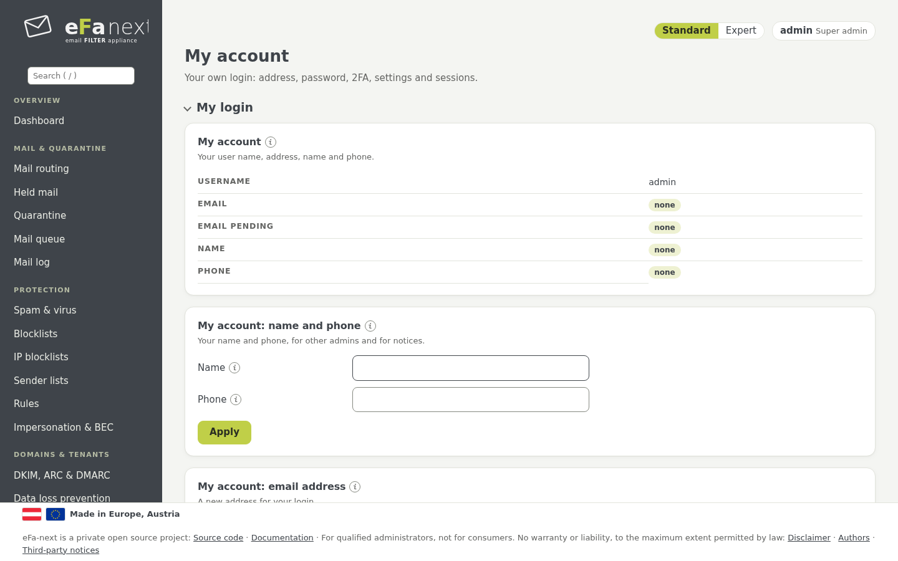

# 3. Erste Anmeldung, 2FA und Mein Konto

## Wo man sich anmeldet

| Wer | Adresse | Anmeldung mit |
|---|---|---|
| Haupt-Admin | `https://<Hostname>/login` | Benutzername **leer**, das Web-Admin-Passwort des Assistenten, der 2FA-Code |
| Weitere Admins, Helpdesk, Mandanten- und Domain-Admins | `https://<Hostname>/login` | eigener Benutzername, Passwort und 2FA-Code |
| Postfach-Benutzer (eigene zurückgehaltene Mail) | `https://<Hostname>/portal/login` | Mailadresse und Passwort, ein Anmeldelink aus der Übersichtsmail, ein Passkey oder Single Sign-on |
| Konsole und SSH | die Konsole, oder `ssh <Konsolen-Benutzer>@<Hostname>` | der Konsolen-Benutzer des Assistenten, dann `sudo efactl menu` für das Textmenü |



Das Feld *2FA-Code, falls eingerichtet* bleibt bei einer Anmeldung ohne 2FA leer. *Passkey verwenden* meldet mit
Sicherheitsschlüssel oder Passkey an, wo die Rolle es erlaubt; *Mit Single Sign-on anmelden* erscheint, wenn ein OIDC-Anbieter
eingerichtet ist (Kapitel 8). Unter dem Formular führt ein Link Postfach-Benutzer zum Benutzerportal.

Fünf falsche Anmeldungen von einer Adresse sperren diese Adresse für fünf Minuten. Manche Änderungen fragen noch einmal nach dem
Passwort (und dem 2FA-Code); nach einer Bestätigung hält die Karte sie fünf Minuten und sagt, wie lange noch.

## Zwei-Faktor-Anmeldung (2FA)

eFa-next nutzt TOTP (RFC 6238: 30 Sekunden, 6 Ziffern) mit jeder Authenticator-App (FreeOTP, Aegis, Microsoft oder Google
Authenticator und andere). Den QR-Code zeichnet eFa-next selbst.

**In der Weboberfläche:** *Mein Konto › Zwei-Faktor-Anmeldung (2FA)*:

1. *Einrichten* zeigt den QR-Code und den Schlüssel als Text.
2. Den ersten Code der App eingeben. 2FA ist an, und zehn Wiederherstellungscodes werden einmal gezeigt. Sicher aufbewahren:
   Jeder gilt einmal statt eines Codes.

Solange eine Anmeldung keine 2FA hat, zeigt das Dashboard einen Hinweis mit *2FA einrichten*. Ein Super-Admin kann 2FA je Rolle
verlangen (*Benutzer › 2FA der Benutzer*, `efactl totp-policy-set --role tenant --mode required`): Solche Anmeldungen erreichen
dann nur die 2FA-Einrichtung, bis sie erledigt ist. In der geführten Einrichtung haben Haupt-Admin und Konsolen-Admin 2FA von
Anfang an und können sie nicht abschalten.

**Passkeys und Sicherheitsschlüssel** (WebAuthn) sind zweiter Faktor oder, wo die Rolle es erlaubt, eine Anmeldung ohne
Passwort: *Mein Konto › Passkeys*. Sie brauchen ein Zertifikat, dem die Browser vertrauen (nicht selbstsigniert). Details:
[two-factor.md](../two-factor.md).

### 2FA auf der Konsole (SSH)

Der Konsolen-Admin hat seine eigene 2FA, getrennt vom Web-Admin. Die Anmelde-Shell fragt sie über SSH ab; die lokale Konsole (tty)
fragt keinen Code. Das Geheimnis ist eine Datei nur für root, so funktioniert SSH auch, wenn die Datenbank nicht läuft.

```bash
sudo efactl console-2fa-enroll                 # zeigt den otpauth-Link und das Geheimnis für die App
sudo efactl console-2fa-enroll --code 123456   # schaltet sie ein, zeigt zehn Wiederherstellungscodes einmal
sudo efactl console-2fa-set --mode on          # die Anmelde-Shell fragt den Code (nur auf der Konsole)
```

Fünf falsche Codes sperren diesen Konsolen-Benutzer für 15 Minuten. In der geführten Einrichtung bleibt die Konsolen-2FA an.

## Mein Konto (oben rechts)

Oben rechts zeigt jede Seite, wer angemeldet ist, mit der Rolle. Das Menü dort enthält **Mein Konto**, **Funktion wünschen oder
verbessern** (das Formular für Funktionswünsche des Projekts auf GitHub) und **Abmelden**.



*Mein Konto* enthält:

- **Meine Anmeldung:** Name und Telefon, eine neue Mailadresse (sie gilt, sobald der Link an sie angeklickt wurde), das Passwort.
- **Zwei-Faktor-Anmeldung (2FA)** und **Passkeys**.
- **Meine Einstellungen:** Sprache, Zeitzone, Zeilen je Seite, Berichtsmails an mich, Standardansicht.
- **Meine Sitzungen:** jede Sitzung dieser Anmeldung, auch auf anderen Geräten; jede lässt sich beenden.

Adresse, Passwort oder 2FA ändern fragt erneut nach dem Passwort, mit dem aktuellen 2FA-Code, wenn eingerichtet.



## Passwort oder 2FA verloren

Auf der Konsole, als Konsolen-Admin:

| Problem | Befehl |
|---|---|
| Web-Admin-Passwort vergessen | `sudo efactl admin-password` (fragt zweimal) |
| Passwort eines anderen Benutzers | `sudo efactl user-set --username <Name> --action set` |
| Benutzer gesperrt | `sudo efactl user-state --username <Name> --mode on` |
| Telefon des Haupt-Admins verloren | ein Wiederherstellungscode, oder auf der lokalen Konsole `efactl user-2fa-reset --username @admin` |
| Telefon eines anderen Benutzers verloren | ein Admin mit dem Recht, den Benutzer zu verwalten: *Benutzer › 2FA der Benutzer* (`user-2fa-reset --username <Name>`) |
| Telefon eines Konsolen-Admins verloren | ein Wiederherstellungscode, oder ein Super-Admin: `user-2fa-reset --username @console:<Name>` |
| Adresse ausgesperrt | fünf Minuten warten |

Niemand setzt seine eigene 2FA zurück.

## Nach einem Upgrade oder einer Migration

Jede Anmeldung bleibt, wie sie war. Die erste Anmeldung nach einem Upgrade kann geänderte Nutzungsbedingungen zur Bestätigung
zeigen, danach die Hinweise des Releases unter *Braucht Aufmerksamkeit*. Nach einer Migration von eFa 5 meldet sich der
Haupt-Admin mit dem neuen Passwort an, das `efa-migrate` am Ende einmal zeigt. Details: [upgrade.md](../upgrade.md).

Weiter: [Dashboard und Angriffswarnung](04-dashboard.de.md) · Zurück: [Handbuch](README.de.md)
