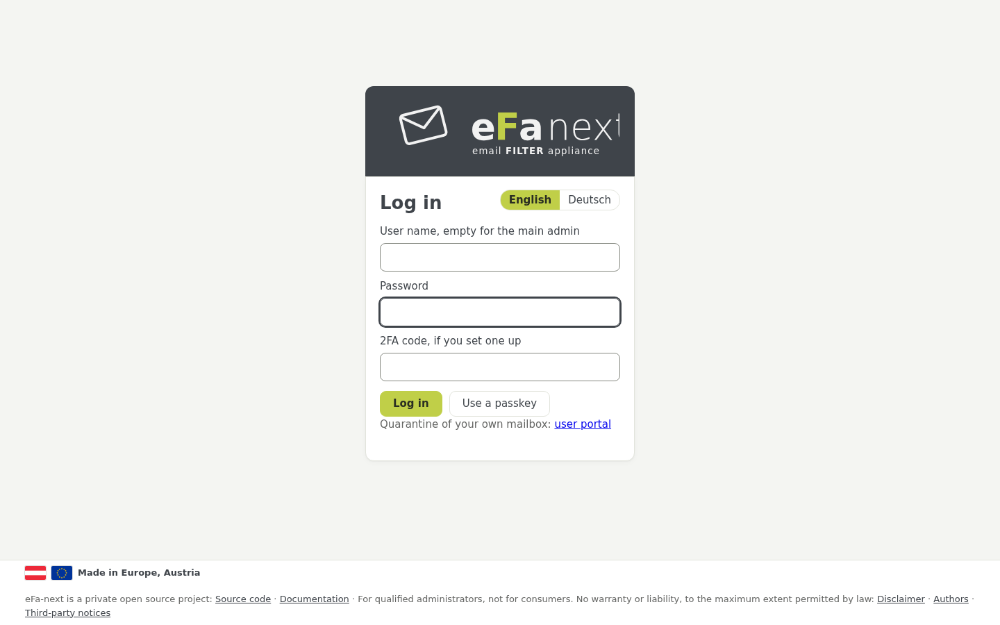
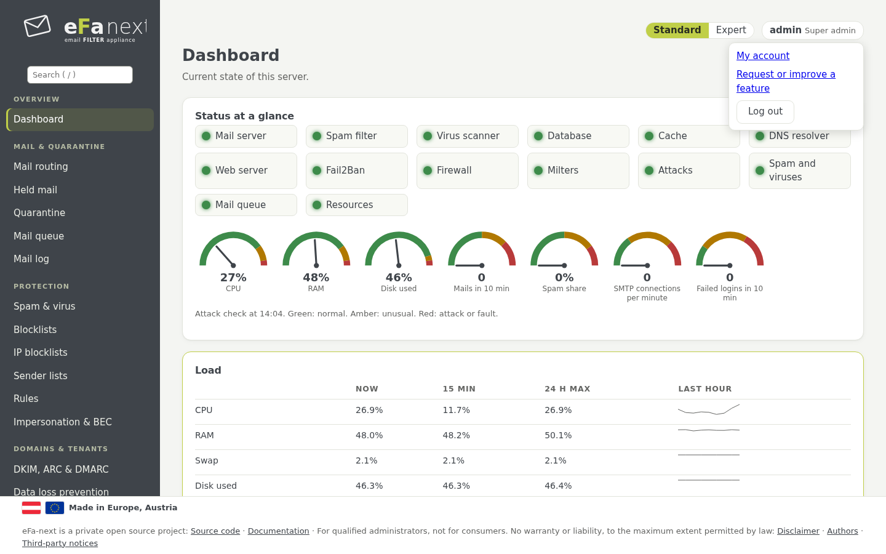
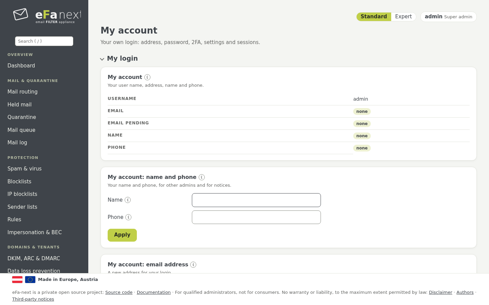

# 3. First login, 2FA and My account

## Where to log in

| Who | Address | Log in with |
|---|---|---|
| Main admin | `https://<host name>/login` | user name **empty**, the web admin password of the wizard, the 2FA code |
| Other admins, helpdesk, tenant and domain admins | `https://<host name>/login` | their user name, password and 2FA code |
| Mailbox users (own held mail) | `https://<host name>/portal/login` | their mail address and password, a login link from the digest, a passkey or single sign-on |
| Console and SSH | the console, or `ssh <console user>@<host name>` | the console user of the wizard, then `sudo efactl menu` for the text menu |



The field *2FA code, if you set one up* stays empty for a login without 2FA. *Use a passkey* logs in with a security key or
passkey where the role allows it; *Log in with single sign-on* appears when an OIDC provider is set up (chapter 8). Below the
form a link leads mailbox users to the user portal.

Five wrong logins from one address lock that address out for five minutes. Some changes ask for your password (and 2FA code)
once more; after a confirmation the card holds it for five minutes and says how long.

## Two-factor login (2FA)

eFa-next uses TOTP (RFC 6238: 30 seconds, 6 digits) with any authenticator app (FreeOTP, Aegis, Microsoft or Google
Authenticator and others). The QR code is drawn by eFa-next itself.

**In the web interface:** *My account › Two-factor login (2FA)*:

1. *Set up* shows the QR code and the key as text.
2. Enter the first code of the app. 2FA is on, and ten recovery codes are shown once. Keep them safe: each works once instead
   of a code.

While a login has no 2FA, the dashboard shows a notice with *Set up 2FA*. A super admin can require 2FA per role
(*Users › 2FA of the users*, `efactl totp-policy-set --role tenant --mode required`): such logins reach only the 2FA setup
until it is done. In the guided setup the main admin and the console admin have 2FA from the start and cannot switch it off.

**Passkeys and security keys** (WebAuthn) are a second factor or, where the role allows it, a login without password:
*My account › Passkeys*. They need a certificate the browsers trust (not self-signed). Details: [two-factor.md](../two-factor.md).

### 2FA on the console (SSH)

The console admin has its own 2FA, separate from the web admin. It is asked by the login shell over SSH; the local console
(tty) asks no code. Its secret is a root-only file, so SSH still works while the database is down.

```bash
sudo efactl console-2fa-enroll                 # prints the otpauth link and the secret for the app
sudo efactl console-2fa-enroll --code 123456   # switches it on, shows ten recovery codes once
sudo efactl console-2fa-set --mode on          # the login shell asks for the code (on the console only)
```

Five wrong codes lock that console user for 15 minutes. In the guided setup the console 2FA stays on.

## My account (top right)

The top right of every page shows who is logged in, with the role. Its menu holds **My account**, **Request or improve a
feature** (the feature form of the project on GitHub) and **Log out**.



*My account* holds:

- **My login:** name and phone, a new email address (it counts once the link sent to it is clicked), the password.
- **Two-factor login (2FA)** and **Passkeys**.
- **My settings:** language, time zone, rows per page, report mails to me, the default view.
- **My sessions:** every session of this login, also on other devices; end any of them.

Changing address, password or 2FA asks your password again, with the current 2FA code if one is set up.



## Lost password or 2FA

On the console, as the console admin:

| Problem | Command |
|---|---|
| Web admin password forgotten | `sudo efactl admin-password` (asks twice) |
| Password of another user | `sudo efactl user-set --username <name> --action set` |
| User locked | `sudo efactl user-state --username <name> --mode on` |
| Phone of the main admin lost | a recovery code, or on the local console `efactl user-2fa-reset --username @admin` |
| Phone of another user lost | an admin with the right to manage the user: *Users › 2FA of the users* (`user-2fa-reset --username <name>`) |
| Phone of a console admin lost | a recovery code, or a super admin: `user-2fa-reset --username @console:<name>` |
| Address locked out | wait five minutes |

Nobody resets their own 2FA.

## After an upgrade or a migration

Every login stays as it was. The first login after an upgrade may ask to confirm changed terms of use, then shows the notes of
the release under *Needs attention*. After a migration from eFa 5 the main admin logs in with the new password `efa-migrate`
printed once at the end. Details: [upgrade.md](../upgrade.md).

Next: [Dashboard and attack alert](04-dashboard.md) · Back: [Manual](README.md)
