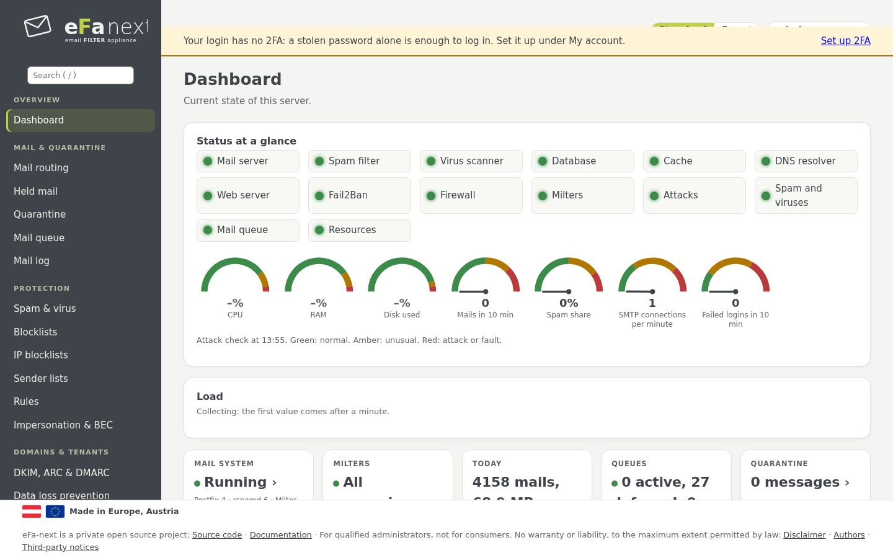
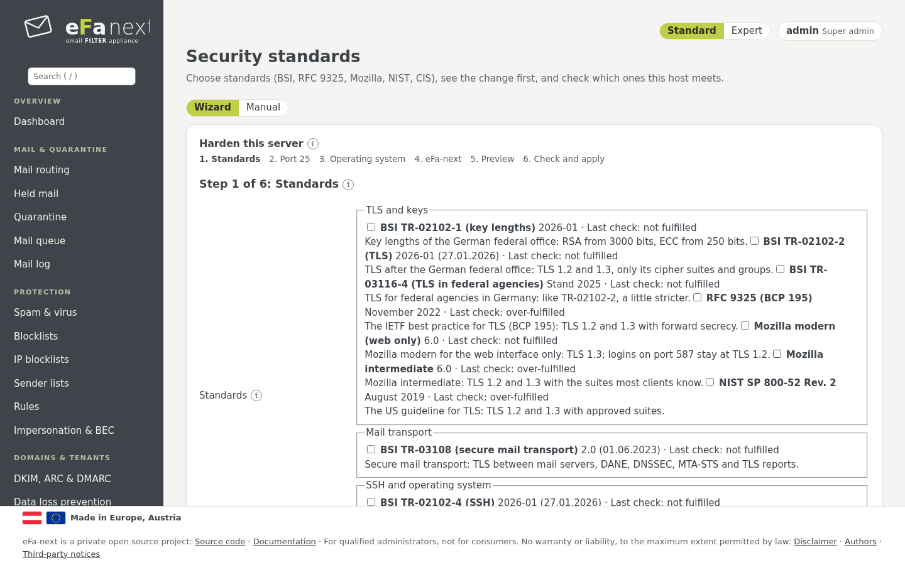
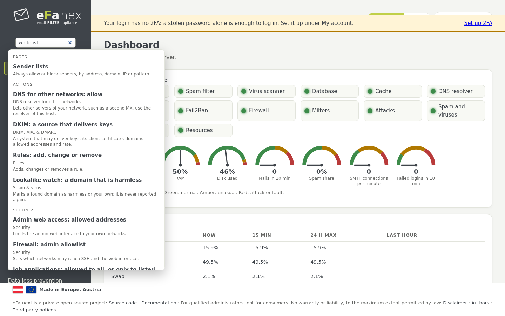
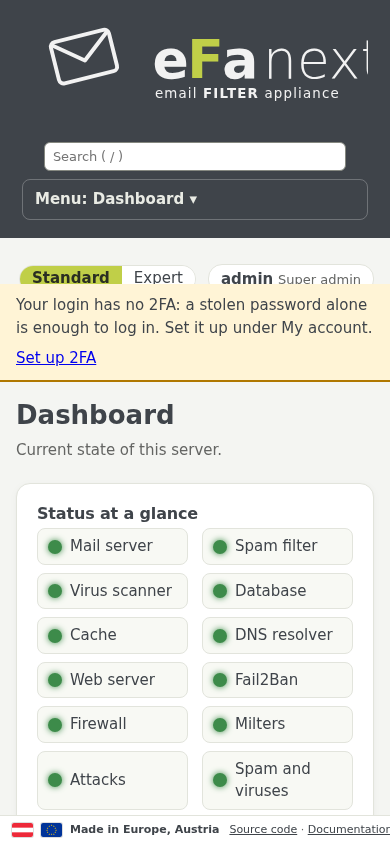
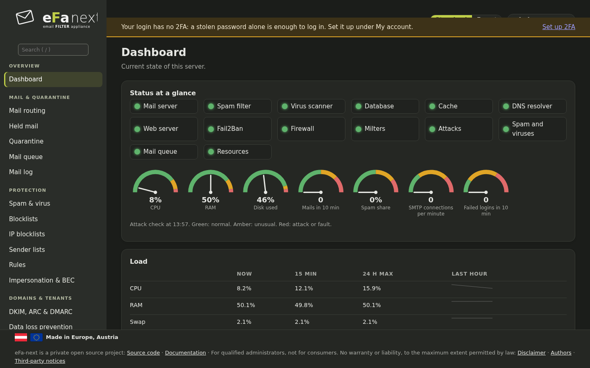

# 4. Dashboard und Angriffswarnung

*Übersicht › Dashboard* ist die erste Seite nach der Anmeldung.

## Status auf einen Blick

Die erste Karte. Jede Lampe ist grün, wenn alles normal ist, gelb bei etwas Ungewöhnlichem, rot bei einem Angriff oder Fehler,
grau ohne aktuellen Wert:

- **Dienste:** Mailserver (Postfix), Spamfilter (rspamd), Virenscanner (ClamAV), Datenbank, Cache, DNS-Resolver, Webserver,
  Fail2Ban, Firewall, Milter.
- **Aus der Angriffsprüfung:** Angriffe, Spam und Viren, Mail-Warteschlange, Ressourcen.

Die Zeiger zeigen CPU, RAM und Platte in Gebrauch, Mails und Spamanteil der letzten 10 Minuten, SMTP-Verbindungen je Minute und
Fehlanmeldungen der letzten 10 Minuten. Das farbige Band jedes Zeigers zeigt, wo Gelb und Rot beginnen. Tafel und Banner
erneuern sich alle 30 Sekunden, solange die Seite sichtbar ist.

## Angriffswarnung auf jeder Seite

Einmal je Minute prüft eFa-next den Host auf Verbindungsfluten über SMTP, SYN-Fluten, Passwortraten bei SMTP AUTH und der
Web-Anmeldung, viele Abweisungen oder Fail2Ban-Sperren, Spam- und Virenwellen, eine volle Warteschlange, gestoppte Dienste, eine
volle Platte, wenig freien Speicher und sehr hohe Last. Eine Flut zählt nur über einer festen Untergrenze und deutlich über dem
Normalwert der letzten Stunde: Ein ausgelasteter Server bleibt bei seiner üblichen Last grün.

Was gefunden wird, erscheint als Banner direkt unter der oberen Leiste jeder Admin-Seite: rot für Angriff oder Fehler, gelb für
Ungewöhnliches, mit seit wann und einem Link zur Seite, die hilft. Super-Admins sehen auch die Adressen, die am meisten dazu
beitrugen; Mandanten-Admins sehen die Warnung ohne Adressen; das Benutzerportal zeigt keine. Eine Warnung bleibt fünf Minuten
nach dem Rückgang des Werts stehen, als abklingend markiert.

*Benutzer & Zugriff › Sicherheit › Angriffswarnung* zeigt das letzte Ergebnis und stellt die Empfindlichkeit ein: *hoch* halbiert
die Grenzen, *niedrig* verdoppelt sie (`efactl threat-set`, Super-Admins). Die Grenzen je Art:
[dashboard.md](../dashboard.md#attack-alert-on-every-page).

Die Prüfung braucht keinen eigenen Dienst: Die Weboberfläche ruft einmal je Minute `efactl threat-run` auf und liest nur lokale
Zähler und Logs.

## Braucht Aufmerksamkeit

Unter dem Status listet *Braucht Aufmerksamkeit*, was zu tun ist: ein Hinweis des Releases nach einem Upgrade, ein fehlendes
Sicherungspasswort, eine Domain ohne DKIM, ein gewählter Sicherheitsstandard, der nicht erfüllt ist, eine Anmeldung ohne 2FA,
eine CVE, die ein installiertes Paket betrifft, und mehr. Jede Zeile verlinkt Seite und Karte mit der Einstellung, im Link genannt
(etwa *Domain-Einstellungen → Bewerbungen*).

*Details* am Ende öffnet den ganzen Status und alle Einstellungen als Text.

## Standard- und Expertenansicht

Der Umschalter oben auf jeder Seite wählt zwischen **Standard** (die Karten, die die meisten Admins brauchen) und **Experte**
(jede Karte). Die Wahl gilt je Anmeldung, unter *Mein Konto › Meine Einstellungen*. Rechte ändern sich mit der Ansicht nicht:
Eine Karte, die die Anmeldung nicht nutzen darf, erscheint nie.

## Assistenten

Manche Seiten beginnen mit einem kurzen Assistenten für die häufigste Einrichtung, Schritt für Schritt: *Mail-Routing* (eine
Domain und ihren Mailserver hinzufügen), *DKIM, ARC & DMARC* (einen DKIM-Schlüssel erzeugen), *Disclaimer* (einen Disclaimer
einrichten), *Archiv-Weitergabe* (ein Mailarchiv einrichten) und *Sicherheitsstandards* (der Härtungs-Assistent, Kapitel 9). Der
Umschalter **Assistent | Manuell** unter dem Seitentitel zeigt stattdessen die vollen Karten; die Wahl gilt je Anmeldung und Seite.
Jeder Schritt hat *Zurück* und *Neu beginnen*, ist mit den wirksamen Werten vorbelegt, und der letzte Schritt zeigt die Änderungen
vor *Übernehmen*. Ein Assistent ruft nur dieselben `efactl`-Befehle wie die Karten auf, mit denselben Prüfungen und Rechten.

## Suche

Das Suchfeld oben im Menü (Taste `/`) schlägt beim Tippen vor: Seiten, Aktionen und Einstellungen mit einer Zeile Erklärung,
Synonyme auf Deutsch und Englisch („Whitelist" findet die Absenderlisten) und das Mail-Log mit einem Filter für Adresse, Domain,
IP oder Queue-ID. Vorgeschlagen wird nur, was die Anmeldung öffnen darf. Pfeiltasten, Enter und Esc funktionieren wie gewohnt.
Das Textmenü der Konsole (efa-tui) hat noch keine Suche; geplant für 6.0.0.7.

## Fußzeile und Funktionswünsche

Die Fußzeile jeder Seite verlinkt den Quellcode, diese Dokumentation, den Haftungsausschluss, die Autoren und die Hinweise zu
Drittsoftware. **Funktion wünschen oder verbessern** steht im Menü oben rechts (Kapitel 3): Es öffnet das Formular für
Funktionswünsche des Projekts auf GitHub.

## Auf dem Telefon

Das Menü klappt zu einem Knopf oben zusammen, Listen werden zu Karten.

Ein dunkles Farbschema folgt der Einstellung des Geräts:

Weiter: [Mail, Quarantäne und Logs](05-mail.de.md) · Zurück: [Handbuch](README.de.md)
