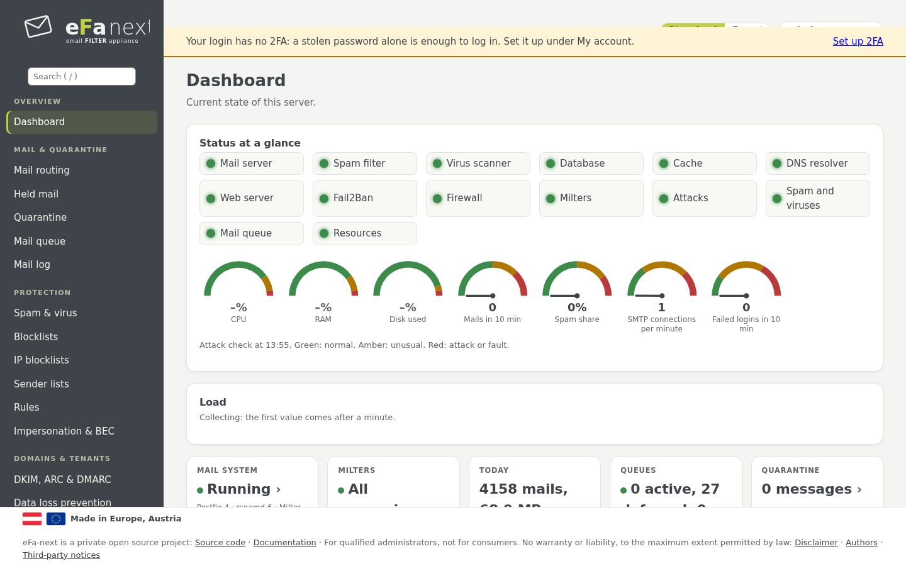
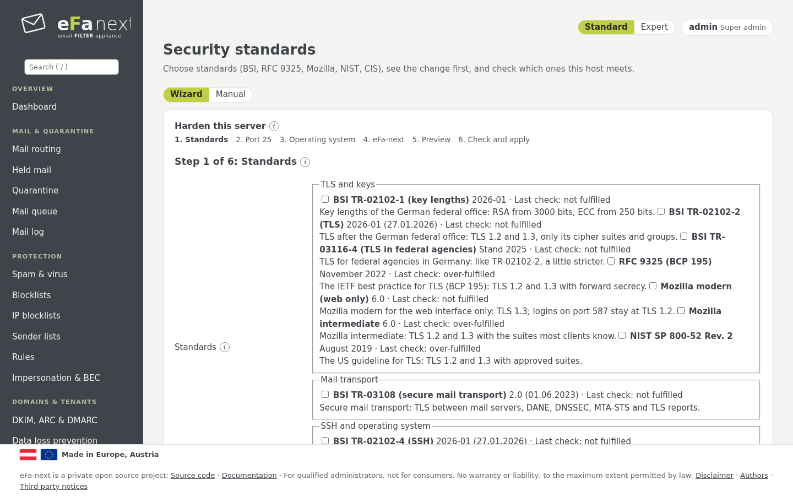
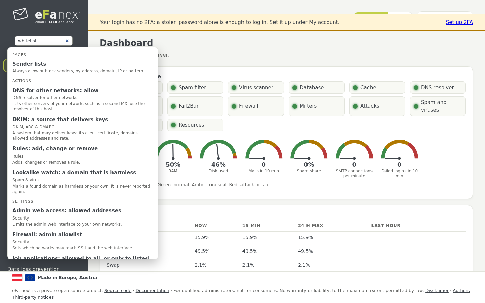
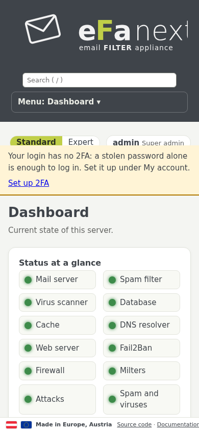
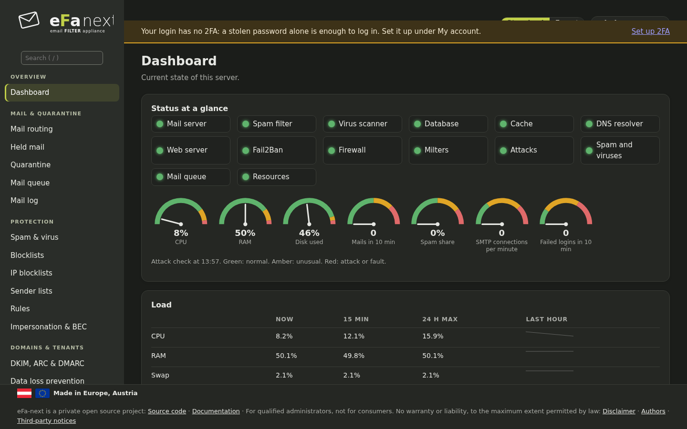

# 4. Dashboard and attack alert

*Overview › Dashboard* is the first page after the login.

## Status at a glance

The first card. Each lamp is green when all is normal, amber when something is unusual, red for an attack or a fault, grey
when there is no current value:

- **Services:** mail server (Postfix), spam filter (rspamd), virus scanner (ClamAV), database, cache, DNS resolver, web
  server, Fail2Ban, firewall, milters.
- **From the attack check:** attacks, spam and viruses, mail queue, resources.

The gauges show CPU, RAM and disk in use, mails and the spam share of the last 10 minutes, SMTP connections per minute and
failed logins of the last 10 minutes. The coloured band of each gauge shows where amber and red begin. Board and banner
renew themselves every 30 seconds while the page is visible.

## Attack alert on every page

Once a minute eFa-next checks the host for SMTP connection floods, SYN floods, password guessing on SMTP AUTH and the web
login, many rejects or Fail2Ban bans, spam and virus waves, a filling queue, stopped services, a full disk, little free memory
and very high load. A flood counts only above a fixed floor and well above the normal value of the last hour, so a busy server
stays green at its usual load.

What it finds shows as a banner right under the top bar of every admin page: red for an attack or a fault, amber for
something unusual, with since when and a link to the page that helps. Super admins also see the addresses that caused most of
it; tenant admins see the alert without addresses; the user portal shows none. An alert stays five minutes after the value
fell back, marked as easing.

*Users & access › Security › Attack alert* shows the last result and sets the sensitivity: *high* halves the limits, *low*
doubles them (`efactl threat-set`, super admins). The limits per kind: [dashboard.md](../dashboard.md#attack-alert-on-every-page).

The check needs no service of its own: the web interface runs `efactl threat-run` once a minute and reads only local
counters and logs.

## Needs attention

Below the status, *Needs attention* lists what to do: a release note after an upgrade, a missing backup password, a domain
without DKIM, a chosen security standard that is not fulfilled, a login without 2FA, a CVE that affects an installed package
and more. Each line links to the page and the card that holds its setting, named in the link (for example
*Domain settings → Job applications*).

*Details* at the end opens the full status and all settings as text.

## Standard and expert view

The switch at the top of every page chooses between **Standard** (the cards most admins need) and **Expert** (every card).
The choice is kept per login under *My account › My settings*. Rights do not change with the view: a card the login may
not use is never shown.

## Wizards

Some pages start with a short wizard for the most common setup, step by step: *Mail routing* (add a domain and its mail
server), *DKIM, ARC & DMARC* (create a DKIM key), *Disclaimers* (set up a disclaimer), *Archive handover* (set up a mail
archive) and *Security standards* (the hardening wizard, chapter 9). The switch **Wizard | Manual** under the page title shows
the full cards instead; the choice is kept per login and page. Every step has *Back* and *Start again*, is filled with the values
in effect, and the last step shows the changes before *Apply*. A wizard only calls the same `efactl` commands as the cards, with
the same checks and rights.

## Search

The search field at the top of the menu (key `/`) suggests while you type: pages, actions and settings with a one-line
explanation, synonyms in English and German ("whitelist" finds the sender lists), and the mail log with a filter for an
address, domain, IP or queue ID. Only what your login may open is suggested. Arrow keys, Enter and Esc work as expected.
The text menu on the console (efa-tui) has no search yet; planned for 6.0.0.7.

## Footer and feature requests

The footer of every page links to the source code, this documentation, the disclaimer, the authors and the third-party notices.
**Request or improve a feature** is in the menu at the top right (chapter 3): it opens the feature form of the project on GitHub.

## On a phone

The menu folds into a button at the top, list tables become cards.

A dark scheme follows the setting of the device:

Next: [Mail, quarantine and logs](05-mail.md) · Back: [Manual](README.md)
