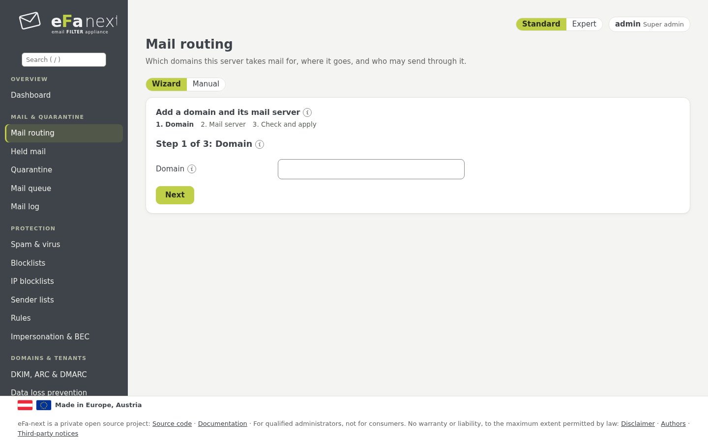
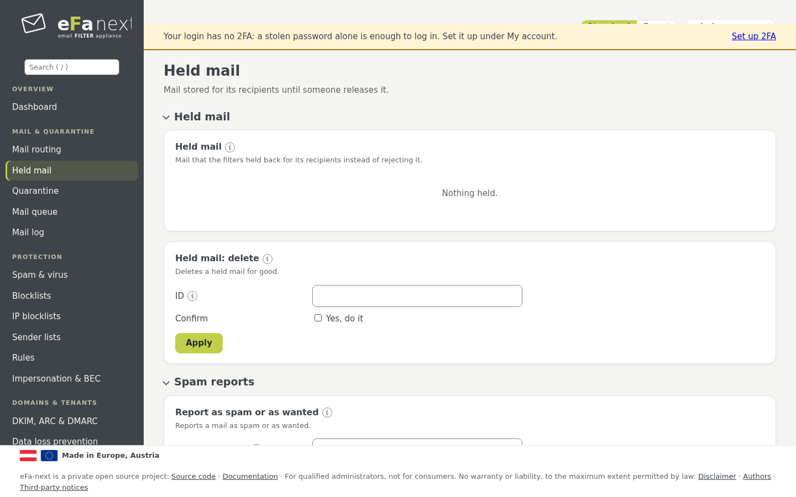
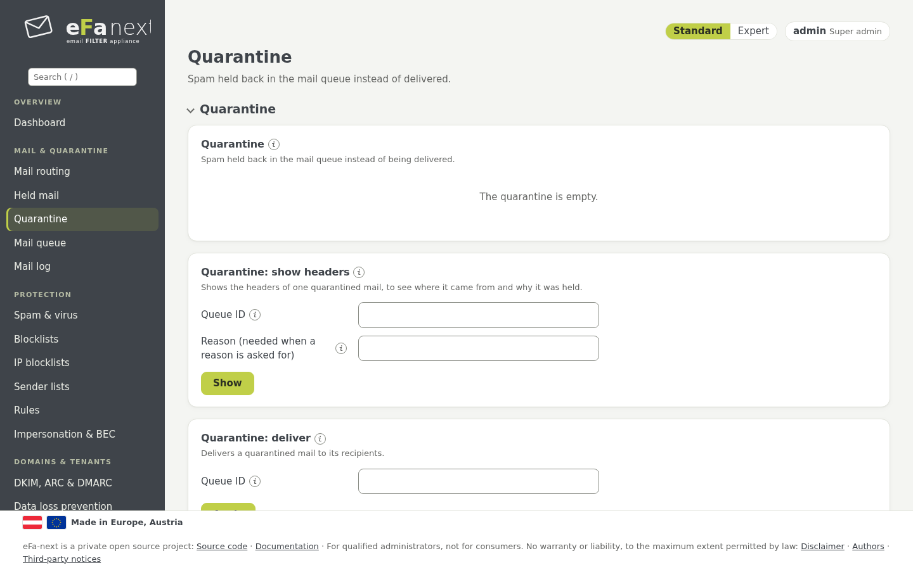
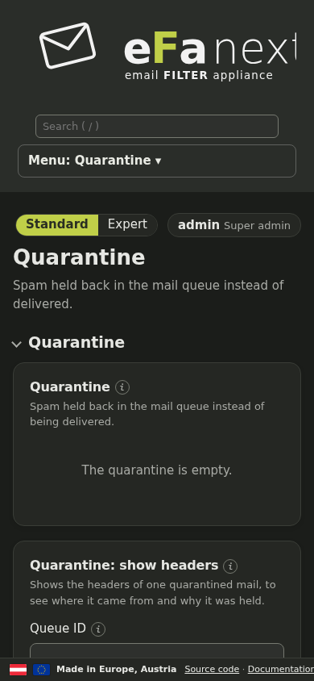
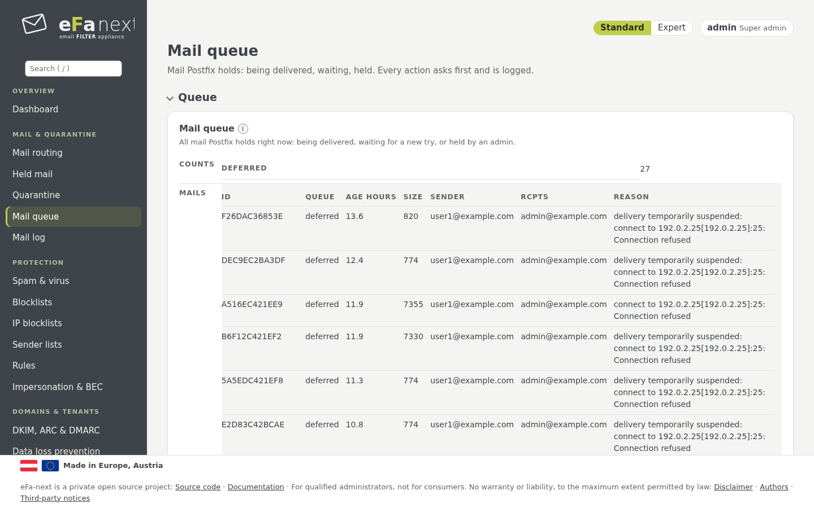
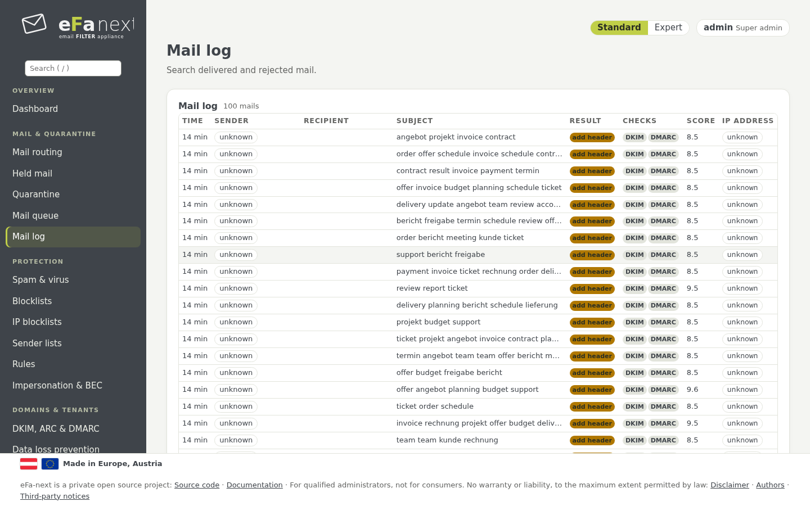
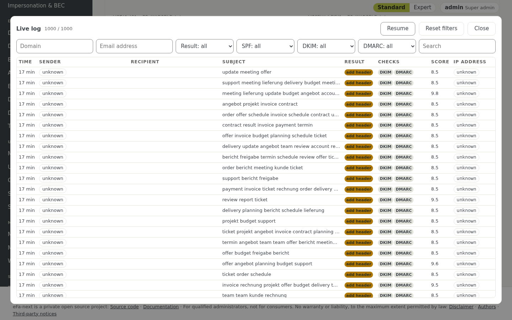
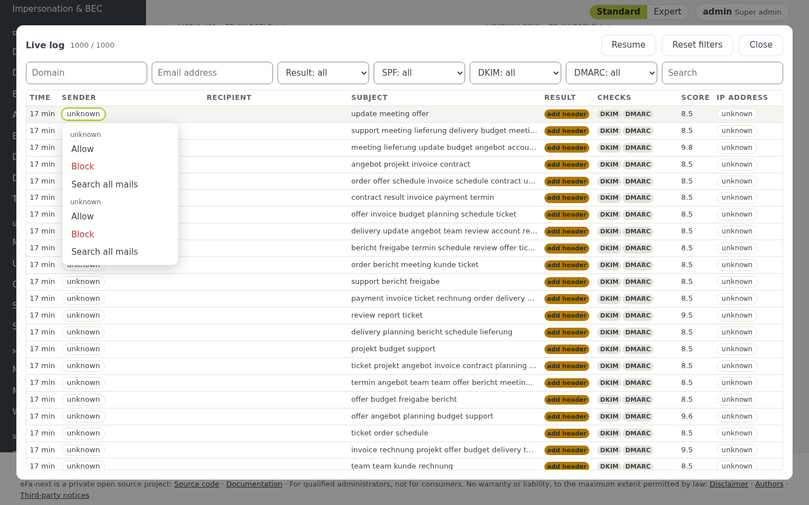

# 5. Mail, Quarantäne und Logs

Die Menügruppe *Mail & Quarantäne*.

## Mail-Routing

*Mail & Quarantäne › Mail-Routing* legt fest, für welche Domains eFa-next Mail annimmt und wohin es sie zustellt.

| Karte | Was eingestellt wird | Konsole |
|---|---|---|
| Domains & Ziele | eine Zeile je Domain mit dem Mailserver, der sie annimmt (`host` oder `host:port`) | `efactl transport-set --domain example.com --action add --destination mail.example.com` |
| Relay-Netze & Smarthost | die Netze Ihrer eigenen Mailserver, die über eFa-next hinaus senden dürfen (*Netze hinzufügen*, dann *Anwenden*), ein Smarthost | `relay-networks-add`, `relay-networks-apply`, `smarthost-set` |
| Einlieferer | Anmeldungen, die über Port 587 senden, Sendelimits, übernommene Konten | `submitter-set`, `outbound-limits-set`, `hijack-list` |
| Header-Datenschutz | für welche Absenderdomains oder Einlieferer interne Header aus ausgehender Mail entfernt werden | `header-privacy-set` |
| Limits & Empfängerprüfung | größte Mail; jeden Empfänger vor der Annahme bei Ihrem Mailserver prüfen | `message-size-set`, `recipient-verification-set` |
| TLS mit Partnern | TLS (wahlweise mit geprüftem Zertifikat) zu genannten Partnerdomains verlangen | `tls-partner-set` |

Anleitungen je Mailplattform: [Microsoft 365](../guide-microsoft-365.md), [Google Workspace](../guide-google-workspace.md),
[Exchange Server](../guide-exchange.md).

## Zurückgehaltene Mail

*Mail & Quarantäne › Zurückgehaltene Mail* ist Mail, die eFa-next für ihre Empfänger aufbewahrt, statt sie abzuweisen. Sie ist
aus, bis sie unter *Einstellungen* am Ende der Seite eingeschaltet wird (`efactl uq-set`): ab welcher Punktzahl Mail behalten
wird, wie viele Tage, ob jeder Empfänger täglich eine Übersicht mit Links bekommt und ob Benutzer allein freigeben dürfen.

- *Freigeben* stellt eine Mail zu, *Admin fragen*, wenn der Benutzer nicht allein freigeben darf, *Absender erlauben* /
  *Absender sperren* machen eine Regel für diesen einen Empfänger.
- *Text* zeigt die Mail als reinen Text: Links sind nicht klickbar, nichts wird nachgeladen; Anhänge werden nur aufgelistet.
- Ein Virus kommt nur durch einen Super-Admin hinaus.
- *Spam-Meldungen*: Mails, die Benutzer als Spam oder erwünscht gemeldet haben, warten hier auf die Entscheidung eines Admins,
  bevor rspamd daraus lernt.

Benutzer sehen ihre eigene zurückgehaltene Mail im **Benutzerportal** (`/portal/login`), mit denselben Knöpfen, eigenen Erlaubt-
und Sperrlisten, Newslettern und eigener Spamgrenze, wo der Admin es erlaubt, *Meine Mail zurückholen* und *Notfallzugriff auf
meine Mail*. Zurückgehaltene Mail kann je Mandant verschlüsselt gespeichert werden (`efactl uq-encrypt-set --mode on`). Details:
[mail-and-quarantine.md](../mail-and-quarantine.md).

## Quarantäne

*Mail & Quarantäne › Quarantäne* enthält Spam und Viren, die in der Mail-Warteschlange zurückgehalten werden. *Zustellen* und
*Header* erscheinen in der Zeile unter der Maus; alle Aktionen stehen im Menü „…" der Zeile. Mehrere Zeilen ankreuzen, um sie auf
einmal zuzustellen, zu löschen oder ihre Absender zu sperren; jede Sammelaktion fragt vorher.

*Einstellungen* legt fest, was in die Quarantäne geht und wie viele Tage es bleibt (`quarantine-set`, `quarantine-days-set`);
*Notfallzugriff* lässt Benutzer und Admins eingehende Mail lesen, während Ihr Mailserver nicht läuft: jede Mail wird
gezeigt, ihre Anhänge werden einzeln gespeichert; ein ZIP- oder MBOX-Export eines ganzen Postfachs ist für 6.0.0.7 geplant.

## Mail-Warteschlange

*Mail & Quarantäne › Mail-Warteschlange* listet die Mail, die Postfix noch nicht zugestellt hat: eine oder alle anhalten,
freigeben, neu einreihen oder löschen (`efactl queue-action`), oder *alle jetzt versuchen* (`queue-flush`). Der Zwischenspeicher
legt fest, wie lange Mail auf einen ausgefallenen Server wartet (etwa `5d`), *Alarm*, ab wie vielen wartenden Mails oder Stunden
der Admin benachrichtigt wird (`queue-alarm-set`).

## Mail-Log

*Mail & Quarantäne › Mail-Log* durchsucht alle Mail nach Absender, Empfänger, Betreff, Ergebnis, Datum und den Headerfeldern
From, Reply-To, Return-Path und X-Mailer. Das Suchfeld nimmt auch Filter:

| Filter | Findet |
|---|---|
| `from:a@example.com` | Mail von diesem Absender |
| `domain:example.com` | Mail mit dieser Domain als Absender oder Empfänger |
| `ip:192.0.2.1` | Mail von diesem sendenden Server |
| `result:reject` | Mail mit diesem Ergebnis (`no_action` für keine Aktion) |

Die Tabelle zeigt die Zeit als Alter (genaue Zeit beim Darüberfahren), das Ergebnis sowie SPF, DKIM und DMARC als Abzeichen und
die Queue-ID. Ein Klick auf eine Zeile öffnet die Details seitlich: Überblick, der Weg über die Server mit der Zeit je Station,
die Ergebnisse der Prüfungen, die DNS-Belege und die rohen Header. Mit dem Recht *export*: Header als `.txt` oder Belege als JSON.

Die Suche steht in der Adresse der Seite nach `#` (Lesezeichen, Links für Kollegen); dieser Teil erreicht nie den Server.
*Ausgabe: CSV-Datei* lädt das Ergebnis herunter, *Header exportieren* schreibt ein ZIP mit den Headern aller passenden Mails.

*Mail prüfen* nimmt eine gespeicherte Mail (`.eml`, bis 10 MB) und zeigt das Urteil von rspamd; nichts wird aufbewahrt oder
gelernt.

*Daten einer Person (DSGVO)* exportiert oder löscht alles zu einer Adresse (Kapitel 12). *Speicherung & Datenschutz* legt fest,
wie lange Mail-Log und Header aufbewahrt werden (Kapitel 12).

### Live-Log

*Live-Log* auf der Seite des Mail-Logs zeigt neue Mail, sobald sie kommt, mit Filtern, alle 5 Sekunden erneuert, solange es offen
ist.

### Absendermenü: erlauben, sperren, suchen

Im Mail-Log, im Live-Log und in der Quarantäne öffnet ein Klick auf Absender, Domain oder IP ein kleines Menü:

- **Erlauben** setzt den Eintrag auf die Erlaubt-Liste, **Sperren** auf die Sperrliste (eine IP kommt in die eigene
  IP-Sperrliste). Es entsteht keine neue Liste; die Einträge stehen wie bisher unter *Absenderlisten* und *IP-Sperrlisten*.
- Ein Dialog zeigt zuerst den genauen Eintrag und die Liste und warnt bei einem Widerspruch zur anderen Liste, bei einer eigenen
  Domain und bei privaten, Relay-, Cluster- oder eigenen Adressen. Adressen, die nie gesperrt werden dürfen, werden abgelehnt.
- Super-Admins schreiben globale Einträge und IPs; Mandanten- und Domain-Admins bekommen eine Regel für ihre eigene
  Empfängerdomain.
- Danach folgt eine Meldung mit **Rückgängig**; jede Aktion steht mit der Queue-ID der Mail im Audit-Log.
- **Alle Mails suchen** öffnet das Mail-Log mit ausgefülltem Filter.

Konsole: `efactl sender-action-check` zeigt, was geschähe, `efactl sender-action` tut es.

Weiter: [Spamschutz](06-spam.de.md) · Zurück: [Handbuch](README.de.md)
