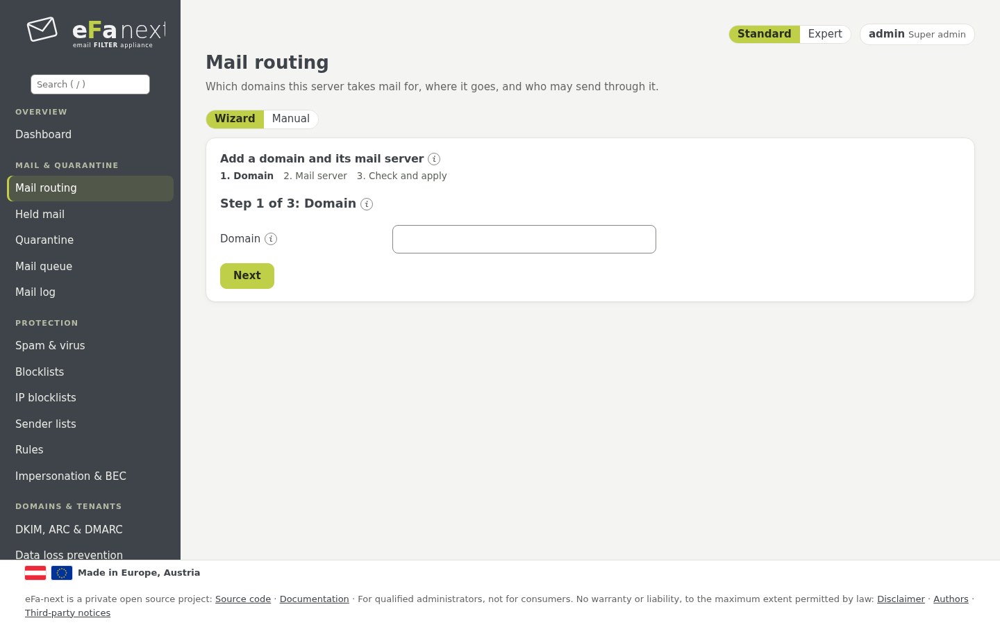
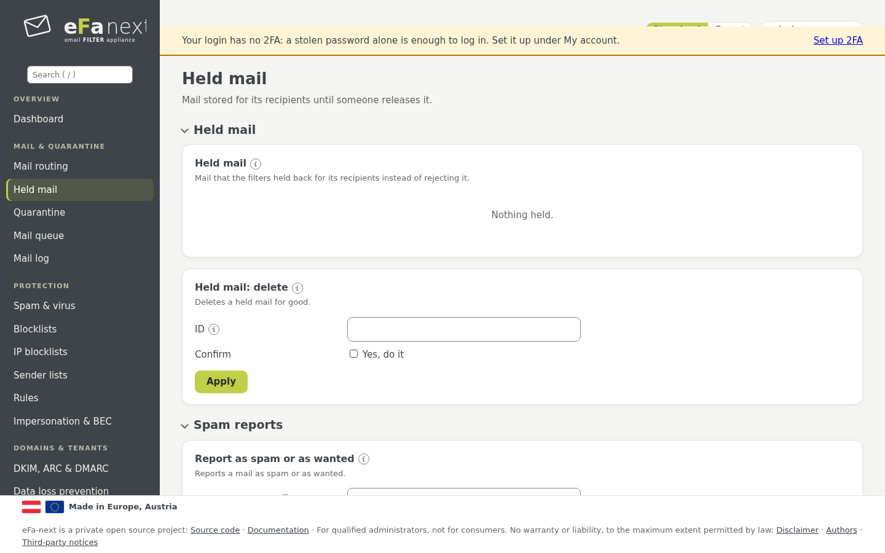
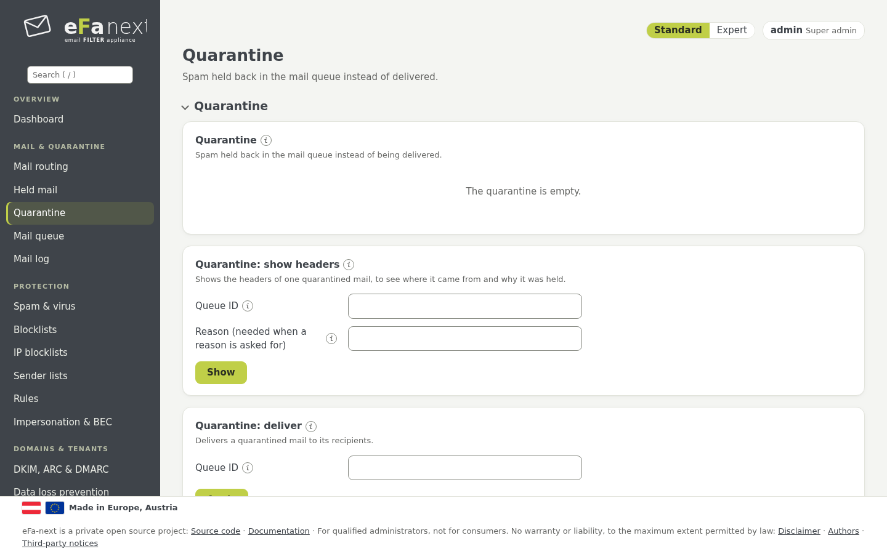
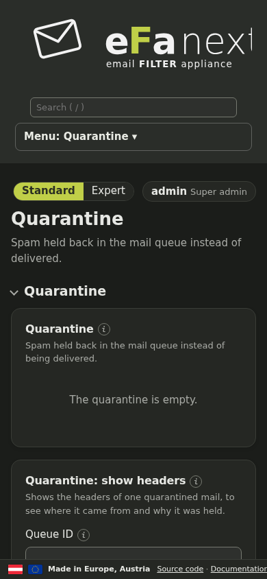
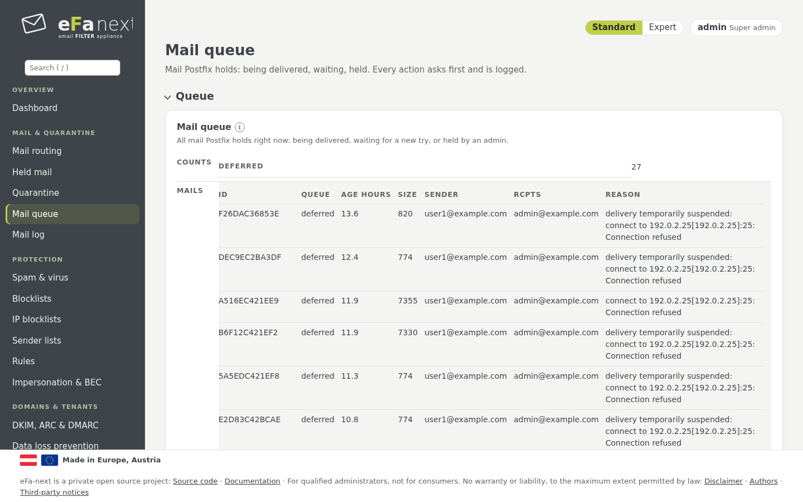
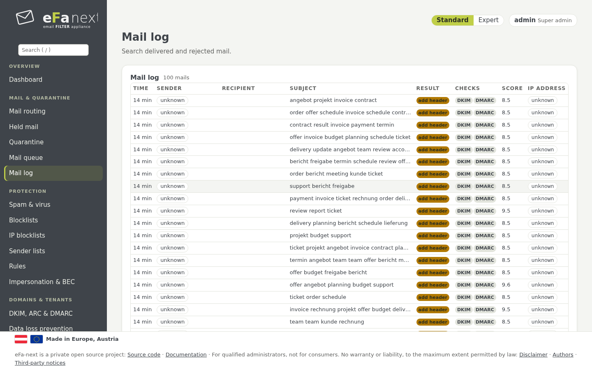
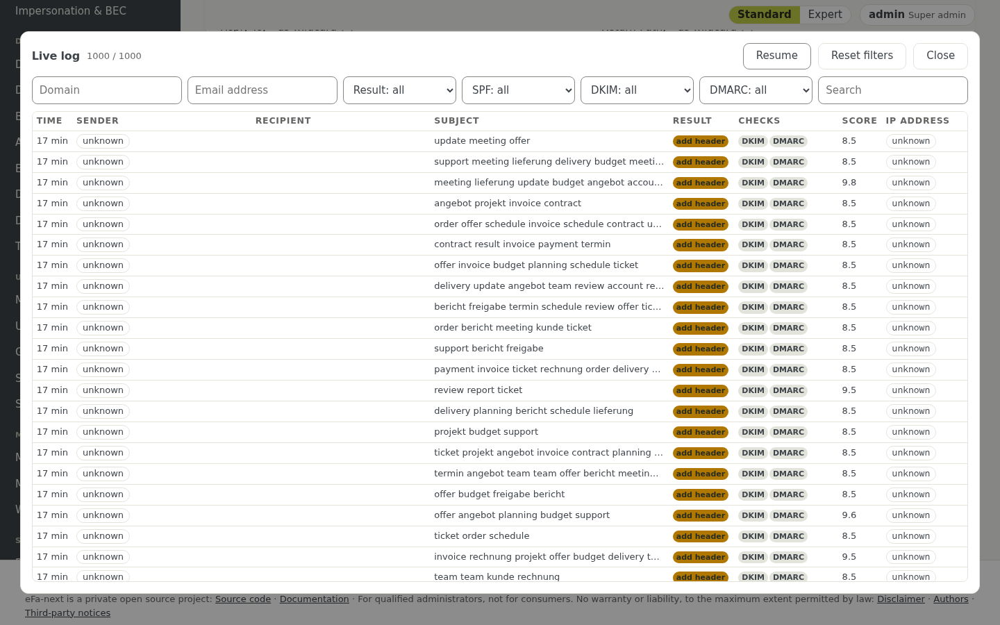
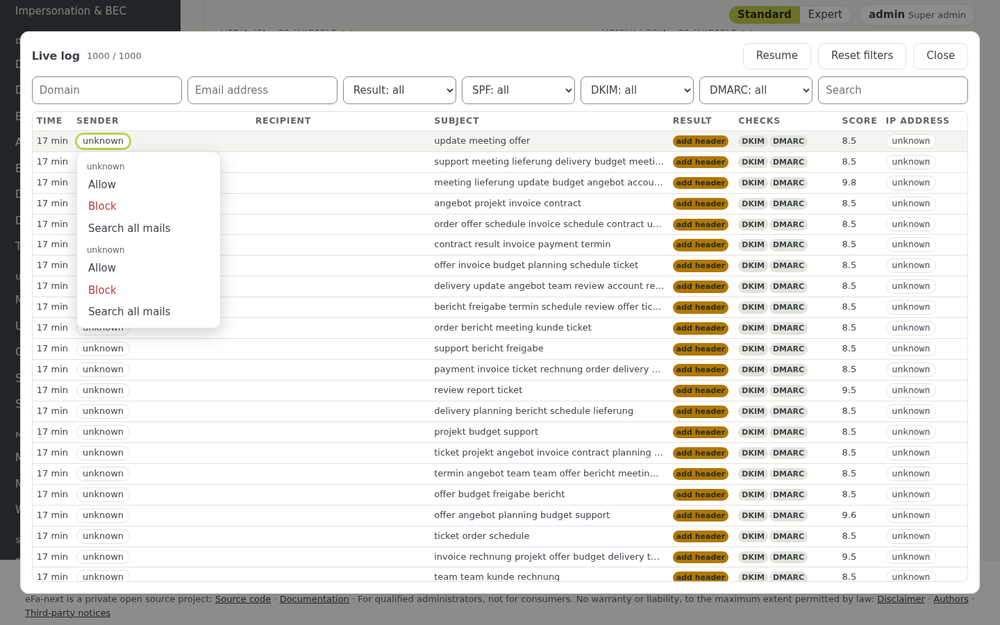

# 5. Mail, quarantine and logs

The menu group *Mail & quarantine*.

## Mail routing

*Mail & quarantine › Mail routing* says which domains eFa-next takes mail for and where it delivers it.

| Card | What you set | Console |
|---|---|---|
| Domains & destinations | one line per domain with the mail server that receives it (`host` or `host:port`) | `efactl transport-set --domain example.com --action add --destination mail.example.com` |
| Relay networks & smarthost | the networks of your own mail servers that may send out through eFa-next (*Add networks*, then *Apply*), an optional smarthost | `relay-networks-add`, `relay-networks-apply`, `smarthost-set` |
| Submitters | logins that send through port 587, outbound limits, taken-over accounts | `submitter-set`, `outbound-limits-set`, `hijack-list` |
| Header privacy | for which sender domains or submitters internal headers are removed from outgoing mail | `header-privacy-set` |
| Limits & recipient check | maximum message size; check each recipient at your mail server before accepting | `message-size-set`, `recipient-verification-set` |
| TLS with partners | require TLS (and optionally a checked certificate) to named partner domains | `tls-partner-set` |

Guides for a mail platform: [Microsoft 365](../guide-microsoft-365.md), [Google Workspace](../guide-google-workspace.md),
[Exchange Server](../guide-exchange.md).

## Held mail

*Mail & quarantine › Held mail* is mail eFa-next keeps for its recipients instead of rejecting it. It is off until switched on
under *Settings* at the end of the page (`efactl uq-set`): from which score mail is kept, for how many days, whether each
recipient gets a daily digest with links, and whether users may release alone.

- *Release* delivers a mail, *Ask an admin* when the user may not release alone, *Allow sender* / *Block sender* make a rule
  for that one recipient.
- *Text* shows the mail as plain text: links are not clickable, nothing is loaded; attachments are only listed.
- A virus only gets out through a super admin.
- *Spam reports*: mails users reported as spam or not spam wait here for an admin's decision before rspamd learns them.

Users see their own held mail in the **user portal** (`/portal/login`), with the same buttons, their own allow and block
lists, newsletters and their own spam limit where the admin allows it, *Recall my mail* and *Emergency access to my mail*.
Held mail can be stored encrypted per tenant (`efactl uq-encrypt-set --mode on`). Details: [mail-and-quarantine.md](../mail-and-quarantine.md).

## Quarantine

*Mail & quarantine › Quarantine* holds the spam and viruses kept back in the mail queue. *Deliver* and *Headers* show on the
row under the mouse; all actions are in the "…" menu of the row. Tick several rows to deliver or delete them at once or to
block their senders; every bulk action asks first.

*Settings* sets what goes to the quarantine and for how many days it is kept (`quarantine-set`, `quarantine-days-set`);
*Emergency access* lets users and admins read incoming mail while your mail server is down: each mail is shown and its
attachments are saved one by one; a ZIP or MBOX export of a whole mailbox is planned for 6.0.0.7.

## Mail queue

*Mail & quarantine › Mail queue* lists the mail Postfix has not delivered yet: hold, release, requeue or delete one mail or all
(`efactl queue-action`), or *try all now* (`queue-flush`). *Spooling* sets how long mail waits for a server that is down
(for example `5d`), *Alarm* from how many waiting mails or hours the admin is told (`queue-alarm-set`).

## Mail log

*Mail & quarantine › Mail log* searches all mail by sender, recipient, subject, result, date and the header fields From,
Reply-To, Return-Path and X-Mailer. The search field also takes filters:

| Filter | Finds |
|---|---|
| `from:a@example.com` | mail from that sender |
| `domain:example.com` | mail with that domain as sender or recipient |
| `ip:192.0.2.1` | mail from that sending server |
| `result:reject` | mail with that result (`no_action` for no action) |

The table shows the time as its age (exact time on hover), the result and SPF, DKIM and DMARC as badges, and the queue ID.
A click on a row opens the details at the side: overview, the path over the servers with the time per hop, the
authentication results, the DNS evidence and the raw headers. With the right *export*: headers as `.txt` or evidence as JSON.

The search is part of the page address after `#` (bookmarks, links for colleagues); that part never reaches the server.
*Output: CSV file* downloads the result, *Export headers* writes a ZIP of the headers of all matching mail.

*Check a mail* takes a saved mail (`.eml`, up to 10 MB) and shows the verdict of rspamd; nothing is kept or learned.

*Data of one person (GDPR)* exports or deletes everything about one address (chapter 12). *Storage & privacy* sets how long
the mail log and the headers are kept (chapter 12).

### Live log

*Live log* on the mail log page shows new mail as it comes, with filters, renewed every 5 seconds while it is open.

### Sender menu: allow, block, search

In the mail log, the live log and the quarantine a click on the sender, its domain or the IP opens a small menu:

- **Allow** puts the entry on the allow list, **Block** on the block list (an IP goes to the own IP blocklist). No new list is
  made; the entries are on *Sender lists* and *IP blocklists* as before.
- A dialog shows the exact entry and list first, and warns on a clash with the other list, on an own domain and on private,
  relay, cluster or own addresses. Addresses that must never be blocked are refused.
- Super admins write global entries and IPs; tenant and domain admins get a rule for their own recipient domain.
- A message with **Undo** follows; every action is in the audit log with the queue ID of the mail.
- **Search all mails** opens the mail log with the filter filled in.

Console: `efactl sender-action-check` shows what would happen, `efactl sender-action` does it.

Next: [Spam protection](06-spam.md) · Back: [Manual](README.md)
