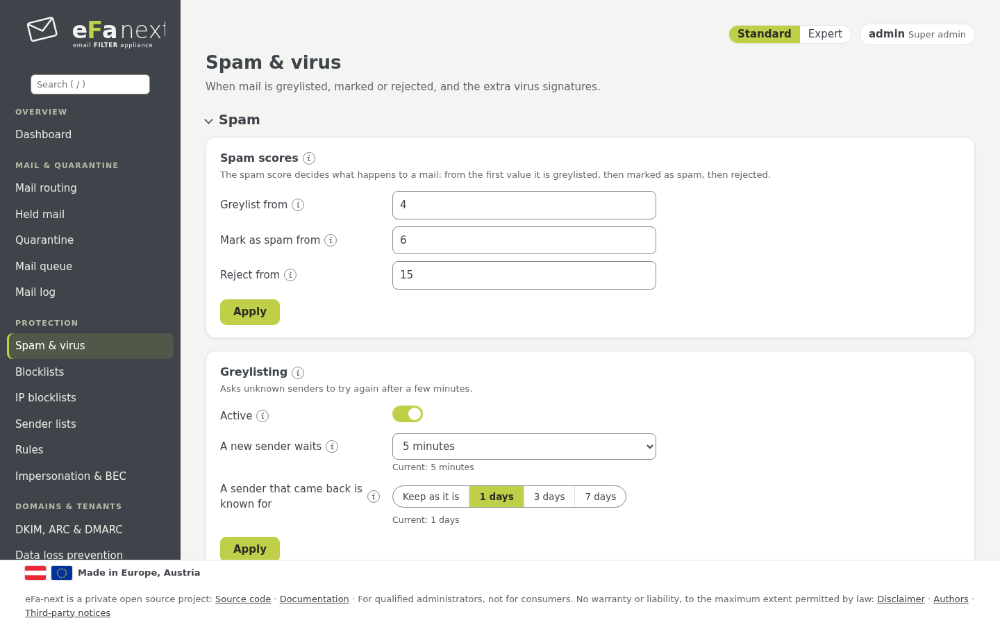
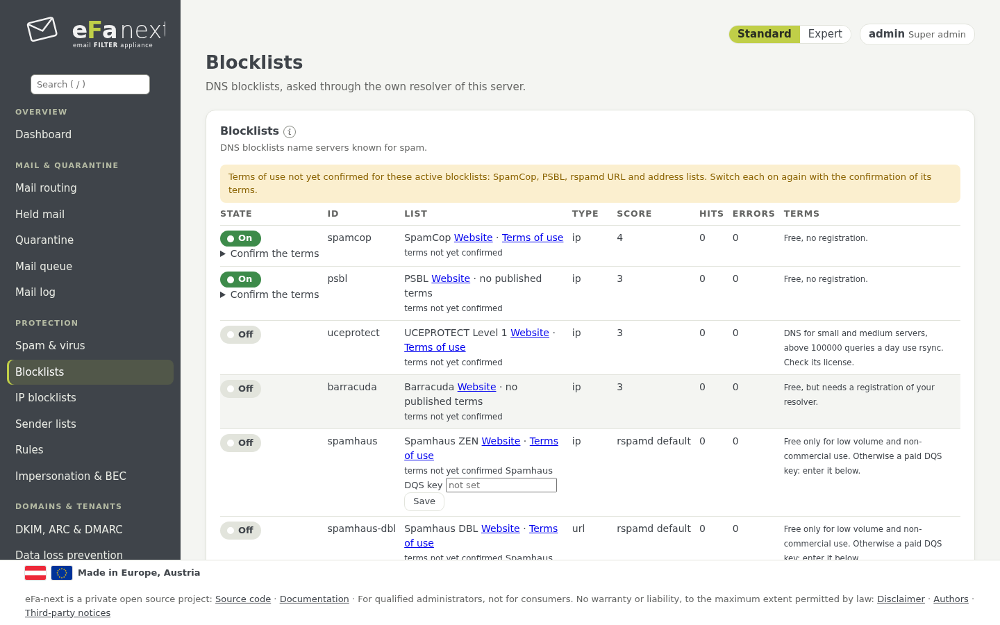
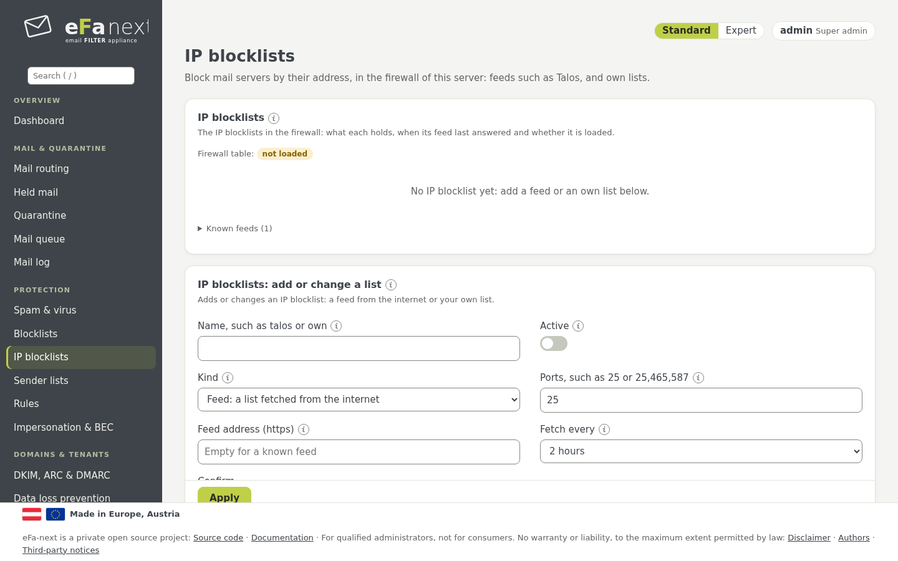
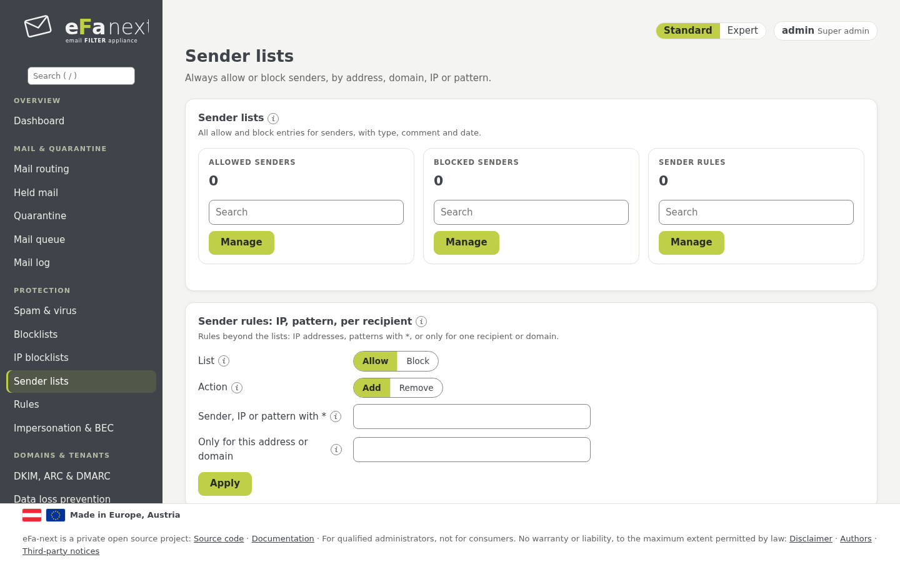
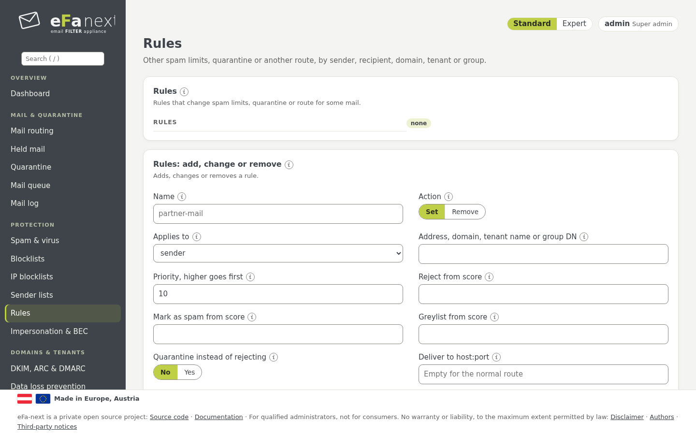
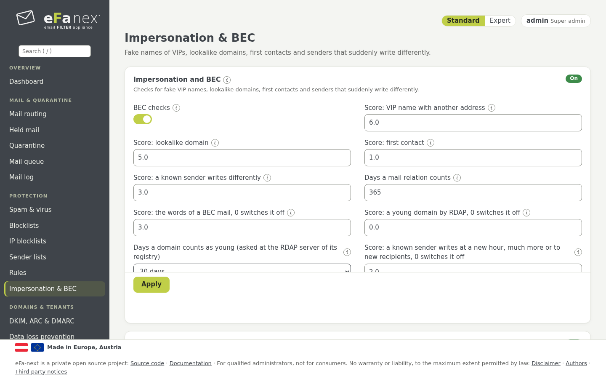

# 6. Spamschutz

Die Menügruppe *Schutz*. rspamd gibt jeder Mail eine Punktzahl; die Schwellen entscheiden, was geschieht.

## Spam-Schwellen und Greylisting

*Schutz › Spam & Viren › Spam*:

| Einstellung | Bedeutung | Konsole |
|---|---|---|
| Greylisting ab | ab dieser Punktzahl wird ein unbekannter Absender per Greylisting verzögert | `efactl spam-scores-set --greylist 4 --mark 6 --reject 15` |
| Als Spam markieren ab | die Mail bekommt den Spam-Header und die Betreffmarkierung | dasselbe |
| Abweisen ab | die Mail wird abgewiesen (oder als zurückgehaltene Mail aufbewahrt, Kapitel 5) | dasselbe |
| Betreffmarkierung | der Text vor dem Betreff von Spam, leer schaltet sie ab | `subject-set` |
| Bayes | der Zustand des Bayes-Klassifikators (nur lesen) | `bayes-status` |



**Greylisting** hält Mail eines unbekannten Absenders einmal zurück; ein echter Mailserver versucht es erneut, die meiste
Spam-Software nicht. Wie lange ein neuer Absender wartet (1 bis 15 Minuten, Standard 5) und wie lange ein wiedergekehrter
Absender bekannt bleibt (1, 3 oder 7 Tage), sind Auswahllisten mit den Werten in Gebrauch. Eine Neuinstallation und eine Migration
von eFa 5 schalten es mit 5 Minuten und 7 Tagen ein; ein Update behält, was eingestellt war
(`efactl greylisting-set --mode on --minutes 5 --days 7`). Ist Greylisting aus und seine Schwelle unter der Spam-Markierung,
bekommt Mail dazwischen gar keine Aktion: Das Dashboard nennt diese Lücke.

Dieselbe Seite hat die weiteren Inhaltsprüfungen von rspamd, jede als eigene Karte: QR-Codes, verschlüsselte Archive,
Office-Makros, Tracking-Schutz, Doppelgänger-Wache, Prüfung nach der Zustellung, Ausbruchsfilter, eigener und gemeinsamer
Fuzzy-Speicher, Newsletter und eigene Spamgrenzen, neuronales Netz, Symbol-Punkte, ein eigenes Modell. Jede beschreibt ihr (i)
und [protection.md](../protection.md). Viren, Anhänge und Links: Kapitel 7. Geplant für 6.0.0.7: Der eigene Fuzzy-Speicher arbeitet je Knoten, noch nicht gemeinsam
im Cluster; BIMI prüft das Logo, noch nicht die VMC/CMC-Zertifikate.

Grenzen je Mandant, Domain, Empfänger oder Absender stehen unter *Domain-Einstellungen* (Kapitel 8) oder als *Regeln* (unten).

## Blocklisten

*Schutz › Blocklisten*: DNS-Blocklisten (RBL), über den eigenen Resolver von eFa-next gefragt. Ein Schalter je Liste zeigt den
wirksamen Zustand. Listen, die nur für geringe Mengen oder nicht kommerziell frei sind, bleiben aus, bis Sie sie einschalten und
ihre Bedingungen annehmen. *Eigene Blockliste* fügt eine weitere hinzu; *postscreen* auf Port 25 verwirft Clients nach dem Gewicht
ihrer Einträge; *Bedrohungs-Feeds* fügt Feeds wie URLhaus oder ThreatFox hinzu, oder einen eigenen TAXII- oder MISP-Feed.



*Schutz › IP-Sperrlisten* enthält eigene Listen von Adressen und Netzen, die die Firewall verwirft, jeder Eintrag dauerhaft oder
für einige Stunden (`efactl blocklist-entry`).



## Absenderlisten

*Schutz › Absenderlisten* erlaubt oder sperrt Absender immer, nach Adresse, Domain, IP oder Muster. *Verwalten* öffnet die Liste
mit Suche, Import und Export; *Absender-Regeln* enthalten Einträge für einen Empfänger oder eine Domain.



```bash
sudo efactl sender-add --list allow --entries "partner@example.com example.org"
sudo efactl sender-rule-set --list block --action add --sender "*@spam.example" --recipient sales@example.com
```

**Ein erlaubter Absender kommt immer durch.** Postfix lässt ihn an den Blocklisten, der HELO- und der DNS-Prüfung des Absenders
vorbei; ein offenes Relay entsteht nie. **Absender sind fälschbar:** Wer eine erlaubte Adresse angibt, bekommt dieselbe Behandlung;
halten Sie nur nötige Absender, als genaue Adressen statt ganzer Domains. Jedes Durchlassen wird protokolliert. Ein Virus in der
Mail eines erlaubten Absenders wird herausgeschnitten, das Original bleibt für den Admin (Entschärfung, Kapitel 7).

Am schnellsten füllt das Absendermenü im Mail-Log die Listen (Kapitel 5).

## Regeln

*Schutz › Regeln* setzt andere Spamgrenzen, Quarantäne statt Abweisung oder einen anderen Weg, für einen Absender, eine
Absenderdomain, einen Empfänger, eine Domain, einen Mandanten oder eine Verzeichnisgruppe. Die höchste passende Priorität gilt.



```bash
sudo efactl rule-set --name partner-mail --action set --kind recipient --value partner@example.com --quarantine on
```

## Identitätsbetrug & BEC

*Schutz › Identitätsbetrug & BEC* erkennt Business Email Compromise: einen Fremden, der sich als bekannte Person oder Domain
ausgibt. Jede Prüfung gibt Punkte; allein wegen dieser Prüfungen wird nichts abgewiesen.

- **Gefälschter Anzeigename:** der Name einer Ihrer VIPs von einer fremden Adresse.
- **Doppelgänger-Domains:** ein Tippfehler, ähnlich aussehende Zeichen, internationale Schreibweise, andere Endung, Ihre Domain
  vor einer fremden.
- **Erstkontakt:** Absender und Empfänger haben sich noch nie geschrieben.
- **Ein bekannter Absender schreibt anders:** andere Uhrzeiten, viel mehr Mails, nur neue Empfänger.
- **Junge Domain:** erst vor Tagen registriert.



An nach einer Neuinstallation und nach einer Migration von eFa 5; nach einem Upgrade bleibt es, wie es war (das Dashboard
empfiehlt es).

```bash
sudo efactl bec-set --mode on
sudo efactl bec-vip-set --action add --name "Alex Example" --address alex@example.com
sudo efactl bec-partner-set --action add --domain partner.example
```

Senden Sie auch ausgehende Mail über eFa-next: Die Erstkontakt-Prüfung lernt daraus. Details: [bec.md](../bec.md).

Weiter: [Viren, Anhänge und Links](07-virus.de.md) · Zurück: [Handbuch](README.de.md)
