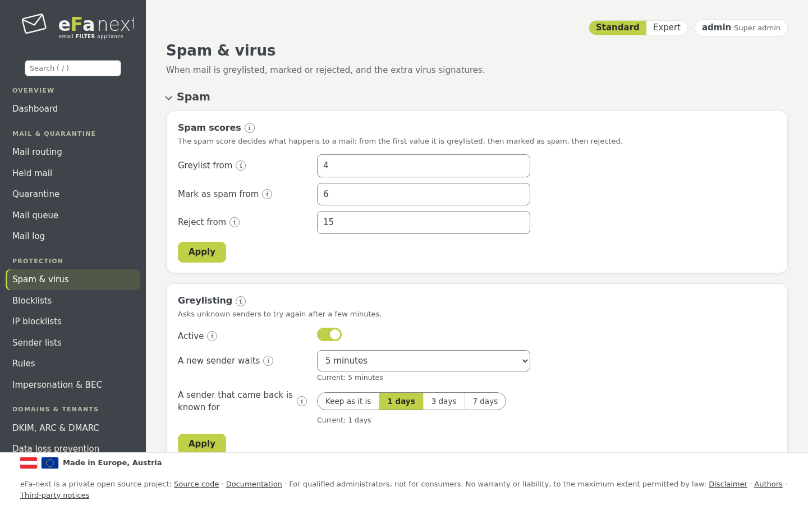
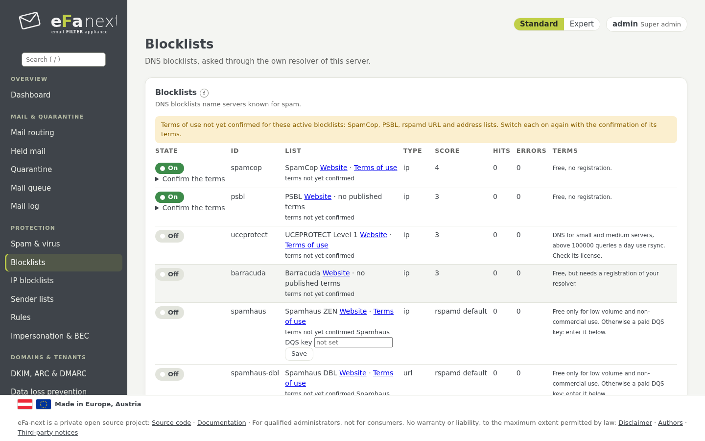
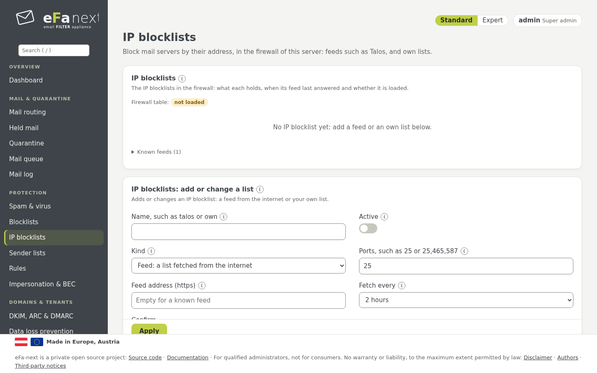
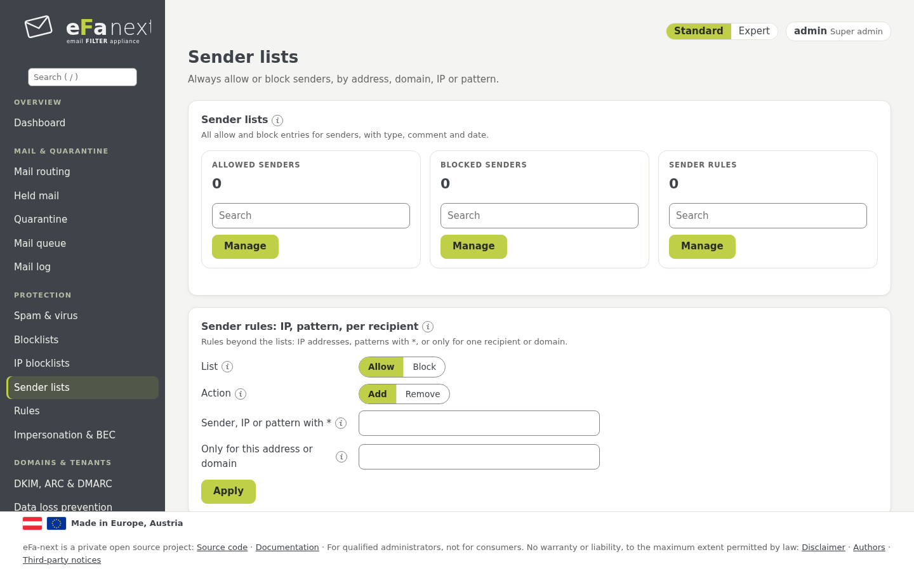
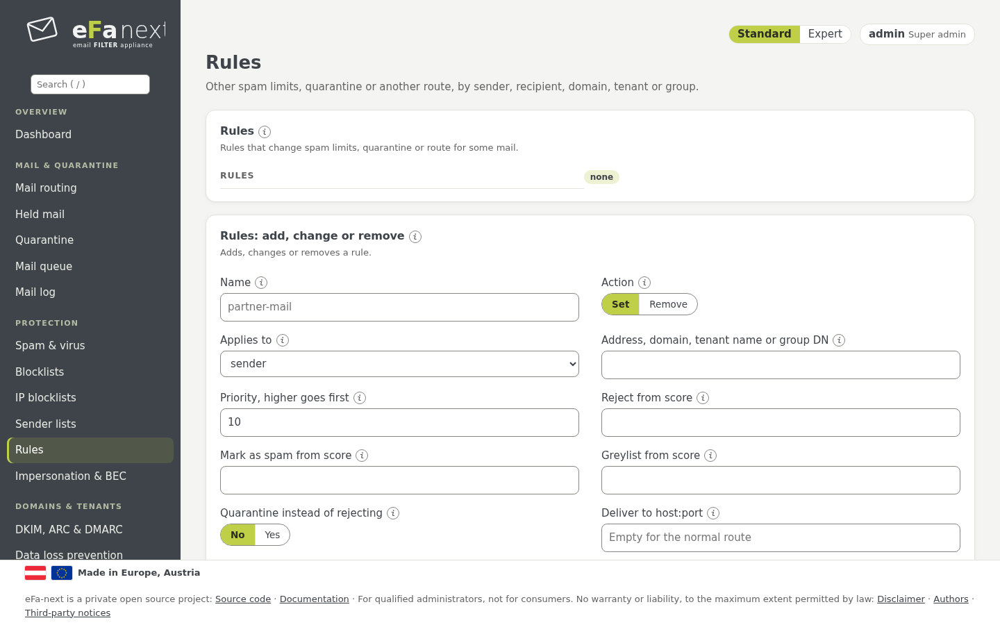
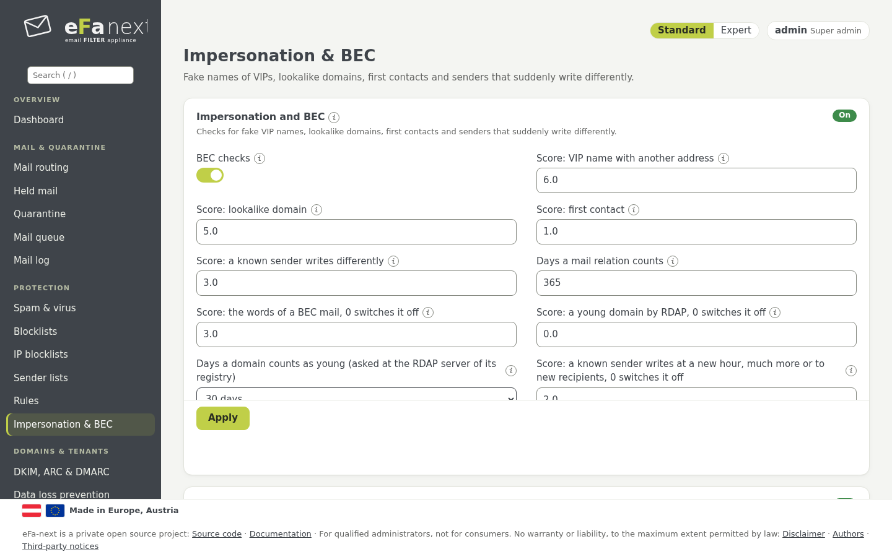

# 6. Spam protection

The menu group *Protection*. rspamd gives every mail a score; the limits decide what happens.

## Spam scores and greylisting

*Protection › Spam & virus › Spam*:

| Setting | Meaning | Console |
|---|---|---|
| Greylist from | from this score an unknown sender is greylisted | `efactl spam-scores-set --greylist 4 --mark 6 --reject 15` |
| Mark as spam from | the mail gets the spam header and the subject marking | the same |
| Reject from | the mail is rejected (or kept as held mail, chapter 5) | the same |
| Subject marking | the text put in front of the subject of spam, empty turns it off | `subject-set` |
| Bayes | the state of the Bayes classifier (read only) | `bayes-status` |



**Greylisting** holds mail of an unknown sender back once; a real mail server tries again, most spam software does not.
How long a new sender waits (1 to 15 minutes, default 5) and how long a sender that came back stays known (1, 3 or 7 days)
are dropdowns with the values in use. A new install and a migration from eFa 5 switch it on with 5 minutes and 7 days; an
update keeps what was set (`efactl greylisting-set --mode on --minutes 5 --days 7`). With greylisting off and its score below
the spam marking, mail in between gets no action at all: the dashboard names that gap.

The same page has the other content checks of rspamd, each a card of its own: QR codes, encrypted archives, Office macros,
tracking protection, lookalike watch, check after delivery, outbreak filter, own and community fuzzy store, newsletters and own
spam limits, neural network, symbol scores, an own model. Each is described by its (i) and in [protection.md](../protection.md).
Viruses, attachments and links: chapter 7. Planned for 6.0.0.7: the own fuzzy store works per node, not yet shared in a
cluster; BIMI checks the logo, not yet the VMC/CMC certificates.

Limits per tenant, domain, recipient or sender are set under *Domain settings* (chapter 8) or as *Rules* (below).

## Blocklists

*Protection › Blocklists*: DNS blocklists (RBL), asked through the own resolver of eFa-next. One switch per list shows the
state in effect. Lists that are free only for low volume or non-commercial use stay off until you switch them on and accept
their terms. *Your own blocklist* adds one more; *postscreen* on port 25 drops clients by the weight of their listings;
*Threat feeds* adds feeds such as URLhaus or ThreatFox, or an own TAXII or MISP feed.



*Protection › IP blocklists* holds own lists of addresses and networks that the firewall drops, each entry for good or for
some hours (`efactl blocklist-entry`).



## Sender lists

*Protection › Sender lists* always allows or blocks senders by address, domain, IP or pattern. *Manage* opens the list with
search, import and export; *Sender rules* hold entries for one recipient or domain.



```bash
sudo efactl sender-add --list allow --entries "partner@example.com example.org"
sudo efactl sender-rule-set --list block --action add --sender "*@spam.example" --recipient sales@example.com
```

**An allowed address or domain always gets through.** Postfix lets it past the blocklists, the HELO and the DNS checks of the
sender; it never makes the server an open relay. **Sender addresses can be forged:** whoever gives an allowed address gets the
same treatment, so keep only senders you need, as exact addresses rather than whole domains. Each pass is logged. A virus in
the mail of an allowed sender is cut out and the original is kept for the admin (content disarm, chapter 7).

The quickest way to fill the lists is the sender menu in the mail log (chapter 5).

## Rules

*Protection › Rules* sets other spam limits, the quarantine instead of a reject, or another route, for a sender, a sender
domain, a recipient, a domain, a tenant or a directory group. The highest priority that fits wins.



```bash
sudo efactl rule-set --name partner-mail --action set --kind recipient --value partner@example.com --quarantine on
```

## Impersonation & BEC

*Protection › Impersonation & BEC* catches business email compromise: a stranger who pretends to be a known person or domain.
It adds a score per check; nothing is rejected on these checks alone.

- **Forged display name:** the name of one of your VIPs from an outside address.
- **Lookalike domains:** one typo, look-alike letters, international spelling, another ending, your domain in front of a
  foreign one.
- **First contact:** sender and recipient never wrote to each other before.
- **A known sender writes differently:** other hours, far more mails, only new recipients.
- **Young domain:** registered only days ago.



On after a fresh install and after a migration from eFa 5; after an upgrade it stays as it was (the dashboard recommends it).

```bash
sudo efactl bec-set --mode on
sudo efactl bec-vip-set --action add --name "Alex Example" --address alex@example.com
sudo efactl bec-partner-set --action add --domain partner.example
```

Send your outgoing mail through eFa-next too: the first-contact check learns from it. Details: [bec.md](../bec.md).

Next: [Viruses, attachments and links](07-virus.md) · Back: [Manual](README.md)
