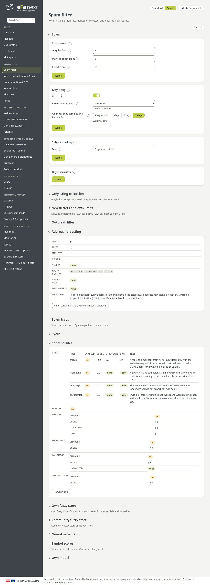
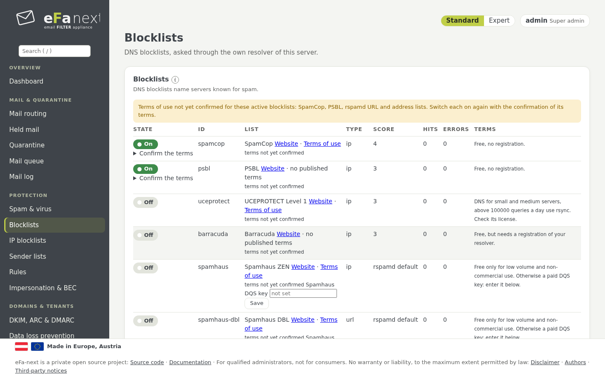
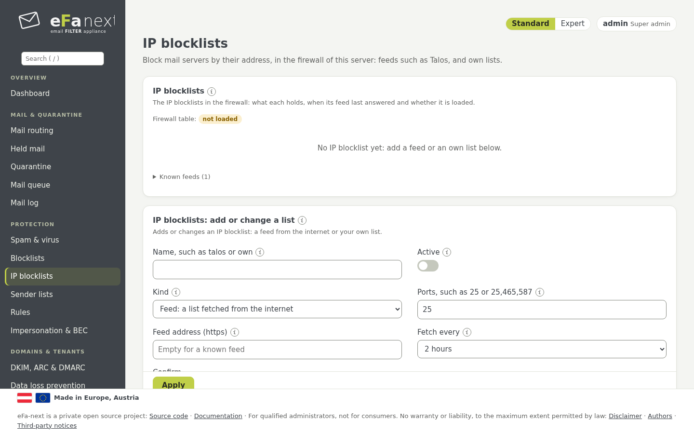
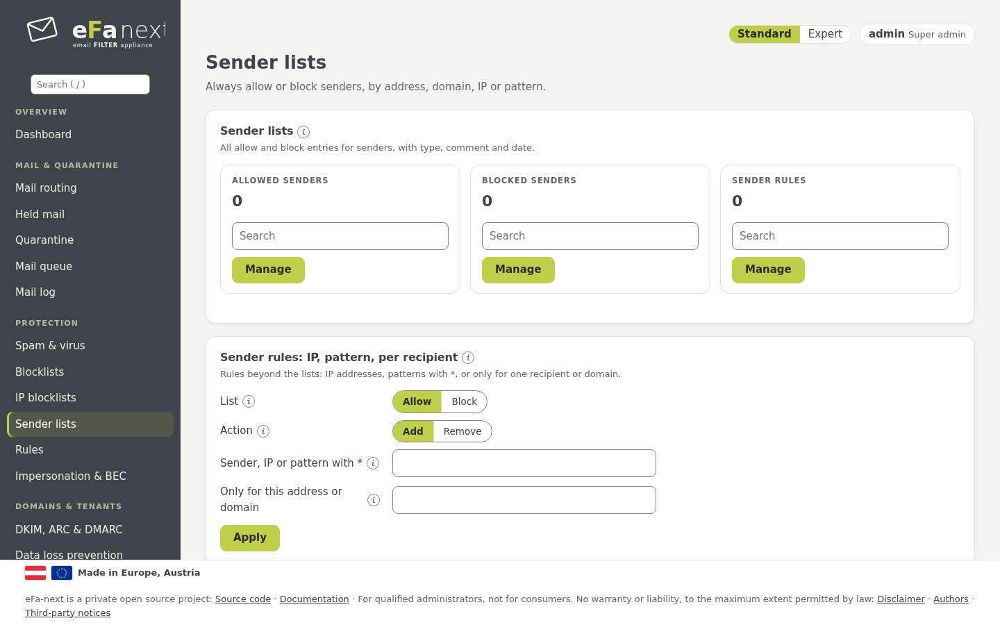
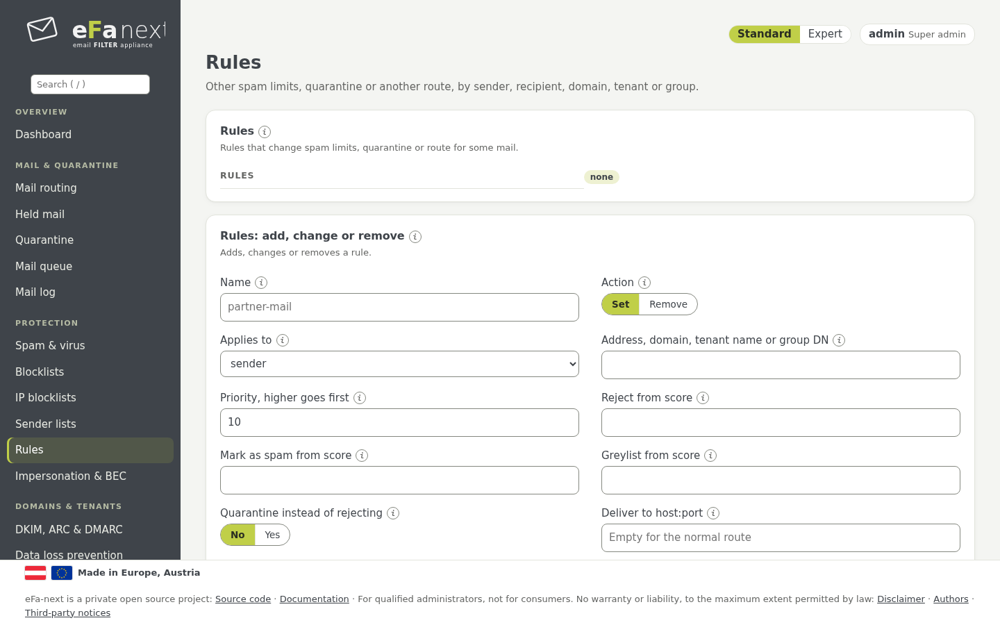
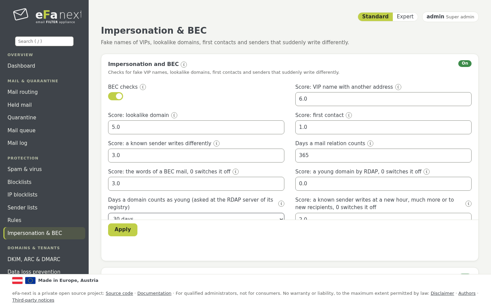

# 6. Spam protection

The menu group *Protection*. rspamd gives every mail a score; the limits decide what happens.

## Spam scores and greylisting

*Protection › Spam filter › Spam*:

| Setting | Meaning | Console |
|---|---|---|
| Greylist from | from this score an unknown sender is greylisted | `efactl spam-scores-set --greylist 4 --mark 6 --reject 15` |
| Mark as spam from | the mail gets the spam header and the subject marking | the same |
| Reject from | the mail is rejected (or kept as held mail, chapter 5) | the same |
| Subject marking | the text put in front of the subject of spam, empty turns it off | `subject-set` |
| Bayes | the state of the Bayes classifier (read only) | `bayes-status` |



**Greylisting** holds mail of an unknown sender back once; a real mail server tries again, most spam software does not.
How long a new sender waits (1 to 15 minutes, default 5) and how long a sender that came back stays known (1, 3 or 7 days)
are dropdowns with the values in use. A new install and a migration from eFa 5 switch it on with 5 minutes and 7 days; an
update keeps what was set (`efactl greylisting-set --mode on --minutes 5 --days 7`). With greylisting off and its score below
the spam marking, mail in between gets no action at all: the dashboard names that gap.

**Greylisting exceptions** (6.0.0.6.4, card *Greylisting exceptions*): networks and domains of sending servers that never wait, for example a partner or an own system (`efactl greylisting-exception-set --action add --value 192.0.2.0/24`). A network is at most /16 (IPv4) or /32 (IPv6). A domain matches the name of the sending server as its reverse DNS shows it, or the registered domain of that name, never the sender address, which anyone can forge. rspamd keeps its own list of big providers as well. `efactl greylisting-status` lists the exceptions. In a cluster the master hands them to every node.

The same page has the other content checks of rspamd, each a card of its own: QR codes, encrypted archives, Office macros,
tracking protection, lookalike watch, check after delivery, outbreak filter, own and community fuzzy store, newsletters and own
spam limits, neural network, symbol scores, an own model. Each is described by its (i) and in [protection.md](../protection.md).
Viruses, attachments and links: chapter 7. BIMI checks the logo and the certificate of the mark (VMC or CMC); fetching them
tells the sender's server that its mail arrived here, so it is off by default.
Shared fuzzy store of a cluster (6.0.0.7): the nodes only read it; what they learn goes to the master over the mutual TLS of the
cluster, and only the master writes to it.

**Pyzor** (6.0.0.6.4, card *Pyzor*, off by default): Pyzor compares a checksum of the text of each incoming mail with the spam
reports of other operators. The local service efa-pyzor makes the checksum here; only the checksum and the address of this
server go to the Pyzor server (public.pyzor.org of the Pyzor project unless you set your own), never the mail or its addresses.
The card names the server in use: checksums (no mail content) go to the Pyzor server set there; the default public.pyzor.org
is outside the EU.
Turning it on asks for a typed yes once per server; with EU relation and a server outside the own networks also the typed
transfer confirmation, and in the web interface the second factor again. Every change is in the strict audit log. A hit
(5 reports or more, none whitelisted) gives `EFA_PYZOR` with 2.0 points, adjustable from 0 to 20; mail of logged-in users and
mail over 2 MB is not asked. Each mail waits at most 3 seconds for the answer; after 3 failures of the
server in a row Pyzor pauses for 5 minutes, which the card and the dashboard show, and mail goes on without it. The package `pyzor` (EPEL) is installed when you turn it on; off stops the service and leaves the
package. `efactl pyzor-set --mode on --accept yes [--server host:port] [--weight 2.0]`.

Limits per tenant, domain, recipient or sender are set under *Domain settings* (chapter 8) or as *Rules* (below).

## Blocklists

*Protection › Blocklists*: DNS blocklists (RBL), asked through the own resolver of eFa-next. One switch per list shows the
state in effect. Lists that are free only for low volume or non-commercial use stay off until you switch them on and accept
their terms. *Your own list*, a button in the table of the blocklists, adds one more; *postscreen* on port 25 drops clients by the weight of their listings;
*Threat feeds* adds feeds such as URLhaus or ThreatFox, or an own TAXII or MISP feed.



*Protection › Blocklists › Firewall blocklists* holds own lists of addresses and networks that the firewall drops, each entry for good or for
some hours (`efactl blocklist-entry`).



## Sender lists

*Protection › Sender lists* always allows or blocks senders by address, domain, IP or pattern. *Manage* opens the list with
search, import and export; *Sender rules* hold entries for one recipient or domain.



```bash
sudo efactl sender-add --list allow --entries "partner@example.com example.org"
sudo efactl sender-rule-set --list block --action add --sender "*@spam.example" --recipient sales@example.com
```

**An allowed address or domain always gets through.** Postfix lets it past the blocklists, the HELO and the DNS checks of the
sender; it never makes the server an open relay. **Sender addresses can be forged:** whoever gives an allowed address gets the
same treatment, so keep only senders you need, as exact addresses rather than whole domains. Each pass is logged. A virus in
the mail of an allowed sender is cut out and the original is kept for the admin (content disarm, chapter 7).

The quickest way to fill the lists is the sender menu in the mail log (chapter 5).

## Rules

*Protection › Rules* sets other spam limits, the quarantine instead of a reject, or another route, for a sender, a sender
domain, a recipient, a domain, a tenant or a directory group. The highest priority that fits wins.



```bash
sudo efactl rule-set --name partner-mail --action set --kind recipient --value partner@example.com --quarantine on
```

## Content rules

*Protection › Spam filter › Content rules* holds four rules on one card. Each is off by default, also after an update; switched
on, a rule only counts and marks until you give it a score (``efactl content-rules-set --rule <rule> --mode on --score <n>``).
While one rule is on, every ``X-eFa-*`` header of incoming mail is removed first: a sender cannot bring its own.

- **Replies to own mail (thread):** for each mail sent from here, a hash of its Message-ID with each recipient domain, salted with a secret of this host, is kept
  (90 days, nothing else). A reply that names such a Message-ID, comes from one of those domains, passes DMARC and has no
  lookalike or BEC hit gets the bonus (default -2). A reply to a Message-ID never sent from here can get points of its own
  (``--unknown``; only while the store answers). In a cluster the hashes are shared through the master (each node salts them
  with its own secret); when it is down each node goes on with its own. Without a cluster nothing is kept for sharing.
- **Marketing mail:** newsletters and campaigns, by two or more signs (list headers, one-click unsubscribe, the headers of
  sending services); the mail gets ``X-eFa-Marketing``. The per-user handling of newsletters stays with *Newsletters (graymail)*.
- **Language:** the language rspamd finds in the text goes into ``X-eFa-Language``; languages you do not expect
  (``--languages "ru zh"``) can add points. A FastText model for better detection is planned for 6.0.0.8.
- **Hidden characters:** invisible characters inside Latin words, soft hyphens after nearly every letter, and words that mix
  Latin with Cyrillic or Greek letters. Characters a script needs (ZWNJ and ZWJ in Persian, Arabic, Indic writing, ZWJ in
  emoji) never count.

```bash
sudo efactl content-rules-set --rule thread --mode on --score -2
sudo efactl content-rules-status
```

## Impersonation & BEC

*Protection › Impersonation & BEC* catches business email compromise: a stranger who pretends to be a known person or domain.
It adds a score per check; nothing is rejected on these checks alone.

- **Forged display name:** the name of one of your VIPs from an outside address.
- **Lookalike domains:** one typo, look-alike letters, international spelling, another ending, your domain in front of a
  foreign one.
- **First contact:** sender and recipient never wrote to each other before.
- **A known sender writes differently:** other hours, far more mails, only new recipients.
- **Young domain:** registered only days ago.



On after a fresh install and after a migration from eFa 5; after an upgrade it stays as it was (the dashboard recommends it).

```bash
sudo efactl bec-set --mode on
sudo efactl bec-vip-set --action add --name "Alex Example" --address alex@example.com
sudo efactl bec-partner-set --action add --domain partner.example
```

Send your outgoing mail through eFa-next too: the first-contact check learns from it. Details: [bec.md](../bec.md).

Next: [Viruses, attachments and links](07-virus.md) · Back: [Manual](README.md)
