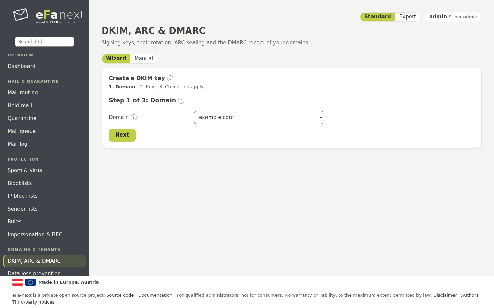
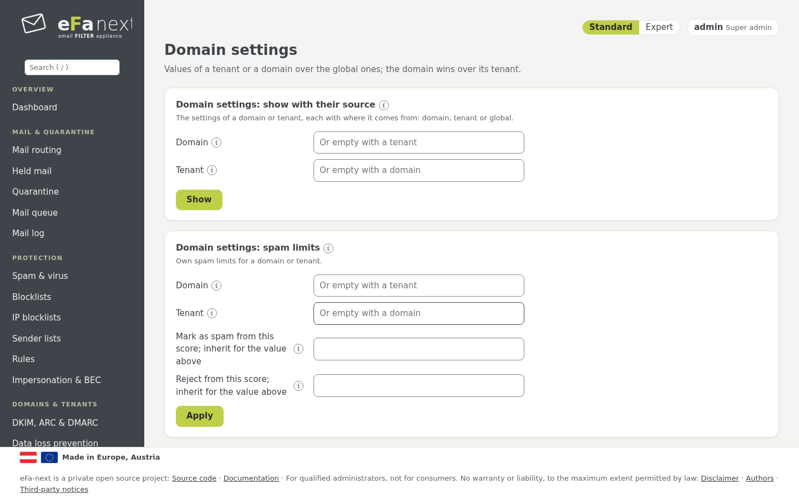
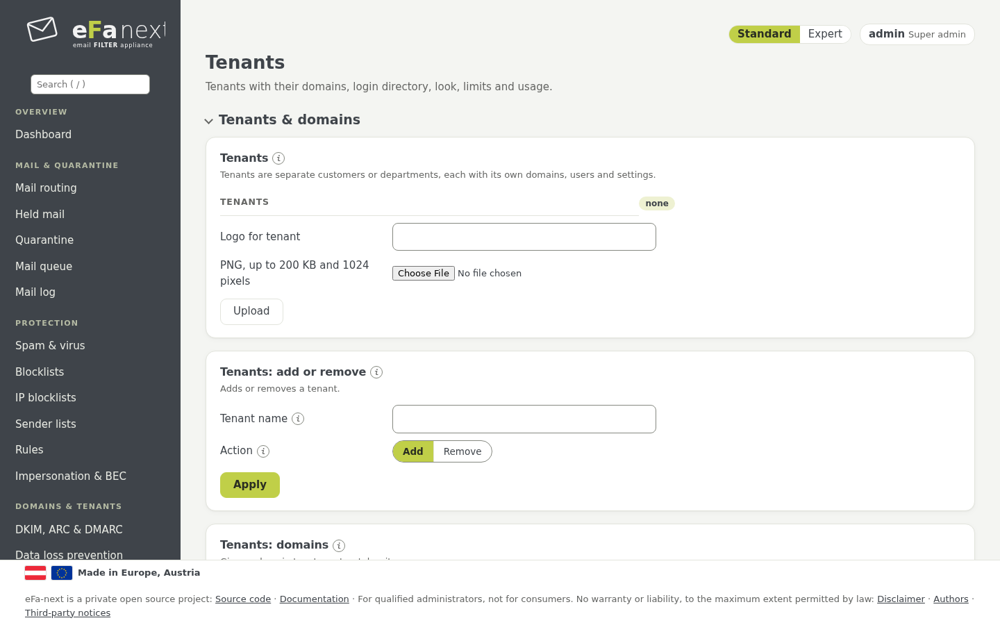
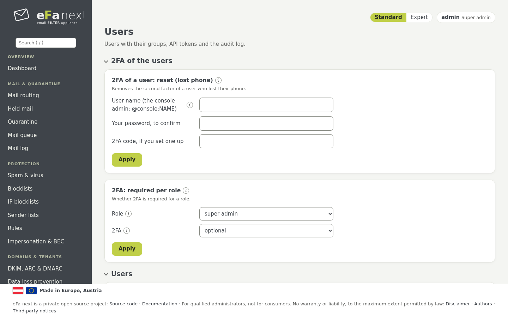
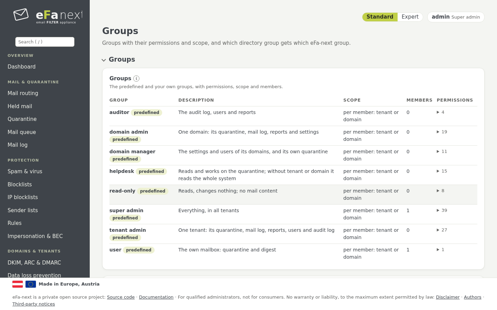
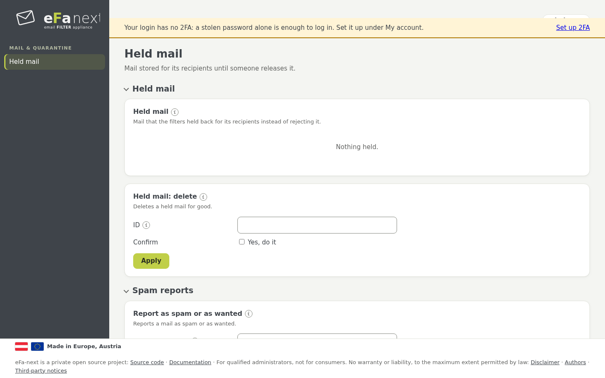

# 8. Domains, Mandanten, Benutzer und Portal

Die Menügruppen *Domains & Mandanten* und *Benutzer & Zugriff*.

## DKIM, ARC & DMARC

*Domains & Mandanten › DKIM, ARC & DMARC*:

- **DKIM-Schlüssel:** *RSA-Schlüssel erzeugen* (2048, 3072 oder 4096 Bit) oder *Ed25519-Schlüssel erzeugen* je Domain, dann den
  DNS-Eintrag aus *DKIM: DNS-Einträge exportieren* veröffentlichen. RSA und Ed25519 gehen nebeneinander.
- **Schlüsselrotation:** Neue Schlüssel entstehen im Voraus; ein Schlüssel übernimmt ab seinem Datum, sobald genug DNS-Server
  seinen Eintrag zeigen.
- **Software-Schlüssel:** DKIM- und ARC-Schlüssel liegen als Dateien vor; ein Hardware-Modul hält nur Backup-Signatur und
  S/MIME-Schlüssel (DKIM und ARC im Hardware-Modul sind für 6.0.0.7 geplant, [hsm.md](../hsm.md)).
- **Extern verwaltet:** DKIM-Schlüssel können über die Provisioning-API aus einem anderen Signiersystem kommen
  ([api-dkim-provisioning.md](../api-dkim-provisioning.md)).
- **ARC:** versiegelt Mail, die eFa-next weitergibt, damit der nächste Server seinen Prüfungen trauen kann.
- **DMARC-Eintrag:** Ein Generator baut den `_dmarc`-Eintrag; mit `p=none` beginnen, die Berichte lesen, dann zu `quarantine`
  und `reject` gehen. *Empfangene Berichte* zeigt die DMARC- und TLS-Berichte anderer Server.



```bash
sudo efactl dkim-create --domain example.com --kind rsa --bits 2048
sudo efactl dkim-export
```

## Weitere Seiten je Domain

| Seite | Was sie tut |
|---|---|
| Schutz vor Datenabfluss | Regeln für ausgehende Mail: anhalten oder sperren bei Mustern wie Karten- oder Kontonummern |
| Massenversand | newsletterfreundliches Senden: Zustellung im Takt je Transport ([bulk.md](../bulk.md)) |
| Archiv-Weitergabe | eine Kopie jeder Mail an ein Archivsystem ([archive.md](../archive.md)) |
| Verschlüsselte PDF-Mail | ausgehende Mail als passwortgeschütztes PDF |
| Disclaimer | Disclaimer und Signaturen je Domain, S/MIME und PGP am Gateway ([smime-pgp.md](../smime-pgp.md)) |

## Domain-Einstellungen

*Domains & Mandanten › Domain-Einstellungen* enthält Werte eines Mandanten oder einer Domain, die vor den globalen gelten:
Spamgrenzen, Tage zurückgehaltener Mail, Stunde und Text der Übersichtsmail, TLS zur Domain, Sprache, gespeicherte Header,
EU-Bezug, Bewerbungen, die Domain-Prüfung, Rollenadressen, Spamfallen. Die Domain geht vor ihrem Mandanten. *Mit Herkunft zeigen*
sagt für jeden Wert, ob er von der Domain, dem Mandanten oder global kommt; *Erben* nimmt einen eigenen Wert wieder weg.



## Mandanten

Ein Mandant ist ein Kunde mit seinen Domains, Benutzern, seinem Aussehen und seinen Limits (*Domains & Mandanten › Mandanten*):

- **Mandanten & Domains:** Ein Super-Admin fügt Domains sofort hinzu; ein Mandanten-Admin fügt eine hinzu, veröffentlicht den
  angezeigten TXT-Eintrag `_efa-verify.<Domain>` und lässt ihn prüfen.
- **Nutzung & Limits:** Domains, Benutzer, Mails je Tag, Quarantäne in MB. Ab 80 % bekommt der Admin eine Mail; bei 100 % kann
  nichts Neues hinzukommen, Mail fließt weiter.
- **Aussehen:** Name, Farbe und ein PNG-Logo für Weboberfläche, Übersichtsmail und Berichte.
- **Anmeldeverzeichnis:** eigenes LDAP oder OIDC eines Mandanten, für die Adressen seiner Domains.
- **Sperren & löschen:** Ein gesperrter Mandant kann sich nicht anmelden; Löschen entfernt alle seine Daten, nachdem sein Name
  erneut getippt wurde.



## Benutzer

*Benutzer & Zugriff › Benutzer*: lokale Benutzer (Passwort zweimal, mindestens 12 Zeichen) oder Benutzer aus LDAP/Active Directory
oder OIDC. Ein Benutzer kann in mehreren Gruppen sein; die Rechte addieren sich. *Sperren* meldet einen Benutzer innerhalb von
15 Sekunden ab und stoppt seine API-Tokens. Das Entfernen eines Benutzers entfernt alles, was an ihm hängt (2FA, Passkeys,
API-Tokens, Sitzungen), in einem Schritt.



Dieselbe Seite enthält die 2FA-Regeln und -Rücksetzungen (Kapitel 3), Passkey-Regeln, **API-Tokens** für die REST-API und
Prometheus, das **Anmeldeverzeichnis** (LDAP, OIDC), die Suche im **Audit-Log**, **NIS2-Vorfälle**, **Datenschutz-Nachweise** und
den **strengen Audit-Modus** mit täglichen Ankern ([audit-anchor.md](../audit-anchor.md)).

```bash
sudo efactl user-set --username helpdesk1 --action set --groups helpdesk --email helpdesk1@example.com
```

## Gruppen und Rechte

*Benutzer & Zugriff › Gruppen*: Jede Aktion braucht ein Recht (etwa `quarantine.release`); eine Gruppe enthält Rechte und einen
Geltungsbereich: global, einige Mandanten oder einige Domains.

| Vordefinierte Gruppe | Für |
|---|---|
| super admin | alles, in allen Mandanten |
| tenant admin | einen Mandanten: Quarantäne, Mail-Log, Berichte, Benutzer, Einstellungen seiner Domains |
| domain admin | eine Domain: dasselbe für diese Domain |
| domain manager | Einstellungen und Benutzer seiner Domains |
| helpdesk | liest und bearbeitet die Quarantäne |
| read-only | liest, ändert nichts, keine Mailinhalte |
| auditor | Audit-Log, Benutzer und Berichte |
| user | das eigene Postfach: zurückgehaltene Mail und Übersicht |

Vordefinierte Gruppen lassen sich nicht ändern; eine kopieren und die Kopie ändern. Niemand kann ein Recht vergeben, das er nicht
hat, seine eigenen Gruppen ändern oder den letzten Super-Admin entfernen. *Verzeichnisgruppen* ordnen LDAP- oder OIDC-Gruppen
eFa-next-Gruppen zu.



## Single Sign-on (OIDC)

*Benutzer › Anmeldeverzeichnis* verbindet einen OpenID-Connect-Anbieter (Issuer, Client-ID und Secret, Weiterleitungsadresse
`https://<Host>/login/oidc/callback`, der Claim mit den Gruppen). Ein Konto ist an Issuer und Subject seiner Anmeldung gebunden,
nicht an den Namen, den der Anbieter sendet. Der zweite Faktor ist der des Anbieters. Mandanten können eigene Anbieter haben.

Das **Benutzerportal** kann denselben Anbieter mit eigener Weiterleitungsadresse `https://<Host>/portal/login/oidc/callback`
nutzen, gesetzt als *Benutzerportal: Weiterleitungsadresse*. Eine Portal-Anmeldung übernimmt die Mailadresse nur, wenn der Anbieter
sie als geprüft kennzeichnet, und nur für eine Domain dieses Servers. Adressen von Admin-Konten melden sich immer an der
Admin-Oberfläche an, nie im Portal.

```bash
sudo efactl oidc-set --mode on --issuer https://idp.example.com/realms/mail --client_id efa-next \
  --redirect_uri https://mx1.example.com/login/oidc/callback \
  --portal_redirect_uri https://mx1.example.com/portal/login/oidc/callback
```

## Das Benutzerportal

Postfach-Benutzer melden sich unter `https://<Host>/portal/login` an. Das Portal ist ein eigener Dienst mit eigenem
Systembenutzer und zeigt nur die eigene Mail: zurückgehaltene Mail mit Freigeben, Erlauben und Sperren, Spam-Meldungen, Newsletter
und eigene Spamgrenze, wo erlaubt, Zurückholen der eigenen ausgehenden Mail, Notfallzugriff und das eigene Konto mit 2FA und
Passkeys.



Weiter: [Sicherheit und Sicherheitsstandards](09-security.de.md) · Zurück: [Handbuch](README.de.md)
