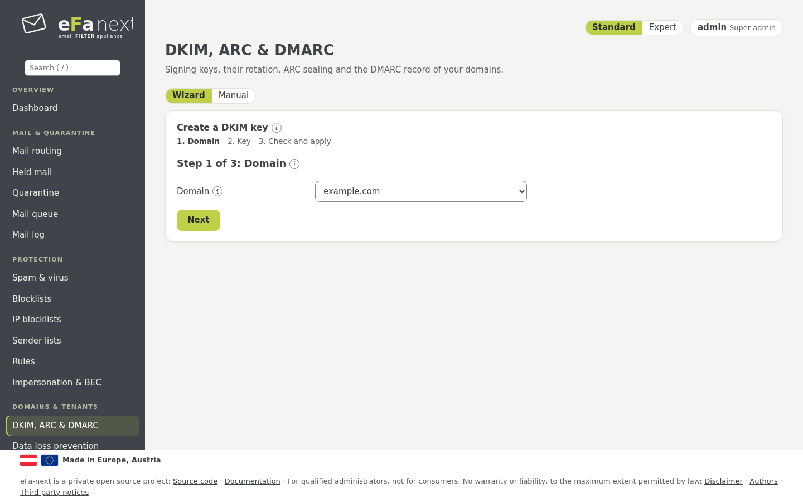
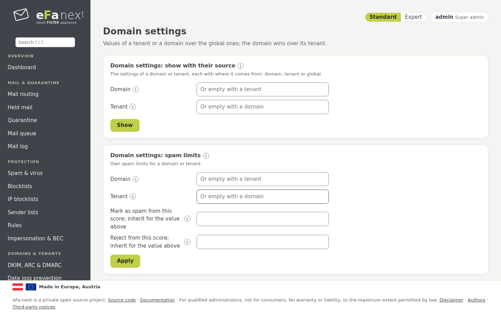
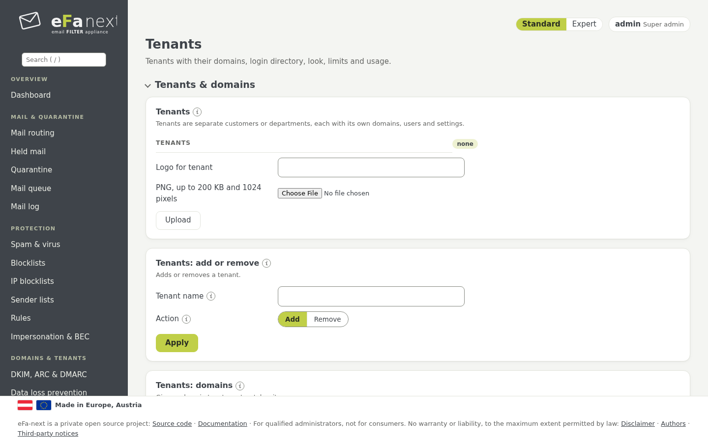
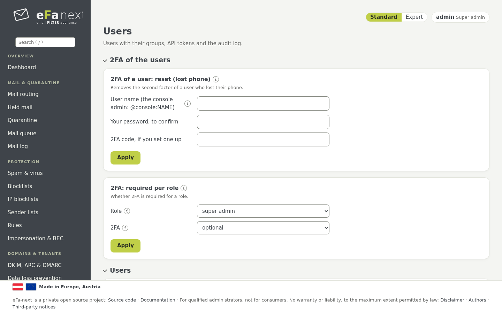
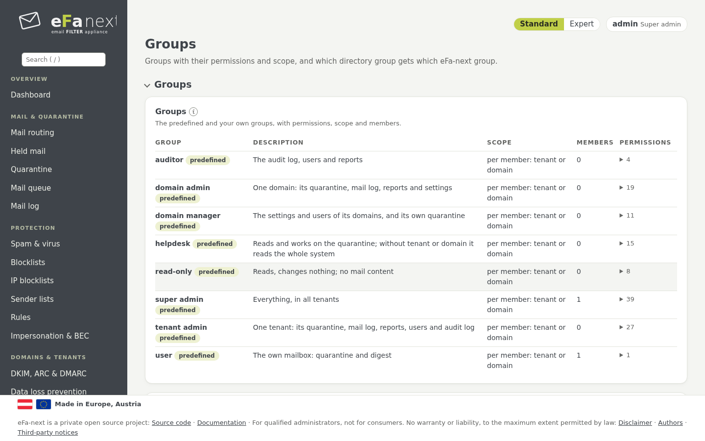
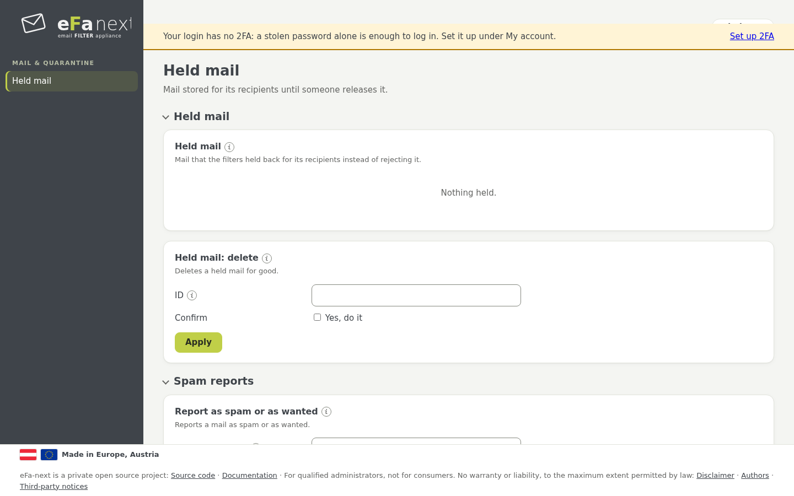

# 8. Domains, tenants, users and the portal

The menu groups *Domains & tenants* and *Users & access*.

## DKIM, ARC & DMARC

*Domains & tenants › DKIM, ARC & DMARC*:

- **DKIM keys:** *RSA key: generate* (2048, 3072 or 4096 bits) or *Ed25519 key: generate* per domain, then publish the DNS
  record from *DKIM: export DNS records*. RSA and Ed25519 can be used side by side.
- **Key rotation:** new keys are made in advance; a key takes over from its date once enough DNS servers show its record.
- **Software keys:** DKIM and ARC keys are kept as files; a hardware module holds only the backup signature and S/MIME keys
  (DKIM and ARC in a hardware module are planned for 6.0.0.7, [hsm.md](../hsm.md)).
- **Managed externally:** DKIM keys can come from another signing system through the provisioning API
  ([api-dkim-provisioning.md](../api-dkim-provisioning.md)).
- **ARC:** seals mail that eFa-next passes on, so the next server can trust its checks.
- **DMARC record:** a generator builds the `_dmarc` record; start with `p=none`, read the reports, then go to `quarantine`
  and `reject`. *Reports received* shows the DMARC and TLS reports of other servers.



```bash
sudo efactl dkim-create --domain example.com --kind rsa --bits 2048
sudo efactl dkim-export
```

## More per domain

| Page | What it does |
|---|---|
| Data loss prevention | rules for outgoing mail: hold or block on patterns such as card or account numbers |
| Bulk mail | newsletter-friendly sending: paced delivery per transport ([bulk.md](../bulk.md)) |
| Archive handover | a copy of each mail to an archive system ([archive.md](../archive.md)) |
| Encrypted PDF mail | outgoing mail as a password-protected PDF |
| Disclaimers | disclaimers and signatures per domain, S/MIME and PGP at the gateway ([smime-pgp.md](../smime-pgp.md)) |

## Domain settings

*Domains & tenants › Domain settings* holds values of a tenant or a domain that win over the global ones: spam limits, days of
held mail, digest hour and text, TLS to the domain, language, stored headers, EU relation, job applications, the domain check,
role addresses, spam traps. The domain wins over its tenant. *Show with their source* tells for each value whether it comes
from the domain, the tenant or global; *Inherit* takes an own value away.



## Tenants

A tenant is one customer with its domains, users, look and limits (*Domains & tenants › Tenants*):

- **Tenants & domains:** a super admin adds domains at once; a tenant admin adds one, publishes the TXT record
  `_efa-verify.<domain>` it shows, then lets it be checked.
- **Usage & limits:** domains, users, mails per day, quarantine in MB. From 80 % the admin gets a mail; at 100 % nothing new
  can be added, mail still flows.
- **Look:** name, colour and a PNG logo for the web interface, the digest and the reports.
- **Login directory:** the own LDAP or OIDC of a tenant, for the addresses of its domains.
- **Lock & delete:** a locked tenant cannot log in; delete removes all its data after its name is typed again.



## Users

*Users & access › Users*: local users (password twice, at least 12 characters), or users of LDAP/Active Directory or OIDC.
A user can be in several groups; the permissions add up. *Lock* logs a user out within 15 seconds and stops their API tokens.
Removing a user removes everything bound to it (2FA, passkeys, API tokens, sessions) in one step.



The same page holds the 2FA rules and resets (chapter 3), passkey rules, **API tokens** for the REST API and Prometheus,
the **login directory** (LDAP, OIDC), the **audit log** search, **NIS2 incidents**, **privacy evidence** and the **strict audit
mode** with daily anchors ([audit-anchor.md](../audit-anchor.md)).

```bash
sudo efactl user-set --username helpdesk1 --action set --groups helpdesk --email helpdesk1@example.com
```

## Groups and permissions

*Users & access › Groups*: each action needs one permission (for example `quarantine.release`); a group holds permissions and
a scope: global, some tenants or some domains.

| Predefined group | For |
|---|---|
| super admin | everything, in all tenants |
| tenant admin | one tenant: quarantine, mail log, reports, users, settings of its domains |
| domain admin | one domain: the same for that domain |
| domain manager | the settings and users of its domains |
| helpdesk | reads and works on the quarantine |
| read-only | reads, changes nothing, no mail content |
| auditor | the audit log, users and reports |
| user | the own mailbox: held mail and digest |

Predefined groups cannot be changed; copy one and change the copy. Nobody can hand out a permission they do not have, change
their own groups or remove the last super admin. *Directory groups* map LDAP or OIDC groups to eFa-next groups.



## Single sign-on (OIDC)

*Users › Login directory* connects an OpenID Connect provider (issuer, client ID and secret, redirect address
`https://<host>/login/oidc/callback`, the claim with the groups). An account is bound to the issuer and subject of its login,
not to the name the provider sends. The second factor is the one of the provider. Tenants can have their own provider.

The **user portal** can use the same provider with its own redirect address `https://<host>/portal/login/oidc/callback`, set
as *User portal: redirect address*. A portal login takes the mail address only when the provider marks it as verified and only
for a domain of this server. Addresses of admin accounts always log in at the admin interface, never in the portal.

```bash
sudo efactl oidc-set --mode on --issuer https://idp.example.com/realms/mail --client_id efa-next \
  --redirect_uri https://mx1.example.com/login/oidc/callback \
  --portal_redirect_uri https://mx1.example.com/portal/login/oidc/callback
```

## The user portal

Mailbox users log in at `https://<host>/portal/login`. The portal is a separate service with its own system user and shows only
the own mail: held mail with release, allow and block, spam reports, newsletters and the own spam limit where allowed, recall
of the own outgoing mail, emergency access, and the own account with 2FA and passkeys.



Next: [Security and security standards](09-security.md) · Back: [Manual](README.md)
