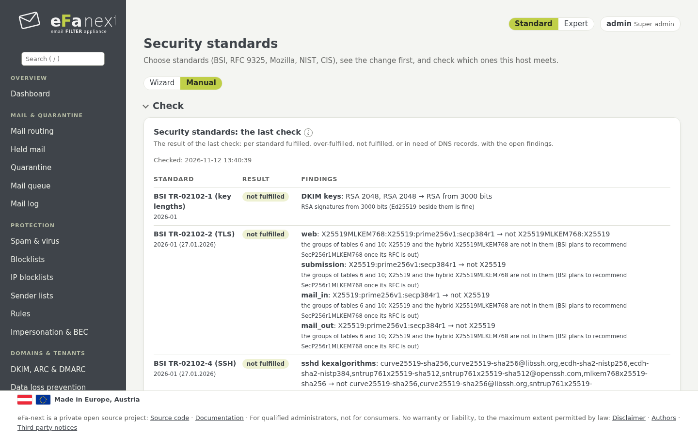
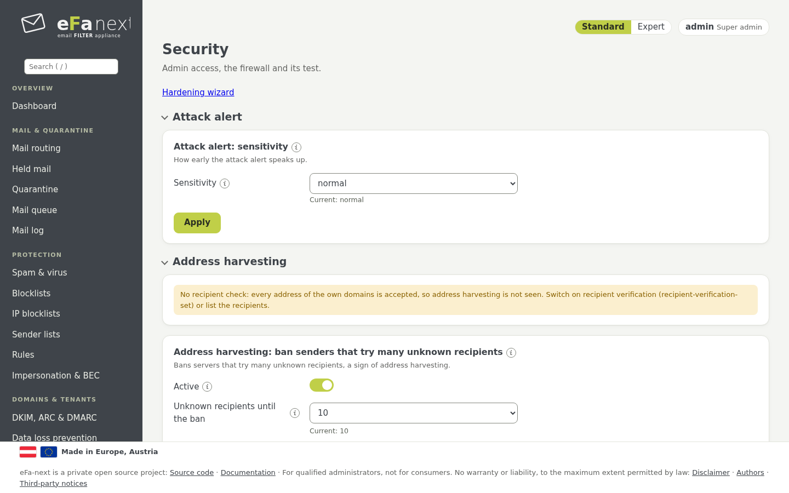

# 9. Sicherheit und Sicherheitsstandards

Die Seiten *Benutzer & Zugriff › Sicherheitsstandards* und *Benutzer & Zugriff › Sicherheit*.

## Sicherheitsstandards

*Sicherheitsstandards* (nur Super-Admins, mit frischem zweitem Faktor) wendet anerkannte Standards an und prüft sie:

| Standard | Was das Anwenden setzt |
|---|---|
| BSI TR-02102-2 (TLS) | TLS-Profil `bsi` |
| BSI TR-02102-1 (Schlüssellängen) | nichts: vorhandene Schlüssel werden gemeldet, nicht ersetzt |
| BSI TR-02102-4 (SSH) | SSH-Profil `bsi`, mit automatischem Rückweg nach 10 Minuten |
| BSI TR-03116-4 (TLS in Bundesbehörden) | TLS-Profil `bsi` |
| BSI TR-03108 (sicherer Mailtransport) | TLS-Profil `bsi`, DANE für ausgehende Mail |
| RFC 9325 (BCP 195) | TLS-Profil `rfc9325` (oder `bsi`, wenn jetzt gesetzt) |
| Mozilla modern | Weboberfläche nur TLS 1.3; Port 587 bleibt bei TLS 1.2 |
| Mozilla intermediate | TLS-Profil `rfc9325` |
| NIST SP 800-52 Rev. 2 | TLS-Profil `rfc9325` |
| CIS AlmaLinux OS 9/10 (sshd, sysctl, Krypto-Richtlinie) | SSH-Profil `bsi`, Kernel-Härtung |



So geht es:

1. **Wählen:** einen oder mehrere Standards. Eine **Vorschau** zeigt jede Einstellung mit dem Wert jetzt und danach, dazu die
   Warnungen. Noch ändert sich nichts.
2. **Anwenden:** Von den gewählten Standards gilt je Einstellung der strengste Wert, nie unter der Grenze von eFa-next und nie
   schwächer als jetzt. Vorher werden ein Rücksprungpunkt und ein Audit-Eintrag geschrieben.
3. **Zurück** zu den Einstellungen davor mit *Sicherheitsstandards: zurück zu den Einstellungen davor*.
4. **Prüfen:** Täglich und auf Abruf wird jeder Standard, gewählt oder nicht, gegen die wirksamen Einstellungen geprüft:
   *erfüllt*, *übererfüllt*, *nicht erfüllt* oder *braucht DNS-Einträge oder ein Postfach*, mit dem Grund jedes Befunds. Das
   Ergebnis steht im Dashboard und im PDF des Härtungsberichts.

```bash
sudo efactl standards-set --select "bsi-02102-2 moz-modern"              # Vorschau
sudo efactl standards-set --select "bsi-02102-2 moz-modern" --apply yes  # anwenden (bei Warnungen zusätzlich --confirm yes)
sudo efactl standards-check
sudo efactl standards-rollback
```

Port 25 bleibt opportunistisch (TLS, wenn der Absender es anbietet), außer *TLS auf Port 25 verlangen* wird bewusst gewählt.
eFa-next behält X25519 und den quantensicheren Hybrid X25519MLKEM768 und meldet sie als Abweichung, wo ein Standard sie noch nicht
nennt. Details und die Tabelle der Abweichungen: [tls-profiles.md](../tls-profiles.md#security-standards-choose-apply-check).

### Der Härtungs-Assistent

Die Seite beginnt mit dem Assistenten **Diesen Server härten** (Super-Admins; *Sicherheit* verlinkt ihn als *Härtungs-Assistent*),
in sechs Schritten:

1. **Standards:** die Standards ankreuzen, vorbelegt mit der wirksamen Wahl, jeder mit dem Stand der letzten Prüfung.
2. **Port 25:** opportunistisch lassen (empfohlen, RFC 3207) oder TLS verlangen, mit der Zahl der Sitzungen ohne TLS der letzten
   7 Tage.
3. **Betriebssystem:** je Punkt sein Stand und *härten* oder *so lassen*, vorgewählt, wo ein gewählter Standard es verlangt:
   SSH-Profil BSI, Kernel-Einstellungen, auditd, chronyd, sshd-Optionen nach CIS, Passwort-Hashverfahren, Rechte von
   `/etc/shadow`, Krypto-Richtlinie, Firewall-Wache. Nur Hinweise, nie automatisch: SELinux erzwingend, OS-Updates, neue
   Hostschlüssel. Fremde Dienste und offene Ports werden gelistet, nie gestoppt.
4. **eFa-next:** die eigenen Schalter (Dienst-Sandbox, Sperre nach Fehlanmeldungen, strenges Audit, Prüfung gegen Datenlecks,
   TLS-Minimum, DANE, automatische Updates und mehr) mit ihrem Stand.
5. **Vorschau:** jede Änderung (Einstellung, jetzt, danach, warum), die Warnungen und was der Assistent nicht ändert
   (Zertifikatsschlüssel, DKIM-Schlüssellänge, DNS-Einträge, Root-Anmeldung).
6. **Prüfen und anwenden:** Passwort und 2FA-Code einmal, ein Rücksprungpunkt für alles, danach die neue Prüfung je Standard.
   Wurde das SSH-Profil geändert: innerhalb von 10 Minuten neu per SSH anmelden und bestätigen, sonst geht es von selbst zurück.

Nur strenger, nie schwächer; `PermitRootLogin` wird nie angefasst (eigener Schalter unter *Sicherheit*). `efactl os-harden-status`
und `os-harden-set` setzen die Punkte des Betriebssystems auf der Konsole.

## Dienst-Sandbox (systemd)

Die Dienste von Drittanbietern bekommen eine systemd-Sandbox: ein schreibgeschütztes System mit nur den Ordnern, die der
jeweilige Dienst schreibt, kein /home, ein eigenes /tmp, schreibgeschützte Kernel-Einstellungen und Control Groups.

| Modus | In der Sandbox | Gesetzt durch |
|---|---|---|
| `default` | rspamd, clamd, freshclam, Unbound | Neuinstallation und Migration von eFa 5 |
| `on` | dieselben plus Redis (Valkey auf EL10) und nginx | den Admin, bewusst |
| `off` | keiner | den Admin; das Dashboard zeigt dann einen Hinweis |

```bash
sudo efactl service-harden --mode default
sudo efactl service-harden-status
```

Jeder Dienst wird mit seiner Sandbox neu gestartet und muss 10 Sekunden laufen; einer, der das nicht tut, läuft wieder ohne,
und ein Ereignis meldet es. Ein Update behält den gesetzten Modus. Postfix und MariaDB bekommen nie eine Sandbox.

## TLS-Profile

*Sicherheit › TLS-Profil* wählt die TLS-Einstellungen aller Dienste auf einmal: **bsi** (Standard), **rfc9325**,
**mozilla-modern** oder **custom**. Die Untergrenze gilt für jedes Profil und lässt sich nicht senken: nur TLS 1.2 oder 1.3,
ECDHE, AEAD-Verfahren.

## Admin-Zugang

*Sicherheit › Admin-Zugang*:

- **Root-Anmeldung über SSH:** aus, nur Schlüssel oder an, in einer Datei (`00-efa-root.conf`). Die Seite warnt und lehnt das
  Abschalten ab, solange kein anderer Admin sich anmelden kann.
- **Web-Zulassungsliste:** Nur diese Netze erreichen SSH und die Weboberfläche. Eine Änderung wird nach 5 Minuten zurückgenommen,
  wenn Sie sie nicht bestätigen, damit ein Fehler Sie nicht aussperrt.
- **Fail2Ban**, die **Admin-Adresse** für Benachrichtigungen, Single Sign-on zur rspamd-Weboberfläche, Härtung des Webservers.

## Firewall

*Sicherheit › Firewall* zeigt und ändert die offenen Ports. Jede Änderung wartet auf *Bestätigen* und wird ohne nach 5 Minuten
zurückgenommen (`efactl firewall-confirm`, `firewall-revert`). Die **Firewall-Wache** prüft regelmäßig, ob die Regeln noch wie
gesetzt sind; der **Firewall-Test** prüft Ports und SMTP, wahlweise über eine eigene Prüfadresse von außen.



## Weitere Karten der Seite Sicherheit

| Karte | Was sie tut |
|---|---|
| Angriffswarnung | letztes Ergebnis und Empfindlichkeit der Angriffsprüfung (Kapitel 4) |
| Adress-Ausspähung | sperrt Absender, die in wenigen Minuten viele unbekannte Empfänger probieren |
| Fehlanmeldungen | Sperre nach Fehlanmeldungen an Weboberfläche, Portal, API und Port 587 |
| Sicherheits-Selbstprüfung | prüft den Host täglich; wahlweise neue Passwörter gegen bekannte Datenlecks (Have I Been Pwned, k-Anonymität: nur ein Hash-Anfang verlässt den Host) |
| CVE-Wache | gleicht die installierten Pakete mit veröffentlichten Schwachstellen ab |
| Konfigurationsverlauf | jede Änderung mit altem und neuem Wert; *Rückgängig* nimmt eine zurück |
| Vier-Augen-Prinzip | gewählte Änderungen brauchen die Zustimmung eines zweiten Admins |
| Milter-Gesundheit | überwacht die Milter und was mit Mail geschieht, wenn einer ausfällt |
| Einrichtungsvariante | geführt oder manuell, Re-Setup, die Konsolen-2FA (Kapitel 2, 3) |
| Mindestsicherheit | die Untergrenzen, unter die keine Einstellung geht, und ihre Prüfung |
| SSH-Profil | die SSH-Verfahren (`bsi`), mit automatischem Rückweg nach 10 Minuten |
| Härtungsbericht | der Zustand aller Härtungsschalter, auch als PDF (`/hardening.pdf`) |

Alle Änderungen aus Web und Konsole stehen im Audit-Log (*Benutzer › Audit-Log*).

## Sicherheitsrichtlinie

Wie Schwachstellen gemeldet und behandelt werden, welche Versionen Korrekturen bekommen, und die Sicherheitshinweise:
[SECURITY.md](../../SECURITY.md). Das Konzept dahinter: [security-model.md](../security-model.md) und
[SECURITY-DESIGN.md](../SECURITY-DESIGN.md).

Weiter: [Netzwerk, DNS und Zertifikat](10-network-dns.de.md) · Zurück: [Handbuch](README.de.md)
