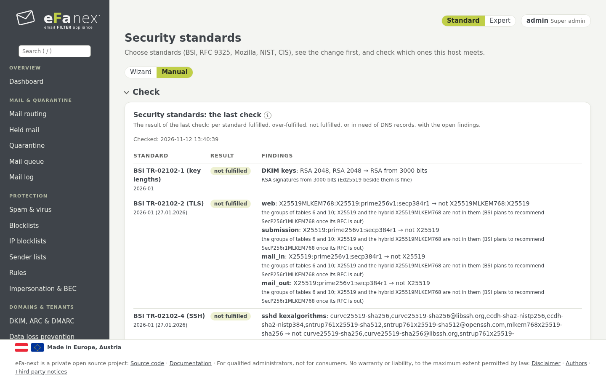
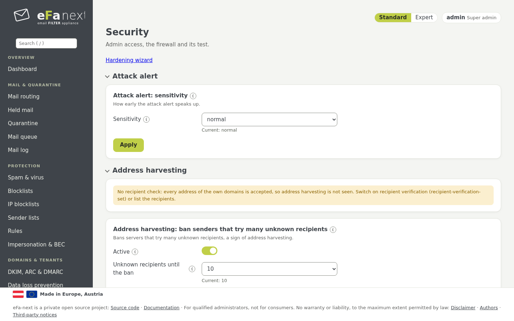

# 9. Security and security standards

The pages *Users & access › Security standards* and *Users & access › Security*.

## Security standards

*Security standards* (super admins only, with a fresh second factor) applies and checks recognised standards:

| Standard | What applying it sets |
|---|---|
| BSI TR-02102-2 (TLS) | TLS profile `bsi` |
| BSI TR-02102-1 (key lengths) | nothing: existing keys are reported, not replaced |
| BSI TR-02102-4 (SSH) | SSH profile `bsi`, with the automatic way back after 10 minutes |
| BSI TR-03116-4 (TLS in federal agencies) | TLS profile `bsi` |
| BSI TR-03108 (secure mail transport) | TLS profile `bsi`, DANE for outgoing mail |
| RFC 9325 (BCP 195) | TLS profile `rfc9325` (or `bsi` if set now) |
| Mozilla modern | web interface TLS 1.3 only; port 587 stays at TLS 1.2 |
| Mozilla intermediate | TLS profile `rfc9325` |
| NIST SP 800-52 Rev. 2 | TLS profile `rfc9325` |
| CIS AlmaLinux OS 9/10 (sshd, sysctl, crypto policy) | SSH profile `bsi`, kernel hardening |



How it works:

1. **Choose** one or more standards. A **preview** shows each setting with its value now and after, and the warnings.
   Nothing changes yet.
2. **Apply.** Of the chosen standards the strictest value of each setting is applied, never below the limit of eFa-next and
   never weaker than now. A rollback point and an audit entry are written first.
3. **Back** to the settings before with *Security standards: back to the settings before*.
4. **Check.** Daily and on demand every standard, chosen or not, is checked against the settings in effect: *fulfilled*,
   *over-fulfilled*, *not fulfilled* or *needs DNS records or a mailbox*, with the reason of each finding. The result is on the
   dashboard and in the PDF of the hardening report.

```bash
sudo efactl standards-set --select "bsi-02102-2 moz-modern"            # preview
sudo efactl standards-set --select "bsi-02102-2 moz-modern" --apply yes  # apply (add --confirm yes with warnings)
sudo efactl standards-check
sudo efactl standards-rollback
```

Port 25 stays opportunistic (TLS when the sender offers it) unless *Require TLS on port 25* is chosen on purpose. eFa-next keeps
X25519 and the quantum-safe hybrid X25519MLKEM768 and reports them as a deviation where a standard does not list them yet.
Details and the table of deviations: [tls-profiles.md](../tls-profiles.md#security-standards-choose-apply-check).

### The hardening wizard

The page starts with the wizard **Harden this server** (super admins; *Security* links to it as *Hardening wizard*), in six steps:

1. **Standards:** tick the standards, prefilled with the choice in effect, each with the state of the last check.
2. **Port 25:** keep it opportunistic (recommended, RFC 3207) or require TLS, with the number of sessions without TLS in the
   last 7 days.
3. **Operating system:** per item its state and *harden* or *leave*, preselected where a chosen standard asks for it: SSH
   profile BSI, kernel settings, auditd, chronyd, sshd options after CIS, password hashing, rights of `/etc/shadow`, crypto
   policy, firewall guard. Hints only, never automatic: SELinux enforcing, OS updates, new host keys. Foreign services and open
   ports are listed, never stopped.
4. **eFa-next:** the own switches (service sandbox, login lockout, strict audit, password breach check, TLS minimum, DANE,
   automatic updates and more) with their state.
5. **Preview:** every change (setting, now, after, why), the warnings, and what the wizard does not change (certificate key,
   DKIM key length, DNS records, root login).
6. **Check and apply:** password and 2FA code once, one rollback point for everything, then the new check per standard. If the
   SSH profile changed: log in again by SSH within 10 minutes and confirm, or it goes back by itself.

Only stricter, never weaker; `PermitRootLogin` is never touched (own switch under *Security*). `efactl os-harden-status` and
`os-harden-set` do the operating system items on the console.

## Service sandbox (systemd)

The third-party daemons get a systemd sandbox: a read-only system with only the folders each daemon writes, no /home, an own
/tmp, read-only kernel tunables and control groups.

| Mode | Sandboxed | Set by |
|---|---|---|
| `default` | rspamd, clamd, freshclam, Unbound | a new install and a migration from eFa 5 |
| `on` | the same plus Redis (Valkey on EL10) and nginx | the admin, on purpose |
| `off` | none | the admin; the dashboard then shows a hint |

```bash
sudo efactl service-harden --mode default
sudo efactl service-harden-status
```

Each unit is restarted with its sandbox and must stay up for 10 seconds; one that does not runs without it again, and the
event says so. An update keeps the mode that was set. Postfix and MariaDB never get a sandbox.

## TLS profiles

*Security › TLS profile* chooses the TLS settings of all services at once: **bsi** (default), **rfc9325**, **mozilla-modern**
or **custom**. The lower limit holds for every profile and cannot be lowered: TLS 1.2 or 1.3 only, ECDHE, AEAD ciphers.

## Admin access

*Security › Admin access*:

- **Root login through SSH:** off, key only or on, in one file (`00-efa-root.conf`). The page warns and refuses to turn it off
  unless another admin can log in.
- **Web allowlist:** only these networks reach SSH and the web interface. A change reverts after 5 minutes unless you confirm
  it, so a mistake does not lock you out.
- **Fail2Ban**, the **admin address** for notifications, single sign-on to the rspamd web interface, web hardening.

## Firewall

*Security › Firewall* shows and changes the open ports. Every change waits for *Confirm* and is taken back after 5 minutes
without it (`efactl firewall-confirm`, `firewall-revert`). The **firewall guard** checks regularly that the rules are still as
set; the **firewall test** checks the ports and SMTP, optionally through an outside probe address of your own.



## More on the Security page

| Card | What it does |
|---|---|
| Attack alert | last result and sensitivity of the attack check (chapter 4) |
| Address harvesting | bans senders that try many unknown recipients within some minutes |
| Failed logins | lockout after failed logins at the web interface, the portal, the API and port 587 |
| Security self check | checks the host daily; optionally new passwords against known data breaches (Have I Been Pwned, k-anonymity: only a hash prefix leaves the host) |
| CVE watch | matches the installed packages against published vulnerabilities |
| Configuration history | every change with old and new value; *Undo* takes one back |
| Four eyes | chosen changes need the approval of a second admin |
| Milter health | watches the milters and what happens to mail when one is down |
| Setup variant | guided or manual, Re-Setup, the console 2FA (chapter 2, 3) |
| Security minimum | the lower limits that no setting goes below, and their check |
| SSH profile | the SSH algorithms (`bsi`), with the automatic way back after 10 minutes |
| Hardening report | the state of all hardening switches, also as PDF (`/hardening.pdf`) |

All changes from the web and the console go into the audit log (*Users › Audit log*).

## Security policy

How vulnerabilities are reported and handled, which versions get fixes, and the advisories: [SECURITY.md](../../SECURITY.md).
The design behind it: [security-model.md](../security-model.md) and [SECURITY-DESIGN.md](../SECURITY-DESIGN.md).

Next: [Network, DNS and certificate](10-network-dns.md) · Back: [Manual](README.md)
