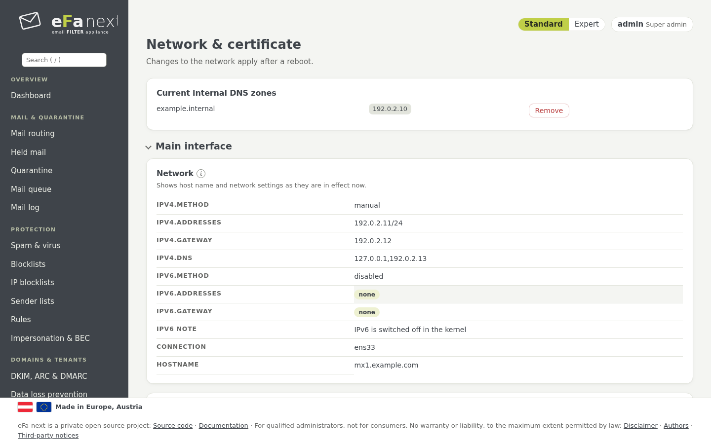
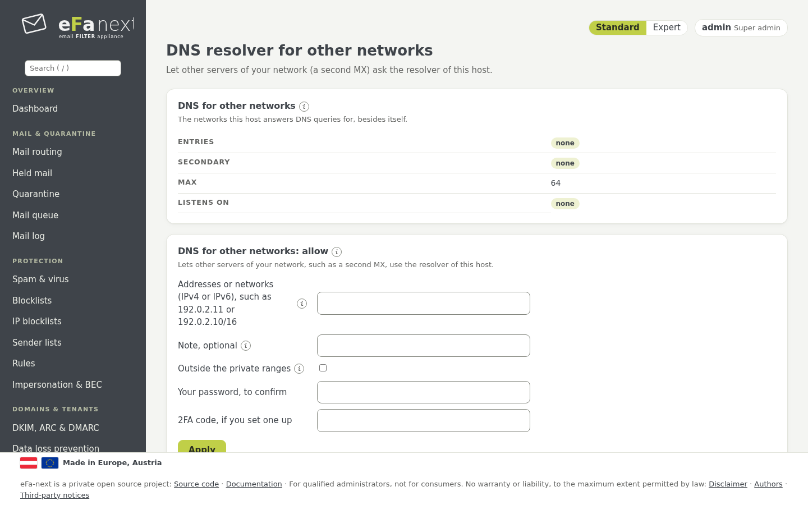

# 10. Netzwerk, DNS und Zertifikat

Die Seiten *System › Netzwerk & Zertifikat* und *System › DNS-Resolver für weitere Netze*.

## Netzwerk

*Netzwerk & Zertifikat › Hauptschnittstelle*: Hostname, IPv4 (manuell oder automatisch) und IPv6 (auto, manuell, ignorieren oder
abgeschaltet; die Seite zeigt das wirksame IPv6). Eine Adressänderung gilt nach einem Neustart.

*Weitere Schnittstellen* fügt Schnittstellen mit einer Rolle hinzu (etwa ein eigenes Admin- oder Sicherungsnetz) und ihre Routen.
Wie bei der Firewall wartet eine Änderung auf *Bestätigen* und wird ohne zurückgenommen. Details: [interfaces.md](../interfaces.md),
[network.md](../network.md).



## DNS: der eigene Resolver

eFa-next löst Namen mit seinem eigenen Unbound auf `127.0.0.1` auf, direkt über die Root-Server und mit DNSSEC. Das ist der
Standard und das, was die DNS-Blocklisten brauchen: Die meisten lehnen Anfragen über einen öffentlichen Resolver ab.

### Interne DNS-Server und Domains

Namen, die nur die DNS-Server Ihres Netzes kennen (der Mailserver hinter eFa-next, ein Verzeichnis, ein Update- oder
Proxy-Server), brauchen eine Weiterleitung: Nennen Sie einmal Ihre **internen DNS-Server**, dann die **Domains**, für die sie
antworten. Alles andere wird wie bisher aufgelöst.

```bash
sudo efactl dns-servers-set --servers 192.0.2.53,192.0.2.54
sudo efactl dns-zone-set --zone example.internal --action add --note "Mailserver"
sudo efactl dns-zone-test --zone example.internal
```

Alle Namen (`.`) weiterzuleiten wird abgelehnt. Eine interne Domain unter einer signierten öffentlichen Domain kann
`--dnssec off` nur für diese Domain brauchen. Jede Änderung prüft `unbound-checkconf`; bleibt Unbound nicht oben, kommen die
Einstellungen von vorher zurück. Details: [dns-forwarding.md](../dns-forwarding.md).

### DNS-Resolver für weitere Netze

*System › DNS-Resolver für weitere Netze* (Super-Admins, mit Passwort und 2FA-Code) lässt andere Server Ihres Netzes, etwa den
zweiten MX eines Clusters, das Unbound dieses Hosts nutzen:

- Nur die genannten Netze dürfen fragen; `0.0.0.0/0`, `::/0` und alles weiter als /8 (IPv4) oder /32 (IPv6) wird abgelehnt: Der
  Host ist nie ein offener Resolver. Ein Netz außerhalb der privaten Bereiche braucht ein getipptes yes und steht im Audit-Log.
- Jedes Netz bekommt einen `access-control`-Eintrag in Unbound und zwei Firewall-Regeln für Port 53 (UDP und TCP), ohne Reload der
  Firewall. Unbound begrenzt die Anfragen je Client.
- **Zweiter Resolver dieses Hosts:** Dieser Host kann nach seinem eigenen Unbound den anderen MX fragen.



```bash
sudo efactl dns-share-add --nets "192.0.2.11"
sudo efactl dns-share-secondary-set --address 192.0.2.11
sudo efactl dns-share-list
```

Die Liste ist in jeder Sicherung und wird bei jedem Update neu geschrieben, sodass ein Restore oder das Release-Upgrade sie behält.

## Zertifikat

Beim ersten Start hat der Host einen selbstsignierten Platzhalter. *DNS und Zertifikat › Let's Encrypt* beantragt ein Zertifikat
für den Hostnamen und erneuert es selbst; Weboberfläche, Portal und Postfix nutzen es. Ein vorhandenes gültiges
Let's-Encrypt-Zertifikat (etwa nach einer Migration) lässt sich übernehmen (`letsencrypt-takeover`).

```bash
sudo efactl letsencrypt-set --domain mx1.example.com --email admin@example.com --accept_tos yes
```

## DANE und MTA-STS

- **DANE:** Ausgehende Mail prüft die TLSA-Einträge des empfangenden Servers (braucht den validierenden Resolver). Für eingehende
  Mail zeigt *TLSA-Einträge*, was für diesen Host zu veröffentlichen ist; ein Zertifikatswechsel hält sie gültig.
- **MTA-STS:** *MTA-STS* schreibt den Richtlinientext für Ihre Domains und prüft die veröffentlichte Richtlinie.

Details: [dmarc-dane-mta-sts.md](../dmarc-dane-mta-sts.md).

Weiter: [Berichte und Überwachung](11-reports.de.md) · Zurück: [Handbuch](README.de.md)
