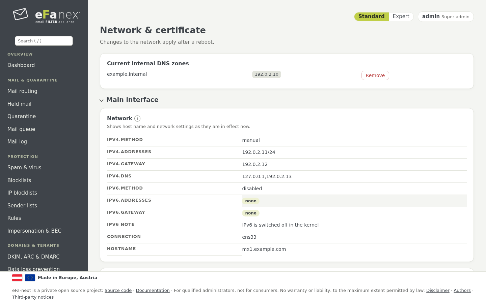
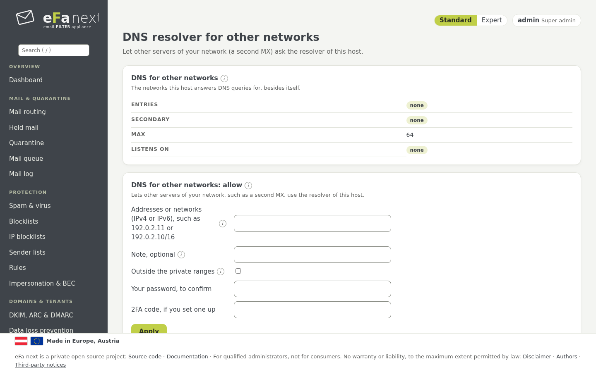

# 10. Network, DNS and certificate

The pages *System › Network & certificate* and *System › DNS resolver for other networks*.

## Network

*Network & certificate › Main interface*: host name, IPv4 (manual or automatic) and IPv6 (auto, manual, ignore or disabled; the page
shows the IPv6 in effect). A change of the address applies after a reboot.

*More interfaces* adds interfaces with a role (for example a separate admin or backup network) and their routes. Like the
firewall, an interface change waits for *Confirm* and is taken back without it. Details: [interfaces.md](../interfaces.md),
[network.md](../network.md).



## DNS: the own resolver

eFa-next resolves names with its own Unbound on `127.0.0.1`, directly from the root servers and with DNSSEC. This is the
default and what the DNS blocklists need: most of them refuse queries that come through a public resolver.

### Internal DNS servers and domains

Names that only the DNS servers of your network know (the mail server behind eFa-next, a directory, an update or proxy
server) need a forwarding: name your **internal DNS servers** once, then the **domains** they answer for. Everything else is
resolved as before.

```bash
sudo efactl dns-servers-set --servers 192.0.2.53,192.0.2.54
sudo efactl dns-zone-set --zone example.internal --action add --note "mail server"
sudo efactl dns-zone-test --zone example.internal
```

Forwarding all names (`.`) is refused. An internal domain below a signed public domain may need `--dnssec off` for that domain
only. Each change is checked by `unbound-checkconf`; if Unbound does not stay up, the settings of before come back.
Details: [dns-forwarding.md](../dns-forwarding.md).

### DNS resolver for other networks

*System › DNS resolver for other networks* (super admins, with password and 2FA code) lets other servers of your network, such
as the second MX of a cluster, use the Unbound of this host:

- Only the networks listed may ask; `0.0.0.0/0`, `::/0` and anything wider than /8 (IPv4) or /32 (IPv6) are refused, so the
  host is never an open resolver. A network outside the private ranges needs a typed yes and is named in the audit log.
- Each network gets an `access-control` entry in Unbound and two firewall rules for port 53 (UDP and TCP), without a reload of
  the firewall. Unbound limits the queries per client.
- **Second resolver of this host:** this host can ask the other MX after its own Unbound.



```bash
sudo efactl dns-share-add --nets "192.0.2.11"
sudo efactl dns-share-secondary-set --address 192.0.2.11
sudo efactl dns-share-list
```

The list is in every backup and is written again on every update, so a restore or the release upgrade keeps it.

## Certificate

On the first start the host has a self-signed placeholder. *DNS and certificate › Let's Encrypt* requests a certificate for
the host name and renews it by itself; the web interface, the portal and Postfix use it. An existing valid Let's Encrypt
certificate (for example after a migration) can be taken over (`letsencrypt-takeover`).

```bash
sudo efactl letsencrypt-set --domain mx1.example.com --email admin@example.com --accept_tos yes
```

## DANE and MTA-STS

- **DANE:** outgoing mail checks the TLSA records of the receiving server (needs the validating resolver). For incoming mail,
  *TLSA records* shows the records to publish for this host; a certificate rollover keeps them valid.
- **MTA-STS:** *MTA-STS* writes the policy text for your domains and checks the published policy.

Details: [dmarc-dane-mta-sts.md](../dmarc-dane-mta-sts.md).

Next: [Reports and monitoring](11-reports.md) · Back: [Manual](README.md)
