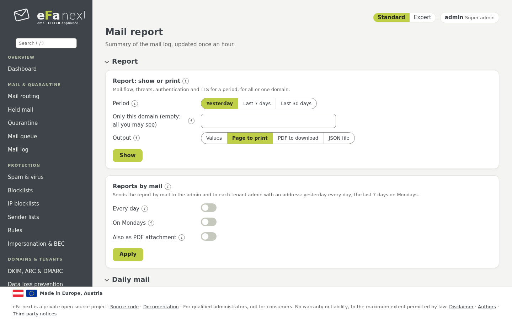
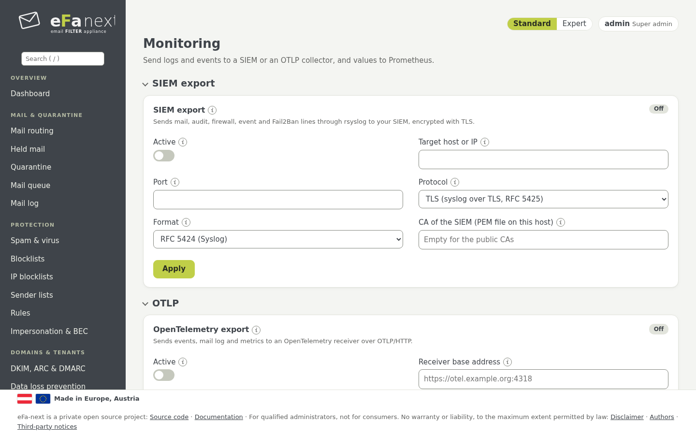
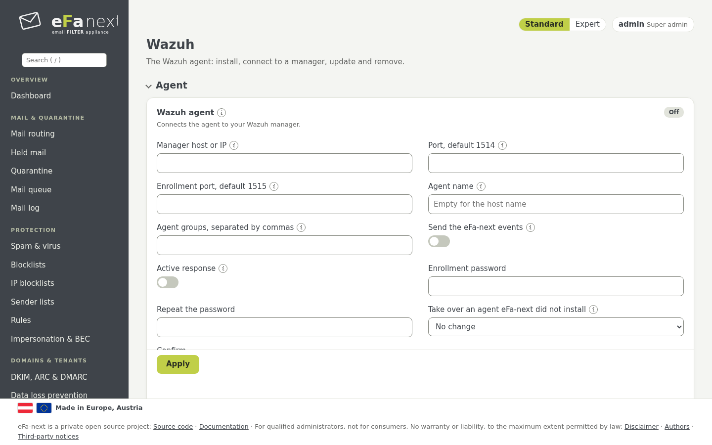

# 11. Berichte und Überwachung

Die Menügruppe *Überwachung & Berichte*.

## Mail-Bericht

*Überwachung & Berichte › Mail-Bericht* zeigt Mailfluss und Bedrohungen von heute, gestern und den letzten 7 Tagen, stündlich
erneuert: Mails ein und aus, Spam, Viren, Abweisungen, die häufigsten Absender und Empfänger, für jeden Leser mit den Domains, die
er sehen darf.



- **Bericht: zeigen oder drucken:** ein Tag, eine Woche oder ein Monat, für alle sichtbaren Domains oder eine; als Seite zum
  Drucken oder als **PDF** zum Herunterladen.
- **Berichte per Mail:** der Tagesbericht und der Wochenbericht (montags) an den Admin; Mandanten-Admins mit Adresse bekommen den
  Bericht ihres Mandanten. Mit *Auch als PDF-Anhang* trägt die Mail den Bericht zusätzlich als PDF.
- **Tägliche Mail:** eine kurze Mail über gestern.

```bash
sudo efactl report-show --period week --format pdf   # das PDF base64-kodiert in der Antwort; die Webseite lädt es herunter
sudo efactl report-set --daily on --weekly on --pdf on
```

Das PDF erzeugt eFa-next selbst (A4, Seitenzahlen), ohne zusätzliche Bibliothek.

## Überwachung

*Überwachung & Berichte › Überwachung*:

- **SIEM-Export:** Mail-, Audit-, Firewall-, Ereignis- und Fail2Ban-Zeilen über rsyslog, als RFC 5424 oder JSON, nur über TLS
  (Port 6514, das Zertifikat des SIEM wird nach seinem Namen geprüft).
- **OTLP:** Ereignisse, Mail-Log und Metriken an einen OpenTelemetry-Collector über HTTPS, mit Bearer-Token oder API-Schlüssel,
  Puffer auf der Platte und Wiederholungen.
- **Prometheus:** liest `https://<Host>/metrics` mit einem API-Token. Die REST-API einschalten und das Token unter
  *Benutzer › API-Tokens* anlegen.



## Wazuh

*Überwachung & Berichte › Wazuh* installiert, verbindet, aktualisiert und entfernt den Wazuh-Agenten. Ein Agent, den jemand anders
installiert hat, wird nur gelesen; `efactl wazuh-config --adopt yes --confirm yes` übernimmt ihn, ohne seine Dateien zu ändern.
Details: [WAZUH.md](../WAZUH.md).



## Benachrichtigungen

Wichtige Ereignisse (eine gescheiterte Sicherung, ein Dienst, der stoppt, ein gescheitertes Update, eine Doppelgänger-Domain, eine
CVE) gehen per Mail an die Admin-Adresse (*Sicherheit › Admin-Zugang*) und erscheinen im Dashboard. Jede Anmeldung wählt unter
*Mein Konto › Meine Einstellungen*, ob sie Berichtsmails bekommt.

Weiter: [Aufbewahrung und Datenschutz](12-retention-privacy.de.md) · Zurück: [Handbuch](README.de.md)
