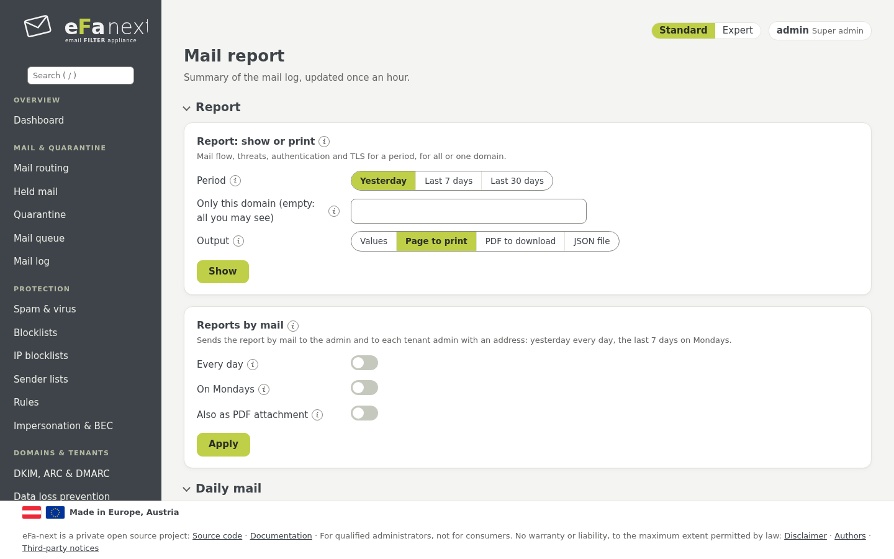
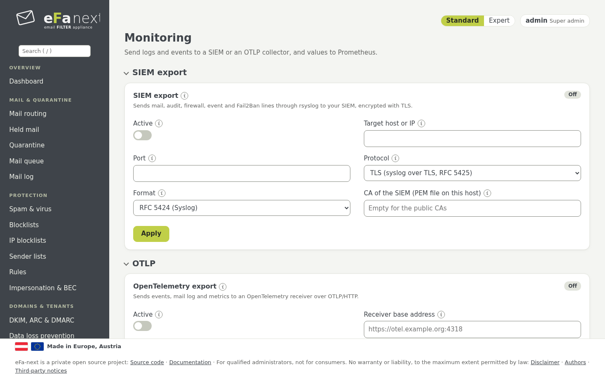
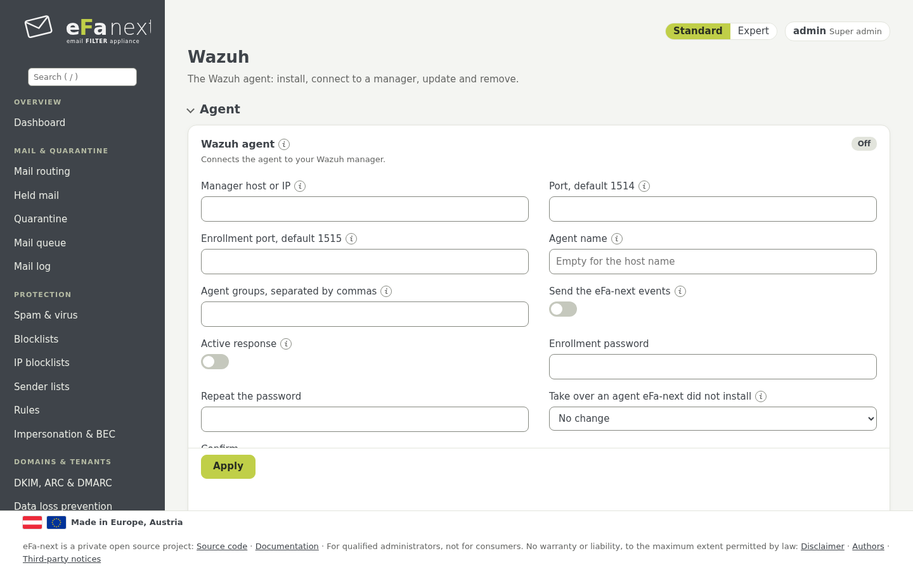

# 11. Berichte und Überwachung

Die Menügruppe *Überwachung & Berichte*.

## Mail-Bericht

*Überwachung & Berichte › Mail-Bericht* zeigt Mailfluss und Bedrohungen von heute, gestern und den letzten 7 Tagen, stündlich
erneuert: Mails ein und aus, Spam, Viren, Abweisungen, die häufigsten Absender und Empfänger, für jeden Leser mit den Domains, die
er sehen darf.



- **Bericht: zeigen oder drucken:** ein Tag, eine Woche oder ein Monat, für alle sichtbaren Domains oder eine; als Seite zum
  Drucken oder als **PDF** zum Herunterladen.
- **Berichte per Mail:** der Tagesbericht und der Wochenbericht (montags) an den Admin; Mandanten-Admins mit Adresse bekommen den
  Bericht ihres Mandanten. Mit *Auch als PDF-Anhang* trägt die Mail den Bericht zusätzlich als PDF.
- **Mail-Verlauf:** ein Monatskalender mit Mails, Spam, Viren und Abweisungen je Tag, dazu der Verlauf über die letzten 30, 90
  oder 365 Tage als kleines Bild vom Server (ohne Skript-Bibliothek). Ein Klick auf einen Tag öffnet die erweiterte Mail-Suche für
  diesen Tag. Mandanten-Admins sehen nur ihre Domains. Die Zahlen vergangener Tage zählt der stündliche Job einmal am Tag in die
  kleine Tabelle `maillog_daily` (Tag, eigene Domain, Zahlen; keine Adressen), heute kommt direkt aus dem Mail-Log; sie folgen der
  Aufbewahrung des Mail-Logs, auch den eigenen Tagen eines Mandanten. Eine Mail zwischen zwei Domains eines Mandanten zählt für beide.

```bash
sudo efactl report-show --period week --format pdf   # das PDF base64-kodiert in der Antwort; die Webseite lädt es herunter
sudo efactl report-set --daily on --weekly on --pdf on
```

Das PDF erzeugt eFa-next selbst (A4, Seitenzahlen), ohne zusätzliche Bibliothek.

## GeoIP: Land und Netz

*Überwachung & Berichte › Mail-Bericht › GeoIP* (Expertenansicht) zeigt Land und Netz (ASN) der Server, die Mail senden, aus
lokalen Dateien von **DB-IP Lite** (Lizenz CC BY 4.0). Es ist **standardmäßig aus**. Eingeschaltet (Bedingungen einmal
bestätigt, nur Super-Admin) lädt dieser Server die Länder- und die Netz-Datei des Monats von download.db-ip.com, prüft Größe,
Format und eine Testabfrage und ersetzt erst dann die alte Datei. Ein Timer schaut einmal am Tag und holt höchstens zwei Dateien
im Monat. Jede Abfrage geschieht auf diesem Server: keine Adresse einer Mail wird irgendwohin geschickt. Aus entfernt die Dateien.

- **Mail-Log und Mail-Details:** Land und Netz unter der IP-Adresse, in der Übersicht einer Mail und für jeden Hop von
  *Weg über die Server*. Private Adressen haben kein Land.
- **Länder der einliefernden Server:** Mails, Spam und Abweisungen je Land über die letzten 7, 30, 90 oder 365 Tage, für die
  Domains, die Sie sehen dürfen.
- Die Quellenangabe *IP geolocation by DB-IP (db-ip.com), CC BY 4.0* steht unter jeder Tabelle mit Ländern.
- **Ohne Internet:** die Dateien kommen mit dem signierten Offline-Bundle (System › Offline-Betrieb) oder von Hand mit
  `geoip-import`. Im Cluster holt jeder Host mit GeoIP ein seine eigenen Dateien.

```bash
sudo efactl geoip-set --mode on --accept_terms yes
sudo efactl geoip-lookup --ip 81.200.1.1
sudo efactl geoip-report --days 30
sudo efactl geoip-import --kind country --file /var/tmp/dbip-country-lite-2026-11.mmdb.gz
```

## Überwachung

*Überwachung & Berichte › Überwachung*:

- **SIEM-Export:** Mail-, Audit-, Firewall-, Ereignis- und Fail2Ban-Zeilen über rsyslog, als RFC 5424 oder JSON, nur über TLS
  (Port 6514, das Zertifikat des SIEM wird nach seinem Namen geprüft).
- **OTLP:** Ereignisse, Mail-Log und Metriken an einen OpenTelemetry-Collector über HTTPS, mit Bearer-Token oder API-Schlüssel,
  Puffer auf der Platte und Wiederholungen.
- **Prometheus:** liest `https://<Host>/metrics` mit einem API-Token. Die REST-API einschalten und das Token unter
  *Benutzer › API-Tokens* anlegen. Auf einem Host mit Swap gibt `efa_swap_used_percent` dessen genutzten Anteil.



## Wazuh

*Überwachung & Berichte › Überwachung › Wazuh-Agent* installiert, verbindet, aktualisiert und entfernt den Wazuh-Agenten. Ein Agent, den jemand anders
installiert hat, wird nur gelesen; `efactl wazuh-config --adopt yes --confirm yes` übernimmt ihn, ohne seine Dateien zu ändern.
Details: [WAZUH.md](../WAZUH.md).



## Benachrichtigungen

Wichtige Ereignisse (eine gescheiterte Sicherung, ein Dienst, der stoppt, ein gescheitertes Update, eine Doppelgänger-Domain, eine
CVE) gehen per Mail an die Admin-Adresse (*Sicherheit › Admin-Zugang*) und erscheinen im Dashboard. Jede Anmeldung wählt unter
*Mein Konto › Meine Einstellungen*, ob sie Berichtsmails bekommt.

Weiter: [Aufbewahrung und Datenschutz](12-retention-privacy.de.md) · Zurück: [Handbuch](README.de.md)
