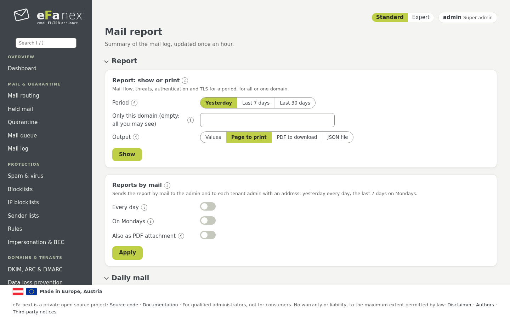
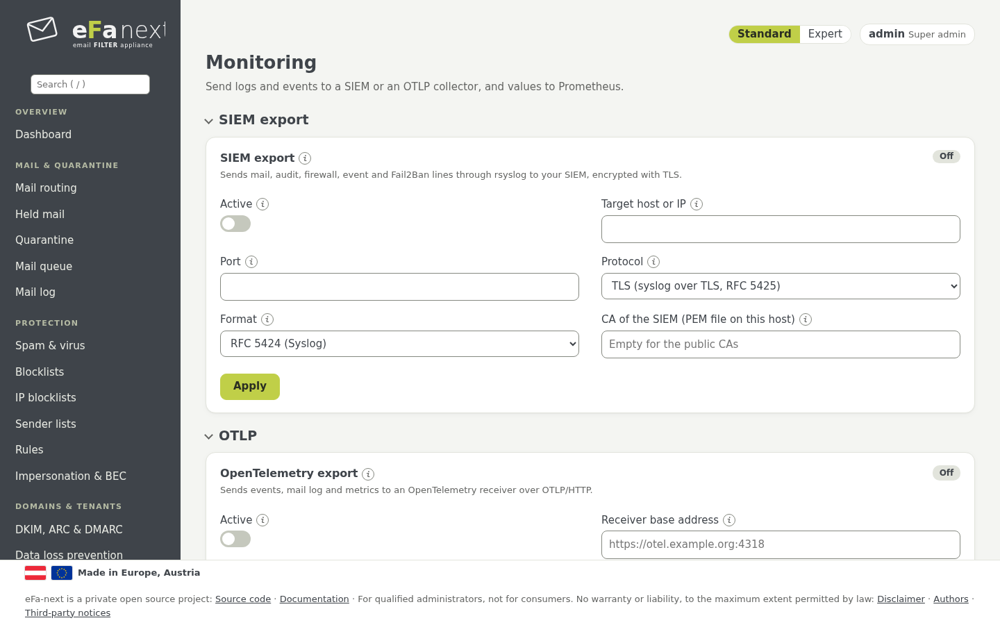
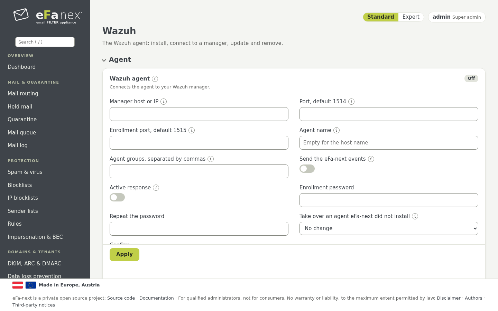

# 11. Reports and monitoring

The menu group *Monitoring & reports*.

## Mail report

*Monitoring & reports › Mail report* shows mail flow and threats of today, yesterday and the last 7 days, updated once an hour:
mails in and out, spam, viruses, rejects, the top senders and recipients, each reader with the domains it may see.



- **Report: show or print:** a day, a week or a month, for all domains you may see or one; as a page to print or as a **PDF**
  to download.
- **Reports by mail:** the daily report and the weekly report (on Mondays) to the admin; tenant admins with an address get the
  report of their tenant. With *Also as PDF attachment* the mail carries the report as PDF too.
- **Daily mail:** a short mail about yesterday.

```bash
sudo efactl report-show --period week --format pdf   # the PDF base64-encoded in the answer; the web page downloads it
sudo efactl report-set --daily on --weekly on --pdf on
```

The PDF is made by eFa-next itself (A4, page numbers), without an extra library.

## Monitoring

*Monitoring & reports › Monitoring*:

- **SIEM export:** mail, audit, firewall, event and Fail2Ban lines through rsyslog, as RFC 5424 or JSON, only over TLS
  (port 6514, the certificate of the SIEM checked by its name).
- **OTLP:** events, mail log and metrics to an OpenTelemetry collector over HTTPS, with a bearer token or an API key, a disk
  buffer and retries.
- **Prometheus:** reads `https://<host>/metrics` with an API token. Switch on the REST API and make the token under
  *Users › API tokens*.



## Wazuh

*Monitoring & reports › Wazuh* installs, connects, updates and removes the Wazuh agent. An agent that someone else installed
is only read; `efactl wazuh-config --adopt yes --confirm yes` takes it over without changing its files. Details:
[WAZUH.md](../WAZUH.md).



## Notifications

Important events (a failed backup, a service that stops, a failed update, a lookalike domain, a CVE) go by mail to the admin
address (*Security › Admin access*) and appear on the dashboard. Each login chooses under *My account › My settings* whether
it gets report mails.

Next: [Retention and privacy](12-retention-privacy.md) · Back: [Manual](README.md)
