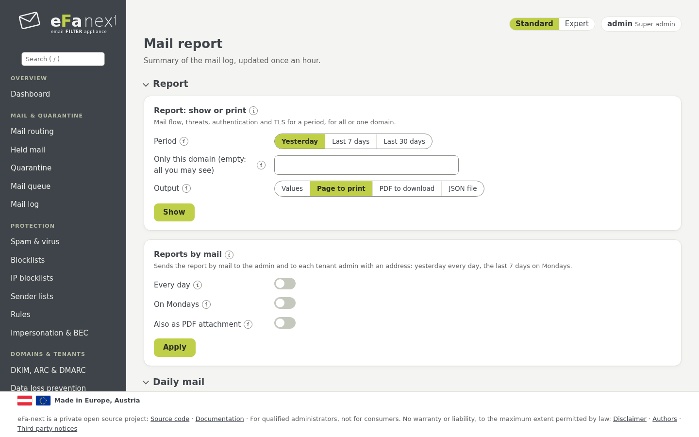
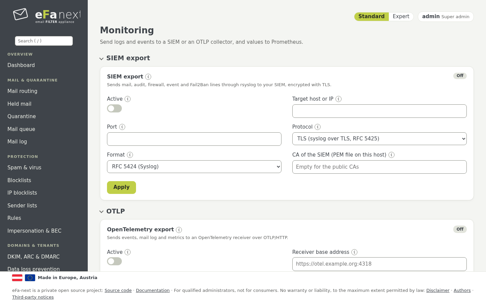
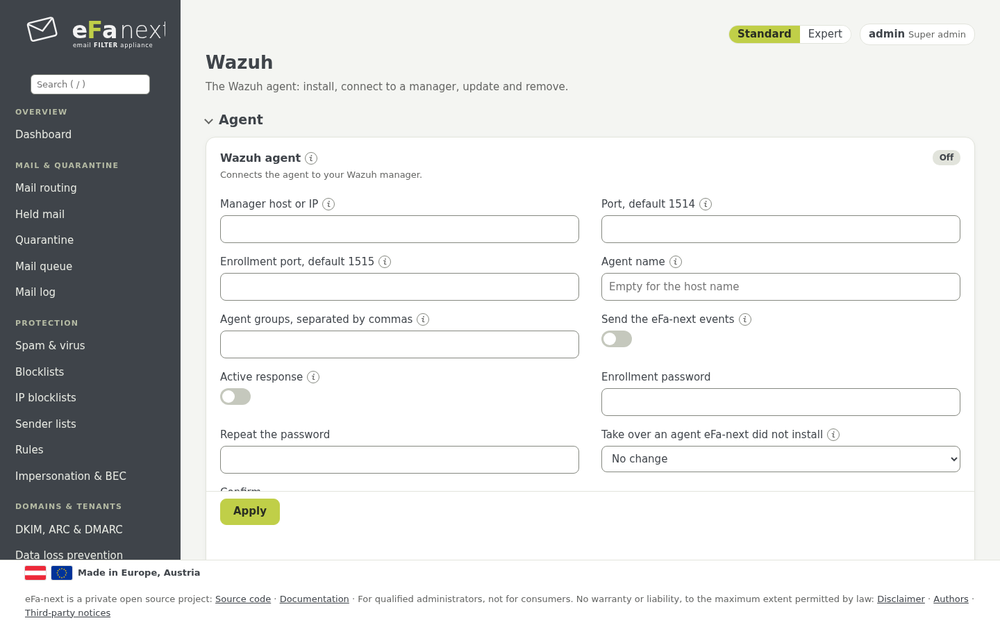

# 11. Reports and monitoring

The menu group *Monitoring & reports*.

## Mail report

*Monitoring & reports › Mail report* shows mail flow and threats of today, yesterday and the last 7 days, updated once an hour:
mails in and out, spam, viruses, rejects, the top senders and recipients, each reader with the domains it may see.



- **Report: show or print:** a day, a week or a month, for all domains you may see or one; as a page to print or as a **PDF**
  to download.
- **Reports by mail:** the daily report and the weekly report (on Mondays) to the admin; tenant admins with an address get the
  report of their tenant. With *Also as PDF attachment* the mail carries the report as PDF too.
- **Daily mail:** a short mail about yesterday.
- **Mail history:** a calendar of one month with the mails, spam, viruses and rejects of each day, and a course over the last
  30, 90 or 365 days as a small picture drawn by the server (no script library). A click on a day opens the advanced mail search
  for that day. Tenant admins see only their domains. The numbers of past days are counted once a day by the hourly job into the
  small table `maillog_daily` (day, own domain, counts; no addresses), today comes live from the mail log; they follow the
  retention of the mail log, also the own days of a tenant. A mail between two domains of one tenant counts for both.

```bash
sudo efactl report-show --period week --format pdf   # the PDF base64-encoded in the answer; the web page downloads it
sudo efactl report-set --daily on --weekly on --pdf on
```

The PDF is made by eFa-next itself (A4, page numbers), without an extra library.

PDF reports show Chinese, Japanese and Korean (package google-droid-sans-fonts, installed by default) and Arabic and Hebrew
right to left (6.0.0.7); only the letters a report uses are embedded.

## GeoIP: country and network

*Monitoring & reports › Mail report › GeoIP* (expert view) shows the country and the network (ASN) of the servers that send
mail, from local files of **DB-IP Lite** (licence CC BY 4.0). It is **off by default**. Switched on (with the terms confirmed
once, super admin only), this server downloads the country file and the network file of the month from download.db-ip.com,
checks the size, the format and a test lookup, and only then replaces the old file. A daily timer looks once a day and fetches at
most two files a month. Every lookup happens on this server: no address of a mail is sent anywhere. Off removes the files.

- **Mail log and mail details:** the country and network under the IP address, in the overview of a mail and for each hop of
  *Path over the servers*. Private addresses have no country.
- **Countries of the delivering servers:** mails, spam and rejects per country over the last 7, 30, 90 or 365 days, for the
  domains you may see.
- The credit *IP geolocation by DB-IP (db-ip.com), CC BY 4.0* stands under every table with countries.
- **Without internet:** the files come with the signed offline bundle (System › Offline operation), or by hand with
  `geoip-import`. In a cluster each host with GeoIP on fetches its own files.

```bash
sudo efactl geoip-set --mode on --accept_terms yes
sudo efactl geoip-lookup --ip 81.200.1.1
sudo efactl geoip-report --days 30
sudo efactl geoip-import --kind country --file /var/tmp/dbip-country-lite-2026-11.mmdb.gz
```

## Monitoring

*Monitoring & reports › Monitoring*:

- **SIEM export:** mail, audit, firewall, event and Fail2Ban lines through rsyslog, as RFC 5424 or JSON, only over TLS
  (port 6514, the certificate of the SIEM checked by its name).
- **OTLP:** events, mail log and metrics to an OpenTelemetry collector over HTTPS, with a bearer token or an API key, a disk
  buffer and retries.
- **Prometheus:** reads `https://<host>/metrics` with an API token. Switch on the REST API and make the token under
  *Users › API tokens*. On a host with swap, `efa_swap_used_percent` gives its share in use.



## Wazuh

*Monitoring & reports › Monitoring › Wazuh agent* installs, connects, updates and removes the Wazuh agent. An agent that someone else installed
is only read; `efactl wazuh-config --adopt yes --confirm yes` takes it over without changing its files. Details:
[WAZUH.md](../WAZUH.md).



## Notifications

Important events (a failed backup, a service that stops, a failed update, a lookalike domain, a CVE) go by mail to the admin
address (*Security › Admin access*) and appear on the dashboard. Each login chooses under *My account › My settings* whether
it gets report mails.

Next: [Retention and privacy](12-retention-privacy.md) · Back: [Manual](README.md)
