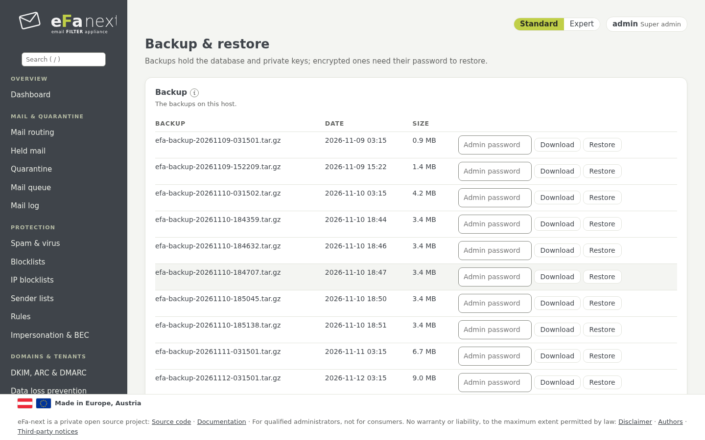

# 13. Sicherung und Wiederherstellung

*System › Sicherung & Wiederherstellung*.



## Was eine Sicherung enthält

Die Datenbank (Mail-Log, Benutzer, Gruppen, Einstellungen), die Einstellungen in `/etc/eFa`, die privaten Schlüssel (DKIM, ARC,
TLS, 2FA, zurückgehaltene Mail), die Einstellungen von Postfix, rspamd, Unbound, fail2ban, ClamAV und SSH, die eFa-next schreibt.
Zurückgehaltene Mail und die Daten von Redis/Valkey werden als Daten aufbewahrt; ein Restore schreibt sie nicht zurück.

Jede Sicherung trägt ein Manifest mit der SHA-256 jeder Datei, signiert mit dem Ed25519-Schlüssel des Hosts. Ein Restore prüft
Signatur und jede Datei, bevor sich etwas ändert ([backup-signature.md](../backup-signature.md)).

## Einrichten

1. **Sicherungspasswort:** *Passwort für automatische Sicherungen* (mindestens 12 Zeichen). Ab dann sind die Sicherungen
   verschlüsselt (AES-256). Bewahren Sie das Passwort außerhalb dieses Hosts auf: Ohne es lässt sich keine Sicherung irgendwo
   wiederherstellen.
2. **Automatische Sicherung:** an oder aus. Updates und das Release-Upgrade machen in jedem Fall zuerst ihre eigene Sicherung.
3. **Jetzt sichern** macht sofort eine; *Herunterladen* fragt erneut nach Ihrem Passwort.
4. **Externe Ziele** (wahlweise): S3 oder SFTP, gedacht für Anbieter in europäischer Hand. Nur verschlüsselte Dateien verlassen den
   Host, nach jeder Sicherung, mit Prüfsumme je Datei und Alarm bei einem Fehler. *Testen* prüft das Ziel
   ([backup-targets.md](../backup-targets.md)).

```bash
sudo efactl backup-password-set --mode set
sudo efactl backup-now
sudo efactl backup-list
sudo efactl backup-target-list
```

## Wiederherstellen

*Wiederherstellen* in einer Zeile der Liste (oder eine Datei auf diesem Server, oder eine hochgeladene Sicherung):

- eine verschlüsselte Sicherung braucht ihr Passwort;
- eine Sicherung eines anderen Hosts (etwa nach einem Umzug auf neue Hardware) braucht den Fingerabdruck des Hosts, der sie
  signiert hat, auf dem alten Host gezeigt von *Sicherungen: Fingerabdruck des Signaturschlüssels* (`efactl backup-key-show`);
- eine Sicherung ohne Signatur (6.0.0.4 oder älter, oder aus `efa5-export`) wird nur mit einem getippten yes wiederhergestellt,
  vermerkt im Audit-Log.

```bash
sudo efactl restore --name <Datei> --confirm yes
```

Ein abgebrochener Restore (Stromausfall) wird erkannt und blockiert spätere Updates nicht. Eine Sicherung mit den Einstellungen
von Postfix und nginx stellt nur der Haupt-Admin (oder root auf der Konsole) wieder her.

## Eine VM klonen

Eine Kopie einer virtuellen Maschine behält die Geheimnisse ihres Originals (SSH-Hostschlüssel, Machine-ID, Sitzungs- und
Signaturschlüssel). Auf der Konsole der Kopie als root ausführen, bevor sie Mail annimmt:

```bash
sudo efactl clone-reset --confirm yes --hostname mx2.example.com
```

Auf einem Cluster-Mitglied lehnt es ab. Was es erneuert und was es behält: [system.md](../system.md#cloning-a-host).

Weiter: [Updates und Release-Upgrade](14-updates.de.md) · Zurück: [Handbuch](README.de.md)
