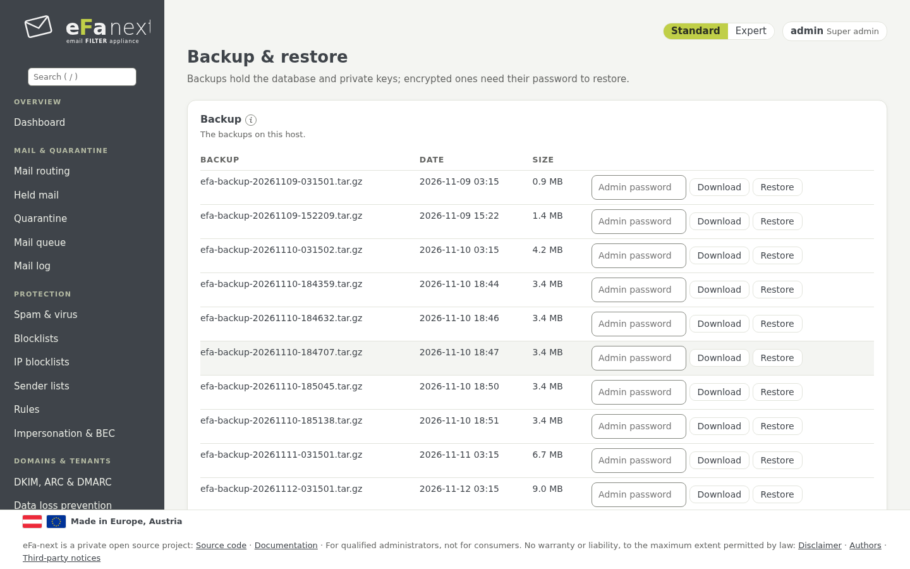

# 13. Backup and restore

*System › Backup & restore*.



## What a backup holds

The database (mail log, users, groups, settings), the settings in `/etc/eFa`, the private keys (DKIM, ARC, TLS, 2FA, held
mail), the Postfix, rspamd, Unbound, fail2ban, ClamAV and SSH settings eFa-next writes. Held mail and the Redis/Valkey data
are kept as data; a restore does not write them back.

Every backup carries a manifest with the SHA-256 of each file, signed with the Ed25519 key of the host. A restore checks the
signature and every file before anything changes ([backup-signature.md](../backup-signature.md)).

## Set it up

1. **Backup password:** *Password for automatic backups* (at least 12 characters). From then on the backups are encrypted
   (AES-256). Keep the password outside this host: without it no backup can be restored anywhere.
2. **Automatic backup:** on or off. Updates and the release upgrade make their own backup first in any case.
3. **Back up now** makes one at once; *Download* asks for your password again.
4. **External targets** (optional): S3 or SFTP, meant for providers in European hands. Only encrypted files leave the host,
   after each backup, with a checksum per file and an alarm on a failure. *Test* checks the target
   ([backup-targets.md](../backup-targets.md)).

```bash
sudo efactl backup-password-set --mode set
sudo efactl backup-now
sudo efactl backup-list
sudo efactl backup-target-list
```

## Restore

*Restore* on a row of the list (or a file on this server, or an uploaded backup):

- an encrypted backup needs its password;
- a backup of another host (for example after moving to new hardware) needs the fingerprint of the host that signed it,
  shown on the old host by *Backups: fingerprint of the signing key* (`efactl backup-key-show`);
- a backup without signature (6.0.0.4 or older, or from `efa5-export`) is restored only with a typed yes, noted in the audit
  log.

```bash
sudo efactl restore --name <file> --confirm yes
```

A restore that was cut off (power cut) is detected and does not block later updates. A backup that holds the settings of
Postfix and nginx is restored only by the main admin (or root on the console).

## Cloning a VM

A copy of a virtual machine keeps the secrets of its origin (SSH host keys, machine id, session and signing keys). Run on the
console of the copy, as root, before it takes mail:

```bash
sudo efactl clone-reset --confirm yes --hostname mx2.example.com
```

It refuses on a member of a cluster. What it renews and what it keeps: [system.md](../system.md#cloning-a-host).

Next: [Updates and release upgrade](14-updates.md) · Back: [Manual](README.md)
