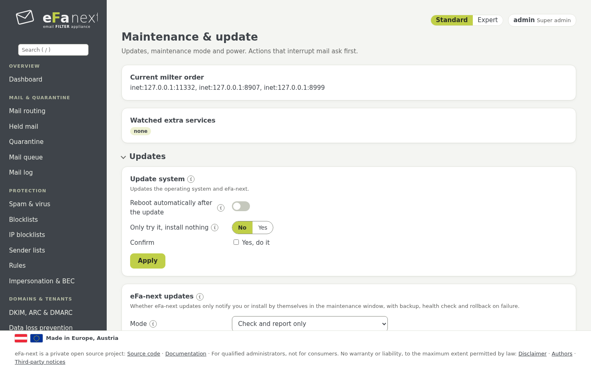

# 14. Updates und Release-Upgrade

*System › Wartung & Update*.



## eFa-next-Updates

eFa-next kommt aus seiner eigenen signierten Paketquelle (`https://repo.efa-next.eu`, GitHub-Releases als Spiegel). Ein Release
wird nur genommen, wenn seine Prüfsummen eine gültige Signatur des eFa-next-Schlüssels tragen (Fingerabdruck in Kapitel 2). Die
Paketquelle ist für normale Systemupdates aus (`enabled=0`): `dnf upgrade` allein ändert eFa-next nie.

- **Automatische eFa-next-Updates:** *aus*, *melden* (Standard) oder *automatisch*, mit Wartungstagen und -uhrzeit.
  *Automatisch* installiert im Fenster, mit Sicherung davor und Gesundheitsprüfung danach.
- **Jetzt nach einem eFa-next-Update suchen** und **Das eFa-next-Update jetzt installieren** tun dasselbe sofort.
- Ein Sicherheitsrelease ist im Dashboard als solches markiert; die Sicherheits-Selbstprüfung meldet ein fehlendes nach 7 Tagen.

```bash
sudo efactl update-check
sudo efactl update-install --confirm yes
sudo efactl autoupdate-set --mode auto --days "sat sun" --time 03:00
```

Von Hand aus der Paketquelle (zuerst die Paketquellen-Datei, siehe
[install.md](../install.md#installation-and-updates-from-the-signed-repository)):

```bash
sudo dnf --enablerepo=efa-next upgrade eFa-next eFa-next-base
```

Ein Update ändert nie Ihre Einstellungen; neue Funktionen eines Releases sind aus, bis Sie sie einschalten. Nach dem Update listet
das Dashboard die Hinweise des Releases unter *Braucht Aufmerksamkeit*.

## Zurück zur Version davor

*Updates › Update: zurück zur Version davor* kehrt zur eFa-next-Version zurück, die vor dem letzten Update installiert war: zuerst
die geprüften Pakete dieser Version, dann die Sicherung, die das Update direkt davor gemacht hat.

- *Nur zeigen, was geschähe* nennt die Versionen und die Sicherung und ändert nichts.
- Mit *Sicherung wiederherstellen* aus bleiben die seit dem Update geänderten Einstellungen; an (Standard) gehen sie mit der
  Sicherung verloren.
- Es braucht eine getippte Bestätigung und geht nur, solange die installierte Version noch die ist, die dieses Update installiert
  hat, und ihre Pakete noch da sind. Währenddessen ist der Wartungsmodus an; der Admin bekommt eine Mail, wenn es fertig ist.

```bash
sudo efactl update-rollback --dry_run yes
sudo efactl update-rollback --confirm yes
```

Updates des Betriebssystems lassen sich so nicht zurücknehmen: Vor großen Updates einen VM-Snapshot machen.

## Systemupdates

- **Ausstehende Updates** listet die Updates des Betriebssystems und der Fremdpakete.
- **System aktualisieren** macht zuerst eine Sicherung und einen Export der Konfiguration, dann aktualisiert es Betriebssystem und
  eFa-next, wahlweise mit Neustart. Es läuft nur von Minute 20 bis 50 einer Stunde und lässt Pakete aus, deren Skripte firewalld
  neu laden oder neu starten (es nennt sie).
- Nach jeder Änderung der installierten Pakete läuft eine Prüfung: die Konfigurationstests von Postfix, nginx, rspamd, Unbound und
  fail2ban, die Maildienste und `.rpmnew`/`.rpmsave`-Dateien. Ein Fehler ist rot im Dashboard und geht per Mail an den Admin
  (*Prüfung nach Paketupdates: jetzt ausführen*).

## Wartung

- **Wartungsmodus:** verhindert, dass die Dienstüberwachung Dienste neu startet, während Sie arbeiten.
- **Lastwarnung:** ab welcher CPU-Last und nach wie vielen Minuten der Admin gewarnt wird.
- **Neustart** und **Herunterfahren** fragen nach einer Bestätigung.
- *Erweitert* (Experte): Milter-Reihenfolge, zusätzliche Dienste, *Datenbanken reparieren*.

## Release-Upgrade von AlmaLinux 9 auf 10

*Release-Upgrade* (nur Super-Admins, mit roter Warnung darüber) hebt das Betriebssystem eines laufenden Hosts von AlmaLinux 9 auf
AlmaLinux 10, mit ELevate (leapp), in festen Schritten:

1. **preflight** prüft und ändert nichts: EL9 und eFa-next 6.0.0.6 oder neuer, die EL10-Paketquelle von eFa-next, eine CPU mit
   x86-64-v3, freien Platz, keine ausstehenden Updates, Netz als NetworkManager-Keyfiles, die Uhr; es warnt bei Mail in der
   Warteschlange, der Cluster-Rolle, Netzwerktreibern, die EL10 nicht mehr pflegt, und alten Postfix-Tabellentypen.
2. **preupgrade** installiert ELevate mit Vendor-Dateien für die Paketquellen von eFa-next und rspamd und führt `leapp preupgrade`
   aus; jeder Inhibitor stoppt hier.
3. **start** fragt nach Passwort und 2FA-Code, einem bestätigten VM-Snapshot und dem getippten Hostnamen. Es macht eine
   verschlüsselte Sicherung, die jedes externe Ziel mit derselben Prüfsumme erreichen muss, gibt neuer Mail `421` (Absender
   versuchen es erneut) und führt `leapp upgrade` mit den Neustarts aus.
4. **abort** stoppt einen Schritt und hebt den Wartungsmodus auf, aber nur bevor `leapp upgrade` begonnen hat.

Nach dem ersten Start in EL10 schließt eFa-next das Upgrade ab (Datenbank, Postfix-Tabellen, SELinux) und prüft das ganze System:
Dienste, Adressen, Firewall, DKIM-Schlüssel, Zählungen, eine Testmail und dass jede Einstellung wie vorher ist. Mail wird erst
wieder angenommen, wenn jede Prüfung besteht.

**Ein Release-Upgrade lässt sich nicht zurücknehmen.** Der einzige Weg zurück ist der VM-Snapshot. Etwa 30 bis 60 Minuten wird
keine Mail angenommen. Solange eFa-next keine Pakete für EL10 veröffentlicht, scheitert preflight an der Prüfung der Paketquelle und
das Upgrade kann nicht starten: Das ist erwartet. Alle Details: [release-upgrade.md](../release-upgrade.md).

```bash
sudo efactl release-upgrade --action=preflight
sudo efactl release-upgrade-status
```

Weiter: [Cluster und Betrieb ohne Internet](15-cluster.de.md) · Zurück: [Handbuch](README.de.md)
