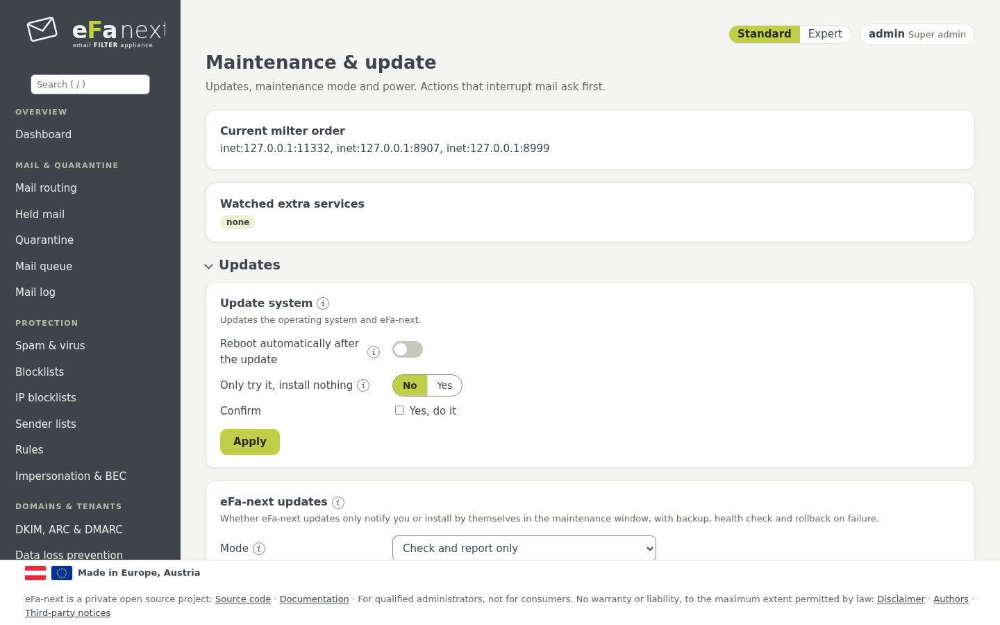

# 14. Updates und Release-Upgrade

*System › Wartung & Update*.



## Die Karte Update

Die erste Karte der Seite enthält alles, was ein Update braucht:

- **Installiert → Verfügbar**: die Version jetzt und das neueste Release, mit einem Hinweis (*Sicherheits-Update*,
  *Update verfügbar*, *Aktuell*).
- Fünf Angaben: das eFa-next-Release, die Zahl der Betriebssystem-Updates der letzten Prüfung (*Anzeigen* listet sie), ob ein
  Neustart fällig ist, die letzte Prüfung (*Jetzt prüfen*) und die Art der automatischen Updates (*Anpassen*).
- Ein Knopf, **Jetzt aktualisieren**: eFa-next und die Pakete des Betriebssystems in einem Schritt, wie *System aktualisieren*.
- Während es läuft: ein **Fortschrittsbalken** mit Prozent, *Schritt 4 von 5: Betriebssystem (27 von 46 Paketen)*, der
  Restzeit, den Schritten (Sicherung, Pakete prüfen, eFa-next, Betriebssystem, Gesundheitscheck, Neustart) und der letzten Zeile
  von dnf. Die Karte erneuert sich alle 3 Sekunden, solange die Seite sichtbar ist; die ganze Seite wird nicht neu geladen.
  Startet die Weboberfläche während des Updates neu, sagt die Karte das und versucht es wieder. Außerhalb von Minute 20 bis 50
  zeigt sie *Startet um 10:20*.
- Danach: das Ergebnis mit Uhrzeit und Dauer, und *Zurück zur Version davor*, wenn das möglich ist.

Die Restzeit kommt aus den Schritten des letzten Updates auf diesem Server (beim ersten Mal feste Schätzwerte); der Schritt
Betriebssystem zählt die Pakete, die dnf fertig hat. Dieselbe Karte zeigt auch die Installation eines eFa-next-Releases allein
(*eFa-next-Update jetzt installieren*, oder *auto* im Wartungsfenster). Die übrigen Update-Karten sind darunter eingeklappt
(*Automatische Updates*, *Zurück zur Version davor, Prüfung nach Paket-Updates*); *Update im Einzelnen* in der Expertenansicht
behält die einzelnen Schritte.

```bash
sudo efactl update-progress     # was die Karte zeigt: Versionen, offene Updates, Schritt, Prozent, Restzeit
```

## eFa-next-Updates

eFa-next kommt aus seiner eigenen signierten Paketquelle (`https://repo.efa-next.eu`, GitHub-Releases als Spiegel). Ein Release
wird nur genommen, wenn seine Prüfsummen eine gültige Signatur des eFa-next-Schlüssels tragen (Fingerabdruck in Kapitel 2). Die
Paketquelle ist für normale Systemupdates aus (`enabled=0`): `dnf upgrade` allein ändert eFa-next nie.

- **Automatische eFa-next-Updates:** *aus*, *melden* (Standard) oder *automatisch*, mit Wartungstagen und -uhrzeit.
  *Automatisch* installiert im Fenster, mit Sicherung davor und Gesundheitsprüfung danach.
- **Updates des Betriebssystems:** *aus*, *nur Sicherheitsupdates* oder *alle Updates*. Auf einem Host allein installiert
  dnf-automatic sie wie eingestellt. Der erste Start von 6.0.0.6.7 übernimmt, was da war: *Sicherheit*, wenn dnf-automatic an
  war, sonst *aus*. Im Cluster siehe [Updates im Cluster](#updates-im-cluster).
- **Jetzt nach einem eFa-next-Update suchen** und **Das eFa-next-Update jetzt installieren** tun dasselbe sofort.
- Ein Sicherheitsrelease ist im Dashboard als solches markiert; die Sicherheits-Selbstprüfung meldet ein fehlendes nach 7 Tagen.

```bash
sudo efactl update-check
sudo efactl update-install --confirm yes
sudo efactl autoupdate-set --mode auto --days "sat sun" --time 03:00 --os security
```

Von Hand aus der Paketquelle (zuerst die Paketquellen-Datei, siehe
[install.md](../install.md#installation-and-updates-from-the-signed-repository)):

```bash
sudo dnf --enablerepo=efa-next upgrade eFa-next eFa-next-base
```

Ein Update ändert nie Ihre Einstellungen; neue Funktionen eines Releases sind aus, bis Sie sie einschalten. Nach dem Update listet
das Dashboard die Hinweise des Releases unter *Braucht Aufmerksamkeit*.

## Zurück zur Version davor

*Updates › Update: zurück zur Version davor* kehrt zur eFa-next-Version zurück, die vor dem letzten Update installiert war: zuerst
die geprüften Pakete dieser Version, dann die Sicherung, die das Update direkt davor gemacht hat.

- *Nur zeigen, was geschähe* nennt die Versionen und die Sicherung und ändert nichts.
- Mit *Sicherung wiederherstellen* aus bleiben die seit dem Update geänderten Einstellungen; an (Standard) gehen sie mit der
  Sicherung verloren.
- Es braucht eine getippte Bestätigung und geht nur, solange die installierte Version noch die ist, die dieses Update installiert
  hat, und ihre Pakete noch da sind. Währenddessen ist der Wartungsmodus an; der Admin bekommt eine Mail, wenn es fertig ist.

```bash
sudo efactl update-rollback --dry_run yes
sudo efactl update-rollback --confirm yes
```

Updates des Betriebssystems lassen sich so nicht zurücknehmen: Vor großen Updates einen VM-Snapshot machen.

## Systemupdates

- **Ausstehende Updates** listet die Updates des Betriebssystems und der Fremdpakete.
- **System aktualisieren** macht zuerst eine Sicherung und einen Export der Konfiguration, dann aktualisiert es Betriebssystem und
  eFa-next, wahlweise mit Neustart. Es läuft nur von Minute 20 bis 50 einer Stunde und lässt Pakete aus, deren Skripte firewalld
  neu laden oder neu starten (es nennt sie).
- Nach jeder Änderung der installierten Pakete läuft eine Prüfung: die Konfigurationstests von Postfix, nginx, rspamd, Unbound und
  fail2ban, die Maildienste und `.rpmnew`/`.rpmsave`-Dateien. Ein Fehler ist rot im Dashboard und geht per Mail an den Admin
  (*Prüfung nach Paketupdates: jetzt ausführen*).
- Vor dieser Prüfung starten die Dienste von eFa-next neu, die noch eine vom Update ersetzte Datei verwenden: zuerst der
  Unterbau (MariaDB, Redis/Valkey, Unbound, ClamAV, rspamd, Fail2Ban, Postfix, Dovecot), dann die Dienste von eFa-next, auch nach
  einem Update der Python-Module, die sie laden. Nie auf diesem Weg neu gestartet: firewalld (es verlöre seine Laufzeitregeln)
  und nginx (Neustart nach `nginx -t`). Die neu gestarteten Dienste stehen im Audit-Log und im Ergebnis der Prüfung.

### Der Unterbau mit dnf

Der Unterbau (ClamAV, Redis/Valkey, nginx, rspamd, Python und seine Module, Fail2Ban, MariaDB, Postfix und das übrige
Betriebssystem) wartet nicht auf ein eFa-next-Release: Minor- und Patch-Updates kommen mit einem einfachen `dnf upgrade`, mit
*System aktualisieren* oder mit den automatischen Betriebssystem-Updates (*nur Sicherheitsupdates* oder *alle Updates*). Die
Pakete von eFa-next verlangen diese Pakete nur mit einer Mindestversion, nie mit einer Obergrenze.

Eine neue **Major**-Version (ClamAV 2, rspamd 5, Flask, Werkzeug oder Waitress 4, pymilter 2, Fail2Ban 2) kommt nur mit einem
eFa-next-Release, das damit getestet ist: Das Setup trägt diese Major-Versionen in die `exclude`-Zeile von `/etc/dnf/dnf.conf`
und des rspamd-Repositorys ein. Diese Zeilen nicht entfernen. Das eFa-next-Release, das eine neue Major-Version unterstützt,
entfernt sie selbst.

```bash
sudo dnf upgrade                   # der Unterbau, innerhalb seiner Major-Versionen
sudo efactl os-check-run           # die Prüfung nach Paketupdates sofort (sie läuft auch von selbst)
```

## Updates im Cluster

Im Cluster gelten die Update-Einstellungen des Masters (`/etc/eFa/update-policy.json`, an jeden Knoten weitergegeben). Auf einem
Knoten sind sie nur lesbar (*Verwaltet von* dem Master); `autoupdate-set`, *System aktualisieren* und *Installieren* werden dort
abgelehnt. dnf-automatic ist auf jedem Mitglied aus. Jede Installation, eFa-next und Betriebssystem, läuft über die gestaffelte
Verteilung des Masters: Ein Knoten installiert (mit Neustart im selben Schritt, wenn die Pakete einen brauchen), der Master
wartet sein Gesundheitsfenster ab dem Ende dieses Schritts, dann folgt der nächste Knoten, der Master zuletzt. Ein Knoten, der
scheitert oder nicht zurückkommt, stoppt die Verteilung und löst einen Alarm aus. Mit *Betriebssystem aus* installiert die
Verteilung nur eFa-next-Releases (im Modus *automatisch*), nie Pakete.

- Ein Knoten hält während seines Schritts eine Sperre von 6 Stunden; ein zweiter Schritt wartet darauf, die Sperre eines toten
  Knotens läuft ab.
- Ohne seinen Master für 48 Stunden plus 6 Stunden je Platz in der Liste der Knoten (der erste nach 48 h, der zweite nach 54 h
  ...) installiert ein Knoten die Sicherheitsupdates des Betriebssystems allein, einmal am Tag, nie ein eFa-next-Release, und
  nicht, solange ein anderer Knoten ein Update meldet. Jedes Mal ein Alarm und eine Mail. Ist der Master zurück, installiert nur
  seine Verteilung.
- Beim Beitritt ersetzt die Richtlinie des Masters die des Knotens; die Vorschau des Beitritts zeigt es (*Updates*).

## Update-Hooks

`/etc/eFa/update-hooks.d/` führt eigene Programme rund um ein Systemupdate aus (und damit rund um jeden Schritt der Verteilung):

| Pfad | Wann | Ein Fehler |
|---|---|---|
| `pre.d/*` | vor der Sicherung | stoppt das Update (ein Veto) |
| `post.d/*` | nach den Paketen, vor einem Neustart | wird gemeldet, das Update bleibt |
| `wrapper` | führt die dnf-Transaktion aus; bekommt die ganze dnf-Befehlszeile als Argumente | das Update scheitert |

Jeder Hook bekommt seine Phase (`pre`, `post`) als Argument und `EFA_UPDATE_JOB`, `EFA_UPDATE_OS`, `EFA_UPDATE_DRY_RUN`; er hat
10 Minuten. Ein Hook läuft nur, wenn der Ordner und jeder Ordner darüber root gehören und für Gruppe und andere nicht schreibbar
sind, und er eine normale Datei ist (kein Symlink), root:root gehört, ausführbar ist und für Gruppe und andere nicht schreibbar.
Einer, der die Prüfung nicht besteht, wird mit Alarm ausgelassen; ein Wrapper, der sie nicht besteht, lehnt das ganze Update mit
Alarm ab, nie ersatzweise reines dnf. Hooks gehören jedem Host: Im Cluster werden sie nicht weitergegeben.

Jede dnf-Transaktion, die eFa-next startet, läuft darin: das Systemupdate, die Installation eines eFa-next-Releases (auch die
automatische) und der Weg zurück, jeder Schritt der Verteilung und die Ausweichinstallation, die Pakete einer Funktion, Wazuh,
das Offline-Paket und das Werkzeug des Release-Upgrades; die Pre- und Post-Hooks laufen einmal darum herum. Nicht über den
Wrapper: die eigene Transaktion von leapp beim Release-Upgrade auf AlmaLinux 10 läuft nach dem Neustart in dessen
Upgrade-Umgebung. Die Pre-Hooks des Release-Upgrades laufen davor und können es stoppen; prüfen Sie die Pakete Ihres Wrappers nach
diesem Upgrade.

```bash
sudo install -d -m 0755 /etc/eFa/update-hooks.d/pre.d
sudo install -m 0755 mein-wrapper /etc/eFa/update-hooks.d/wrapper   # z. B. exec /usr/local/sbin/mein-safe-update "$@"
```

## Wartung

- **Wartungsmodus:** verhindert, dass die Dienstüberwachung Dienste neu startet, während Sie arbeiten.
- **Lastwarnung:** ab welcher CPU-Last und nach wie vielen Minuten der Admin gewarnt wird.
- **Neustart** und **Herunterfahren** fragen nach einer Bestätigung.
- *Erweitert* (Experte): Milter-Reihenfolge, zusätzliche Dienste, *Datenbanken reparieren*.

## Release-Upgrade von AlmaLinux 9 auf 10

eFa-next auf EL9 (AlmaLinux, Rocky Linux und RHEL 9) hat Unterstützung und Sicherheitsupdates bis 31.05.2027. Ab 01.12.2026
warnt das Dashboard eines EL9-Hosts (gelb: Release-Upgrade planen), ab 01.06.2027 ist es rot: keine Updates mehr, nur noch der
Wechsel auf Version 10 mit dem Release-Upgrade oder einer Migration, die beide offen bleiben. AlmaLinux 9 selbst erhält
Sicherheitsupdates bis 31.05.2032; das ist das Datum des Betriebssystems, nicht von eFa-next.

*Release-Upgrade* (nur Super-Admins, mit roter Warnung darüber) hebt das Betriebssystem eines laufenden Hosts von AlmaLinux 9 auf
AlmaLinux 10, mit ELevate (leapp), in festen Schritten:

1. **preflight** prüft und ändert nichts: EL9 und eFa-next 6.0.0.6 oder neuer, die EL10-Paketquelle von eFa-next, eine CPU mit
   x86-64-v3, freien Platz, keine ausstehenden Updates, Netz als NetworkManager-Keyfiles, die Uhr; es warnt bei Mail in der
   Warteschlange, der Cluster-Rolle, Netzwerktreibern, die EL10 nicht mehr pflegt, und alten Postfix-Tabellentypen.
2. **preupgrade** installiert ELevate mit Vendor-Dateien für die Paketquellen von eFa-next und rspamd und führt `leapp preupgrade`
   aus; jeder Inhibitor stoppt hier.
3. **start** fragt nach Passwort und 2FA-Code, einem bestätigten VM-Snapshot und dem getippten Hostnamen. Es macht eine
   verschlüsselte Sicherung, die jedes externe Ziel mit derselben Prüfsumme erreichen muss, gibt neuer Mail `421` (Absender
   versuchen es erneut) und führt `leapp upgrade` mit den Neustarts aus. Nur für Super-Admins: Mit dem Satz
   `ohne Backup, nur Snapshot` (oder `without backup, snapshot only`) im letzten Feld lässt der Start die Sicherung weg; das
   Audit-Log hält es fest, und der Rückweg ist dann nur der VM-Snapshot.
4. **abort** stoppt einen Schritt und hebt den Wartungsmodus auf, aber nur bevor `leapp upgrade` begonnen hat.

In der Weboberfläche (*Wartung & Update › Release-Upgrade*) führt eine Karte durch diese Schritte: *Upgrade vorbereiten und
prüfen* führt Vorprüfung und Preupgrade in einem Zug aus; danach sagt die Karte *Das Upgrade ist möglich* oder nennt die Gründe,
warum nicht; der Start fragt nach VM-Snapshot, Hostname, Passwort und 2FA-Code (wahlweise nach dem Satz für einen Start ohne
Sicherung); dann zeigt ein Balken Sicherung, Upgrade, Neustarts und Prüfungen und wartet während der Neustarts auf den Host. Die
einzelnen Schritte bleiben in der Expertenansicht.

Nach dem ersten Start in EL10 schließt eFa-next das Upgrade ab (Datenbank, Postfix-Tabellen, SELinux) und prüft das ganze System:
Dienste, Adressen, Firewall, DKIM-Schlüssel, Zählungen, eine Testmail und dass jede Einstellung wie vorher ist. Mail wird erst
wieder angenommen, wenn jede Prüfung besteht.

**Ein Release-Upgrade lässt sich nicht zurücknehmen.** Der einzige Weg zurück ist der VM-Snapshot. Etwa 30 bis 60 Minuten wird
keine Mail angenommen. Solange eFa-next keine Pakete für EL10 veröffentlicht, scheitert preflight an der Prüfung der Paketquelle und
das Upgrade kann nicht starten: Das ist erwartet. Alle Details: [release-upgrade.md](../release-upgrade.md).

```bash
sudo efactl release-upgrade --action=preflight
sudo efactl release-upgrade-status
```

Weiter: [Cluster und Betrieb ohne Internet](15-cluster.de.md) · Zurück: [Handbuch](README.de.md)
