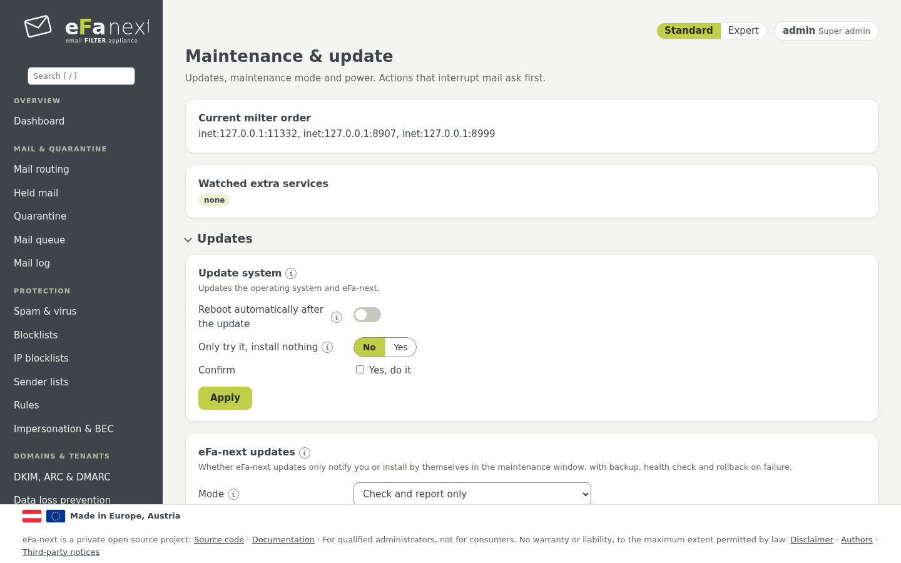

# 14. Updates and release upgrade

*System › Maintenance & update*.



## The Update card

The first card of the page holds everything an update needs:

- **Installed → Available**: the version now and the newest release, with a badge (*Security update*, *Update available*,
  *Up to date*).
- Five facts: the eFa-next release, the number of operating system updates found by the last check (*Show* lists them), whether
  a restart is due, the last check (*Check now*) and the mode of the automatic updates (*Adjust*).
- One button, **Update now**: eFa-next and the operating system packages in one go, as *Update system* below.
- While it runs: a **progress bar** with the percentage, *Step 4 of 5: Operating system (27 of 46 packages)*, the time left,
  the steps (backup, check packages, eFa-next, operating system, health check, reboot) and the last line of dnf. The card
  renews itself every 3 seconds while the page is in view; the whole page is not reloaded. When the web interface restarts
  during the update the card says so and tries again. Outside minute 20 to 50 it shows *Starts at 10:20*.
- Afterwards: the result with its time and duration, and *Back to the version before* when that is possible.

The time left comes from the steps of the last update on this host (the first time: fixed estimates); the operating system step
counts the packages dnf has done. The same card shows the install of an eFa-next release alone (*Install the eFa-next update
now*, or *auto* in the maintenance window). The other update cards are folded below it (*Automatic updates*, *Back to the
version before, checks after package updates*); *Update details* in the expert view keeps the single steps.

```bash
sudo efactl update-progress     # what the card shows: versions, pending, step, percentage, time left
```

## eFa-next updates

eFa-next comes from its own signed repository (`https://repo.efa-next.eu`, GitHub releases as a mirror). A release is taken only
when its checksums carry a valid signature of the eFa-next key (fingerprint in chapter 2). The repository is off for normal
system updates (`enabled=0`), so `dnf upgrade` alone never changes eFa-next.

- **Automatic eFa-next updates:** *off*, *notify* (default) or *auto*, with maintenance days and time. *auto* installs in the
  window, with a backup first and a health check after it.
- **Operating system updates:** *off*, *security updates only* or *all updates*. On a host alone dnf-automatic installs them
  as set. The first start of 6.0.0.6.7 takes what was there: *security* when dnf-automatic was on, else *off*. In a cluster
  see [Updates in a cluster](#updates-in-a-cluster).
- **Check for an eFa-next update now** and **Install the eFa-next update now** do the same at once.
- A security release is marked as such on the dashboard; the security self check reports a missing one after 7 days.

```bash
sudo efactl update-check
sudo efactl update-install --confirm yes
sudo efactl autoupdate-set --mode auto --days "sat sun" --time 03:00 --os security
```

By hand from the repository (the repository file first, see [install.md](../install.md#installation-and-updates-from-the-signed-repository)):

```bash
sudo dnf --enablerepo=efa-next upgrade eFa-next eFa-next-base
```

An update never changes your settings; new features of a release are off until you switch them on. After the update the
dashboard lists the notes of the release under *Needs attention*.

## Back to the version before (rollback)

*Updates › Update: back to the version before* returns to the eFa-next version that was installed before the last update:
first the verified packages of that version, then the backup the update made right before it.

- *Only show what would happen* lists the versions and the backup, and changes nothing.
- With *Restore the backup* off, the settings changed since the update are kept; on (default) they are lost with the backup.
- It needs a typed confirmation and works only while the installed version is still the one that update installed and its
  packages are still there. Maintenance mode is on while it runs; the admin gets a mail when it is done.

```bash
sudo efactl update-rollback --dry_run yes
sudo efactl update-rollback --confirm yes
```

Updates of the operating system cannot be rolled back this way: take a VM snapshot before big ones.

## System updates

- **Pending updates** lists the updates of the operating system and third-party packages.
- **Update system** makes a backup and an export of the configuration first, then updates the operating system and eFa-next,
  optionally with a reboot. It runs only from minute 20 to 50 of an hour and leaves out packages whose scripts reload or
  restart firewalld (it names them).
- After every change of the installed packages a check runs: the configuration tests of Postfix, nginx, rspamd, Unbound and
  fail2ban, the mail services, and `.rpmnew`/`.rpmsave` files. A failure is red on the dashboard and mailed to the admin
  (*Check after package updates: run now*).
- Before that check, the services of eFa-next that still run a file the update replaced restart by themselves: the base first
  (MariaDB, Redis/Valkey, Unbound, ClamAV, rspamd, Fail2Ban, Postfix, Dovecot), then those of eFa-next, also after an update
  of the Python modules they load. Never restarted this way: firewalld (it would drop its runtime rules) and nginx (restarted
  after `nginx -t`). The restarted services are in the audit log and in the result of the check.

### The base system with dnf

The base system (ClamAV, Redis/Valkey, nginx, rspamd, Python and its modules, Fail2Ban, MariaDB, Postfix and the rest of the
operating system) does not wait for an eFa-next release: minor and patch updates come with a plain `dnf upgrade`, with
*Update system* or with the automatic operating system updates (*security updates only* or *all updates*). The packages of
eFa-next require these only with a minimum version, never an upper bound.

A new **major** version (ClamAV 2, rspamd 5, Flask, Werkzeug or Waitress 4, pymilter 2, Fail2Ban 2) comes only with an eFa-next
release that was tested with it: the setup puts these major versions on the `exclude` line of `/etc/dnf/dnf.conf` and of the
rspamd repository. Do not remove these lines. The release of eFa-next that supports a new major version removes them itself.

```bash
sudo dnf upgrade                   # the base system, within its major versions
sudo efactl os-check-run           # the check after package updates at once (it also runs by itself)
```

## Updates in a cluster

In a cluster the update settings are those of the master (`/etc/eFa/update-policy.json`, handed on to every node). On a node
they are read only (*Managed by* the master); `autoupdate-set`, *Update system* and *Install* are refused there. dnf-automatic
is off on every member. Every install, eFa-next and the operating system, goes through the staged rollout of the master: one
node installs (a reboot in the same step when the packages need one), the master waits its health window from the end of
that step, then the next node follows, the master last. A node that fails or does not come back stops the rollout and
raises an alarm. With *operating system off* the rollout installs only eFa-next releases (in *auto* mode), never packages.

- A node holds a lease of 6 hours while its step runs; a second step waits for it, a lease of a dead node expires.
- Without its master for 48 hours plus 6 hours per place in the list of nodes (the first after 48 h, the second after 54 h
  ...), a node installs the security updates of the operating system alone, once a day, never an eFa-next release, and not
  while another node reports an update. Each time an alarm and a mail. When the master is back, only its rollout installs.
- On joining, the policy of the master replaces that of the node; the join preview shows it (*Updates*).

## Update hooks

`/etc/eFa/update-hooks.d/` lets you run your own programs around a system update (and so around each step of the rollout):

| Path | When | A failure |
|---|---|---|
| `pre.d/*` | before the backup | stops the update (a veto) |
| `post.d/*` | after the packages, before a reboot | reported, the update stays |
| `wrapper` | runs the dnf transaction; gets the whole dnf command line as arguments | the update fails |

Each hook gets its phase (`pre`, `post`) as its argument and `EFA_UPDATE_JOB`, `EFA_UPDATE_OS`, `EFA_UPDATE_DRY_RUN`; it has 10
minutes. A hook runs only when the folder and every folder above it belong to root and are not writable by group or others,
and it is a regular file (no symlink), owned by root:root, executable, not writable by group or others. One that fails the
check is left out with an alarm; a wrapper that fails it refuses the whole update with an alarm, it never falls back to
plain dnf. Hooks are of each host: they are not handed on in a cluster.

Every dnf transaction eFa-next starts runs inside them: the system update, the install of an eFa-next release (also the
automatic one) and its way back, each step of the rollout and the fallback, the packages a feature installs, Wazuh, the
offline bundle and the tool of the release upgrade; the pre and post hooks run once around each. Not wrapped: leapp's own
transaction during the release upgrade to AlmaLinux 10 runs in its upgrade environment after the reboot. The pre hooks of the
release upgrade run before it and can stop it; check the packages of your wrapper after that upgrade.

```bash
sudo install -d -m 0755 /etc/eFa/update-hooks.d/pre.d
sudo install -m 0755 my-wrapper /etc/eFa/update-hooks.d/wrapper   # e.g. exec /usr/local/sbin/my-safe-update "$@"
```

## Maintenance

- **Maintenance mode:** stops the service monitor from restarting services while you work.
- **Load warning limits:** from which CPU load and after how many minutes the admin is warned.
- **Reboot** and **Halt** ask for a confirmation.
- *Advanced* (expert): milter order, extra services, *Repair databases*.

## Release upgrade from AlmaLinux 9 to 10

eFa-next on EL9 (AlmaLinux, Rocky Linux and RHEL 9) has support and security updates until 2027-05-31. From 2026-12-01 the
dashboard of an EL9 host warns (yellow: plan the release upgrade), from 2027-06-01 it is red: no more updates, only the move to
version 10 with the release upgrade or a migration, which stay open. AlmaLinux 9 itself gets security updates until
2032-05-31; that is the date of the operating system, not of eFa-next.

*Release-Upgrade* (super admins only, with a red warning above it) upgrades the operating system of a running host from
AlmaLinux 9 to AlmaLinux 10 with ELevate (leapp), in fixed steps:

1. **preflight** checks and changes nothing: EL9 and eFa-next 6.0.0.6 or newer, the EL10 repository of eFa-next, a CPU with
   x86-64-v3, free space, no pending updates, network as NetworkManager keyfiles, the clock; it warns about mail in the queue,
   the cluster role, network drivers EL10 no longer maintains and old Postfix map types.
2. **preupgrade** installs ELevate with vendor files for the eFa-next and rspamd repositories and runs `leapp preupgrade`;
   any inhibitor stops here.
3. **start** asks for your password and 2FA code, a confirmed VM snapshot and the typed host name. It makes an encrypted backup
   that must reach every external target with the same checksum, gives new mail `421` (senders try again), and runs
   `leapp upgrade` with the reboots. Only for a super admin: with the sentence `without backup, snapshot only` typed into the
   last field the start leaves the backup out; the audit log keeps it, and the VM snapshot is then the only way back.
4. **abort** stops a step and lifts the maintenance mode, but only before `leapp upgrade` has started.

In the web interface (*Maintenance & update › Release-Upgrade*) one guided card leads through these steps: *Prepare and check
the upgrade* runs preflight and preupgrade in one go; the card then says *The upgrade is possible* or lists why not; the start
asks for the VM snapshot, the host name, your password and 2FA code (optionally the sentence for a start without backup); then a
bar follows backup, upgrade, restarts and the checks, and waits for the host during the restarts. The single steps stay in the
expert view.

After the first EL10 boot eFa-next finishes the upgrade (database, Postfix maps, SELinux) and checks the whole system: services,
addresses, firewall, DKIM keys, counts, a test mail, and that every setting is the same as before. Mail is accepted again only
when every check passes.

**There is no rollback of a release upgrade.** The only way back is the VM snapshot. Mail is not accepted for about 30 to 60
minutes. Until eFa-next publishes packages for EL10, preflight fails on the repository check and the upgrade cannot start: that is
expected. All details: [release-upgrade.md](../release-upgrade.md).

```bash
sudo efactl release-upgrade --action=preflight
sudo efactl release-upgrade-status
```

Next: [Cluster and offline operation](15-cluster.md) · Back: [Manual](README.md)
