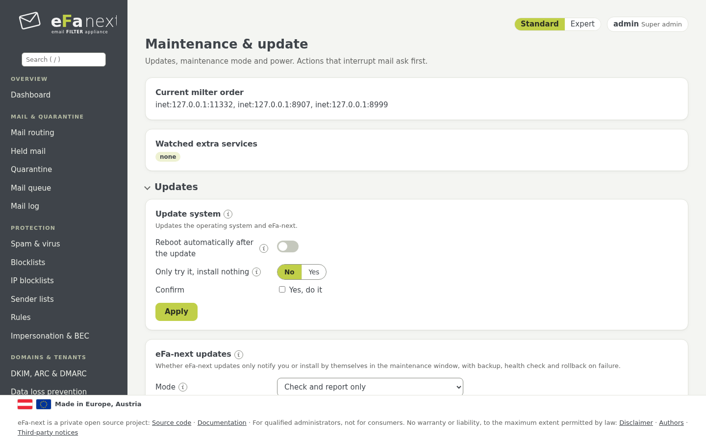

# 14. Updates and release upgrade

*System › Maintenance & update*.



## eFa-next updates

eFa-next comes from its own signed repository (`https://repo.efa-next.eu`, GitHub releases as a mirror). A release is taken only
when its checksums carry a valid signature of the eFa-next key (fingerprint in chapter 2). The repository is off for normal
system updates (`enabled=0`), so `dnf upgrade` alone never changes eFa-next.

- **Automatic eFa-next updates:** *off*, *notify* (default) or *auto*, with maintenance days and time. *auto* installs in the
  window, with a backup first and a health check after it.
- **Check for an eFa-next update now** and **Install the eFa-next update now** do the same at once.
- A security release is marked as such on the dashboard; the security self check reports a missing one after 7 days.

```bash
sudo efactl update-check
sudo efactl update-install --confirm yes
sudo efactl autoupdate-set --mode auto --days "sat sun" --time 03:00
```

By hand from the repository (the repository file first, see [install.md](../install.md#installation-and-updates-from-the-signed-repository)):

```bash
sudo dnf --enablerepo=efa-next upgrade eFa-next eFa-next-base
```

An update never changes your settings; new features of a release are off until you switch them on. After the update the
dashboard lists the notes of the release under *Needs attention*.

## Back to the version before (rollback)

*Updates › Update: back to the version before* returns to the eFa-next version that was installed before the last update:
first the verified packages of that version, then the backup the update made right before it.

- *Only show what would happen* lists the versions and the backup, and changes nothing.
- With *Restore the backup* off, the settings changed since the update are kept; on (default) they are lost with the backup.
- It needs a typed confirmation and works only while the installed version is still the one that update installed and its
  packages are still there. Maintenance mode is on while it runs; the admin gets a mail when it is done.

```bash
sudo efactl update-rollback --dry_run yes
sudo efactl update-rollback --confirm yes
```

Updates of the operating system cannot be rolled back this way: take a VM snapshot before big ones.

## System updates

- **Pending updates** lists the updates of the operating system and third-party packages.
- **Update system** makes a backup and an export of the configuration first, then updates the operating system and eFa-next,
  optionally with a reboot. It runs only from minute 20 to 50 of an hour and leaves out packages whose scripts reload or
  restart firewalld (it names them).
- After every change of the installed packages a check runs: the configuration tests of Postfix, nginx, rspamd, Unbound and
  fail2ban, the mail services, and `.rpmnew`/`.rpmsave` files. A failure is red on the dashboard and mailed to the admin
  (*Check after package updates: run now*).

## Maintenance

- **Maintenance mode:** stops the service monitor from restarting services while you work.
- **Load warning limits:** from which CPU load and after how many minutes the admin is warned.
- **Reboot** and **Halt** ask for a confirmation.
- *Advanced* (expert): milter order, extra services, *Repair databases*.

## Release upgrade from AlmaLinux 9 to 10

*Release-Upgrade* (super admins only, with a red warning above it) upgrades the operating system of a running host from
AlmaLinux 9 to AlmaLinux 10 with ELevate (leapp), in fixed steps:

1. **preflight** checks and changes nothing: EL9 and eFa-next 6.0.0.6 or newer, the EL10 repository of eFa-next, a CPU with
   x86-64-v3, free space, no pending updates, network as NetworkManager keyfiles, the clock; it warns about mail in the queue,
   the cluster role, network drivers EL10 no longer maintains and old Postfix map types.
2. **preupgrade** installs ELevate with vendor files for the eFa-next and rspamd repositories and runs `leapp preupgrade`;
   any inhibitor stops here.
3. **start** asks for your password and 2FA code, a confirmed VM snapshot and the typed host name. It makes an encrypted backup
   that must reach every external target with the same checksum, gives new mail `421` (senders try again), and runs
   `leapp upgrade` with the reboots.
4. **abort** stops a step and lifts the maintenance mode, but only before `leapp upgrade` has started.

After the first EL10 boot eFa-next finishes the upgrade (database, Postfix maps, SELinux) and checks the whole system: services,
addresses, firewall, DKIM keys, counts, a test mail, and that every setting is the same as before. Mail is accepted again only
when every check passes.

**There is no rollback of a release upgrade.** The only way back is the VM snapshot. Mail is not accepted for about 30 to 60
minutes. Until eFa-next publishes packages for EL10, preflight fails on the repository check and the upgrade cannot start: that is
expected. All details: [release-upgrade.md](../release-upgrade.md).

```bash
sudo efactl release-upgrade --action=preflight
sudo efactl release-upgrade-status
```

Next: [Cluster and offline operation](15-cluster.md) · Back: [Manual](README.md)
