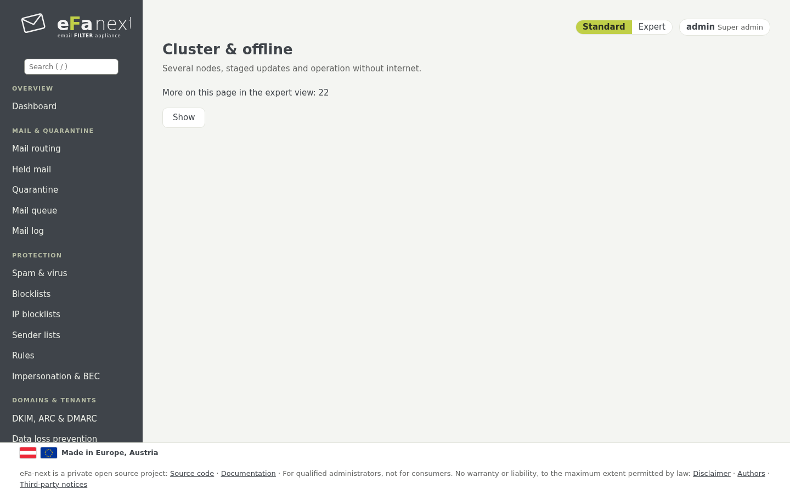

# 15. Cluster und Betrieb ohne Internet

*System › Cluster & offline*.



## Cluster

Ein Master, beliebig viele Knoten. Was auf dem Master eingestellt wird, gilt für alle Knoten.

| Modus | Einstellungen | Wenn der Master ausfällt |
|---|---|---|
| einzelner Host | nicht im Cluster (Standard) | – |
| `master-client` | nur auf dem Master; ein Knoten lehnt eine Änderung ab und zeigt „Verwaltet von …" | die Knoten filtern mit den letzten Einstellungen weiter |
| `ha` | auf jedem Knoten: ein Knoten gibt die Änderung an den Master, der sie ausführt und an alle weitergibt | die Knoten filtern weiter; Änderungen warten, bis der Master zurück ist |

Einrichten:

```bash
# auf dem Master
sudo efactl cluster-init --name mx-01 --mode ha
sudo efactl cluster-token
# auf jedem Knoten, mit Token und CA-Fingerabdruck aus cluster-token
sudo efactl cluster-join --master mx-01.example.com:8460 --name mx-02 --address 192.0.2.12 --ca_fingerprint <Fingerabdruck>
```

Die Knoten folgen dem Journal des Masters über gegenseitiges TLS (Port 8460), jeder mit eigenem Schlüssel. Gemeinsam: die
Einstellungen von eFa-next, rspamd-Regeln, DKIM- und ARC-Schlüssel, die Postfix-Tabellen, Benutzer, Gruppen und Einstellungen mit
Geltungsbereich und die Fail2Ban-Sperren. Jeder Host behält seine Identität: Hostname, Adressen, TLS-Zertifikate,
SSH-Hostschlüssel; Firewall, Netz, Update, Sicherung und Wazuh wirken immer auf dem eigenen Host. Werte nur für einen Knoten
kommen nach `/etc/eFa/local.d/`.

*Cluster: alle Knoten* zeigt Mail-Log, Quarantäne und Warteschlange aller Knoten und handelt auf einer Mail jedes Knotens.
Der eigene Fuzzy-Speicher bleibt je Knoten; ein gemeinsamer Speicher im Cluster ist für 6.0.0.7 geplant.
`efactl cluster-status` zeigt jeden Knoten und wie weit er zurückliegt, `cluster-resync` übernimmt alle Einstellungen neu,
`cluster-mx-check` prüft die MX-Einträge. Ist der Master endgültig weg, macht `cluster-promote` einen Knoten zum Master eines neuen
Clusters.

Der zweite MX kann diesen Host als DNS-Resolver nutzen (Kapitel 10).

**Gestaffelte Updates:** `efactl cluster-update-set --mode on --window 2` lässt den Master einen Knoten nach dem anderen
aktualisieren: Der erste Knoten installiert im Wartungsfenster, der Master wartet ein Gesundheitsfenster, dann folgt der nächste;
ein ungesunder Knoten stoppt die Verteilung. Details: [cluster.md](../cluster.md).

## Betrieb ohne Internet

- **Ein lokaler Spiegel:** `efactl update-mirror-set --url https://mirror.example.lan/el9` holt Updates nur aus einer Kopie der
  eFa-next-Paketquelle. Die Signatur wird genau wie bei der Paketquelle selbst geprüft.
- **Signierte Pakete** für ein Netz ganz ohne Verbindung: `offline-bundle-make` auf einem Host mit Internet packt die Pakete des
  neuesten Releases, die ClamAV-Signaturen und die Karten der Bedrohungs-Feeds in eine Datei, signiert mit eigenem Schlüssel; der
  abgeschottete Host vertraut diesem Schlüssel einmal (`offline-trust-set`) und spielt die Datei ein (`offline-bundle-apply`).

Details: [offline.md](../offline.md).

Weiter: [Migration von eFa 5](16-migration.de.md) · Zurück: [Handbuch](README.de.md)
