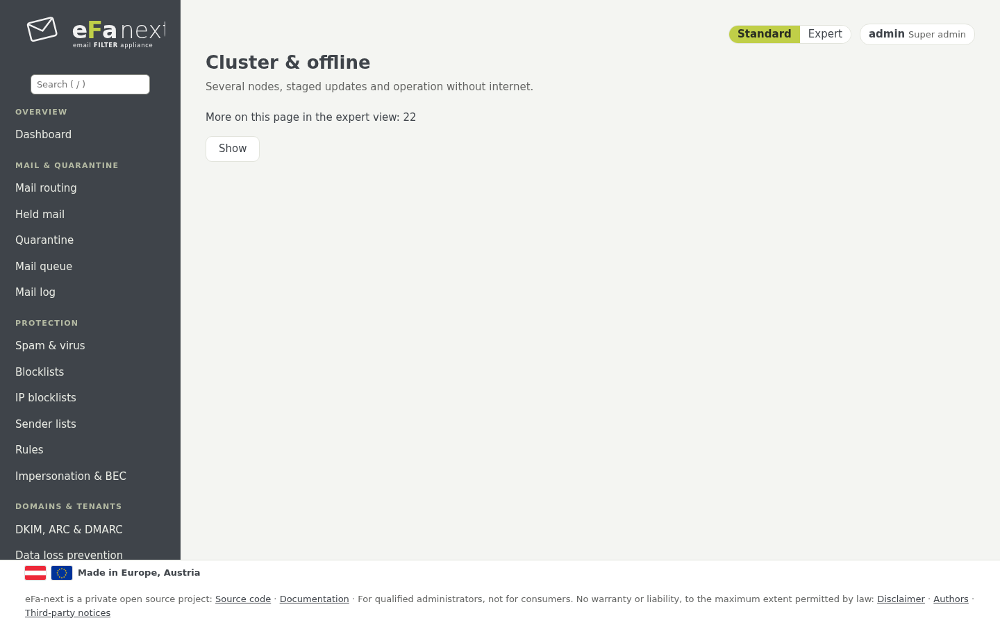

# 15. Cluster and offline operation

*System › Cluster & offline*.



## Cluster

One master, any number of nodes. What is set on the master applies to all nodes.

| Mode | Settings | When the master is down |
|---|---|---|
| single host | not in a cluster (default) | – |
| `master-client` | only on the master; a node refuses a change and shows "Managed by …" | the nodes filter on with the last settings |
| `ha` | on every node: a node hands the change to the master, which runs it and hands it to all | the nodes filter on; changes wait until the master is back |

Set it up:

```bash
# on the master
sudo efactl cluster-init --name mx-01 --mode ha
sudo efactl cluster-token
# on each node, with the token and the CA fingerprint of cluster-token
sudo efactl cluster-join --master mx-01.example.com:8460 --name mx-02 --address 192.0.2.12 --ca_fingerprint <fingerprint>
```

The nodes follow the journal of the master over mutual TLS (port 8460), each with its own key. Shared: the eFa-next settings,
rspamd rules, DKIM and ARC keys, the Postfix tables, the users, groups and scoped settings, and the Fail2Ban bans. Each host
keeps its identity: host name, addresses, TLS certificates, SSH host keys; firewall, network, update, backup and Wazuh always act
on their own host. Values for one node only go into `/etc/eFa/local.d/`.

*Cluster: all nodes* shows the mail log, quarantine and queue of all nodes and acts on a mail of any node.
The own fuzzy store stays per node; a store shared in the cluster is planned for 6.0.0.7.
`efactl cluster-status` shows each node and how far it is behind, `cluster-resync` takes all settings anew, `cluster-mx-check`
checks the MX records. When the master is gone for good, `cluster-promote` makes a node the master of a new cluster.

The second MX can use this host as its DNS resolver (chapter 10).

**Staged updates:** `efactl cluster-update-set --mode on --window 2` lets the master update one node at a time: the first node
installs in the maintenance window, the master waits a health window, then the next follows; an unhealthy node stops the rollout.
Details: [cluster.md](../cluster.md).

## Operation without internet

- **A local mirror:** `efactl update-mirror-set --url https://mirror.example.lan/el9` takes updates only from a copy of the
  eFa-next repository. The signature is checked exactly as with the repository itself.
- **Signed bundles** for a network without any connection: `offline-bundle-make` on a host with internet packs the packages of
  the newest release, the ClamAV signatures and the threat feed maps into one file signed with its own key; the isolated host
  trusts that key once (`offline-trust-set`) and applies the file (`offline-bundle-apply`).

Details: [offline.md](../offline.md).

Next: [Migration from eFa 5](16-migration.md) · Back: [Manual](README.md)
