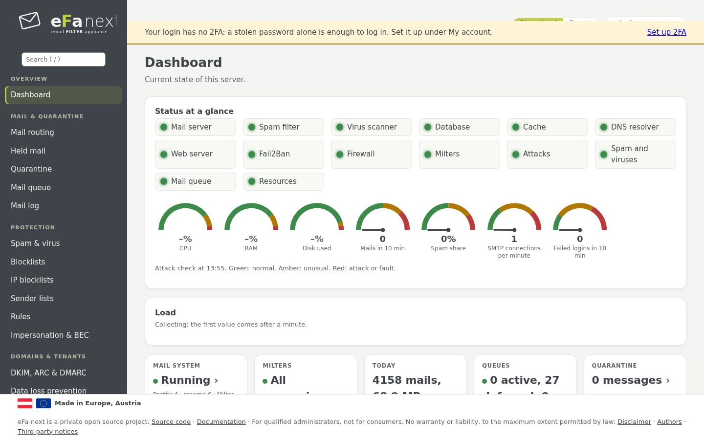

# Handbuch eFa-next (6.0.0.6)

[English](README.md)

Dieses Handbuch führt durch eFa-next von der Installation bis zum täglichen Betrieb, Seite für Seite der Weboberfläche. Jedes
Kapitel sagt, was eine Seite tut, wie man sie benutzt und welcher `efactl`-Befehl dasselbe auf der Konsole tut. Für die Details
einer einzelnen Funktion verweist es auf die Referenzseiten in [docs/](../README.md) (meist auf Englisch).

## Kapitel

| # | Kapitel | Inhalt |
|---|---|---|
| 1 | [Überblick](01-overview.de.md) | Was eFa-next ist, wie Mail fließt, die Bestandteile |
| 2 | [Voraussetzungen und Installation](02-install.de.md) | Größen, Installation mit einem Befehl, der Einrichtungsassistent |
| 3 | [Erste Anmeldung, 2FA und Mein Konto](03-first-login.de.md) | Anmelden, Zwei-Faktor-Anmeldung im Web und auf der Konsole, eigenes Konto, Passwort vergessen |
| 4 | [Dashboard und Angriffswarnung](04-dashboard.de.md) | Status auf einen Blick, das Banner, Hinweise, Suche, Standard- und Expertenansicht |
| 5 | [Mail, Quarantäne und Logs](05-mail.de.md) | Mail-Routing, zurückgehaltene Mail, Quarantäne, Warteschlange, Mail-Log, Live-Log, Absendermenü |
| 6 | [Spamschutz](06-spam.de.md) | Spam-Schwellen, Greylisting, Blocklisten, Absenderlisten, Regeln, Identitätsbetrug und BEC |
| 7 | [Viren, Anhänge und Links](07-virus.de.md) | ClamAV, weitere Signaturquellen (SecuriteInfo-Stufe), Anhänge, Entschärfung, Linkprüfung |
| 8 | [Domains, Mandanten, Benutzer und Portal](08-domains-users.de.md) | DKIM, ARC, DMARC, Domain-Einstellungen, Mandanten, Benutzer, Gruppen, Single Sign-on, Benutzerportal |
| 9 | [Sicherheit und Sicherheitsstandards](09-security.de.md) | Sicherheitsstandards (BSI, Mozilla, NIST, CIS), TLS-Profile, Admin-Zugang, Firewall, Audit |
| 10 | [Netzwerk, DNS und Zertifikat](10-network-dns.de.md) | Schnittstellen, Unbound, interne DNS-Zonen, DNS für weitere Netze, Let's Encrypt, DANE, MTA-STS |
| 11 | [Berichte und Überwachung](11-reports.de.md) | Mail-Bericht, Berichte per Mail und als PDF, SIEM, OTLP, Prometheus, Wazuh |
| 12 | [Aufbewahrung und Datenschutz](12-retention-privacy.de.md) | Tage je Datenart und Mandant, Pseudonyme, DSGVO-Anfragen |
| 13 | [Sicherung und Wiederherstellung](13-backup.de.md) | Verschlüsselte, signierte Sicherungen, externe Ziele, Wiederherstellen |
| 14 | [Updates und Release-Upgrade](14-updates.de.md) | eFa-next-Updates, Rückkehr zur Vorversion, Systemupdates, Wartung, EL9 auf EL10 |
| 15 | [Cluster und Betrieb ohne Internet](15-cluster.de.md) | Master und Knoten, gestaffelte Updates, Spiegel und Offline-Pakete |
| 16 | [Migration von eFa 5](16-migration.de.md) | Wo der Migrationsleitfaden steht |
| 17 | [efactl-Referenz](17-efactl.de.md) | Jeder Befehl, gruppiert wie das Menü |
| 18 | [Fehlersuche](18-troubleshooting.de.md) | Logs, häufige Probleme, ausgesperrt |

Sicherheitsrichtlinie und Meldung einer Schwachstelle: [SECURITY.md](../../SECURITY.md).

## Schreibweise

- Menüpfade stehen als *Menü › Seite › Karte*, etwa *System › Wartung & Update › Updates*.
- Befehle laufen auf der Konsole als Konsolen-Admin: `sudo efactl <Befehl>`.
- Karten mit *Experte* erscheinen nur in der Expertenansicht (Umschalter oben auf jeder Seite).
- Namen und Adressen in Beispielen und Bildschirmfotos sind Beispiele (`example.com`, `192.0.2.x`, `198.51.100.x`).
- Die Bildschirmfotos zeigen die englische Oberfläche; die deutsche hat dieselben Seiten und Karten.
