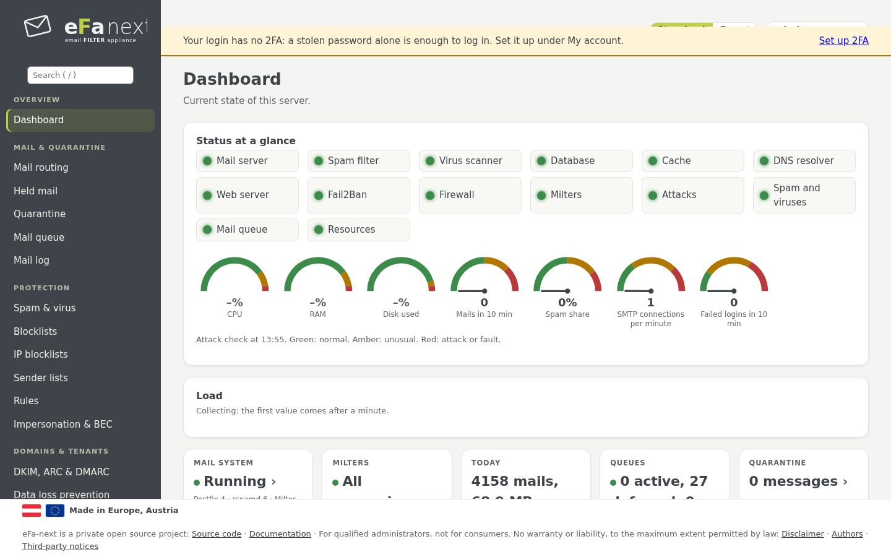

# eFa-next manual (6.0.0.6)

[Deutsch](README.de.md)

This manual walks through eFa-next from the install to daily operation, page by page of the web interface. Each chapter
says what a page does, how to use it and which `efactl` command does the same on the console. For the details of a single
feature it links to the reference pages in [docs/](../README.md).

## Chapters

| # | Chapter | What it covers |
|---|---|---|
| 1 | [Overview](01-overview.md) | What eFa-next is, how mail flows, the parts |
| 2 | [Requirements and install](02-install.md) | Sizes, the one-command install, the setup wizard |
| 3 | [First login, 2FA and My account](03-first-login.md) | Logging in, two-factor login in the web and on the console, own account, lost password |
| 4 | [Dashboard and attack alert](04-dashboard.md) | Status at a glance, the banner, notices, search, standard and expert view |
| 5 | [Mail, quarantine and logs](05-mail.md) | Mail routing, held mail, quarantine, mail queue, mail log, live log, sender menu |
| 6 | [Spam protection](06-spam.md) | Spam scores, greylisting, blocklists, sender lists, rules, impersonation and BEC |
| 7 | [Viruses, attachments and links](07-virus.md) | ClamAV, more signature sources (SecuriteInfo tier), attachments, content disarm, link check |
| 8 | [Domains, tenants, users and the portal](08-domains-users.md) | DKIM, ARC, DMARC, domain settings, tenants, users, groups, single sign-on, user portal |
| 9 | [Security and security standards](09-security.md) | Security standards (BSI, Mozilla, NIST, CIS), TLS profiles, admin access, firewall, audit |
| 10 | [Network, DNS and certificate](10-network-dns.md) | Interfaces, Unbound, internal DNS zones, DNS for other networks, Let's Encrypt, DANE, MTA-STS |
| 11 | [Reports and monitoring](11-reports.md) | Mail report, reports by mail and as PDF, SIEM, OTLP, Prometheus, Wazuh |
| 12 | [Retention and privacy](12-retention-privacy.md) | Days to keep per kind of data and tenant, pseudonyms, GDPR requests |
| 13 | [Backup and restore](13-backup.md) | Encrypted, signed backups, external targets, restore |
| 14 | [Updates and release upgrade](14-updates.md) | eFa-next updates, rollback, system updates, maintenance, EL9 to EL10 |
| 15 | [Cluster and offline operation](15-cluster.md) | Master and nodes, staged updates, operation without internet |
| 16 | [Migration from eFa 5](16-migration.md) | Where the migration guide is |
| 17 | [efactl reference](17-efactl.md) | Every command, grouped like the menu |
| 18 | [Troubleshooting](18-troubleshooting.md) | Logs, common problems, locked out |

Security policy and how to report a vulnerability: [SECURITY.md](../../SECURITY.md).

## Conventions

- Menu paths are written as *Menu › Page › Card*, for example *System › Maintenance & update › Updates*.
- Commands run on the console as the console admin: `sudo efactl <command>`.
- Cards marked *expert* show only in the expert view (switch at the top of every page).
- Names and addresses in the examples and screenshots are examples (`example.com`, `192.0.2.x`, `198.51.100.x`).
