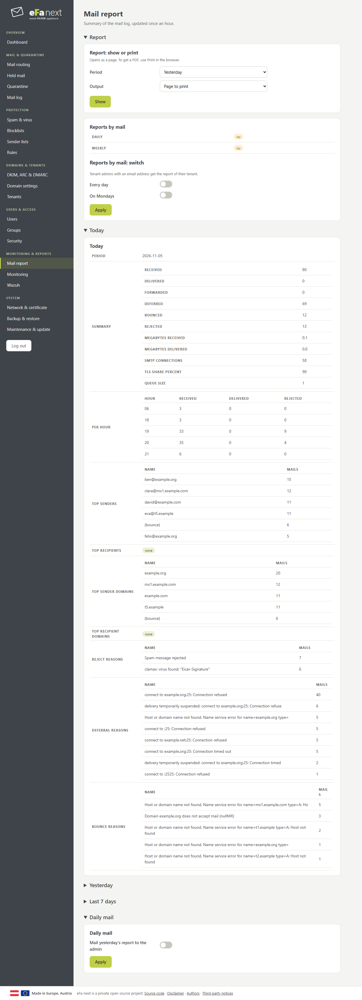
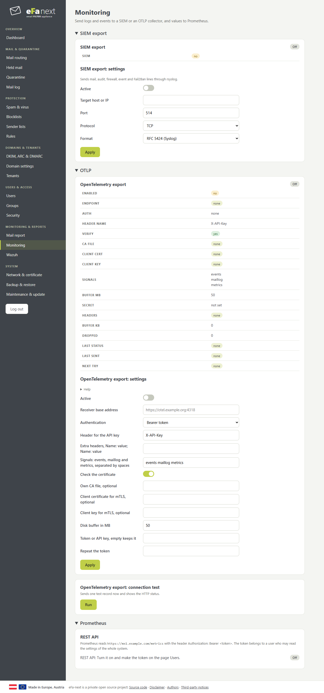
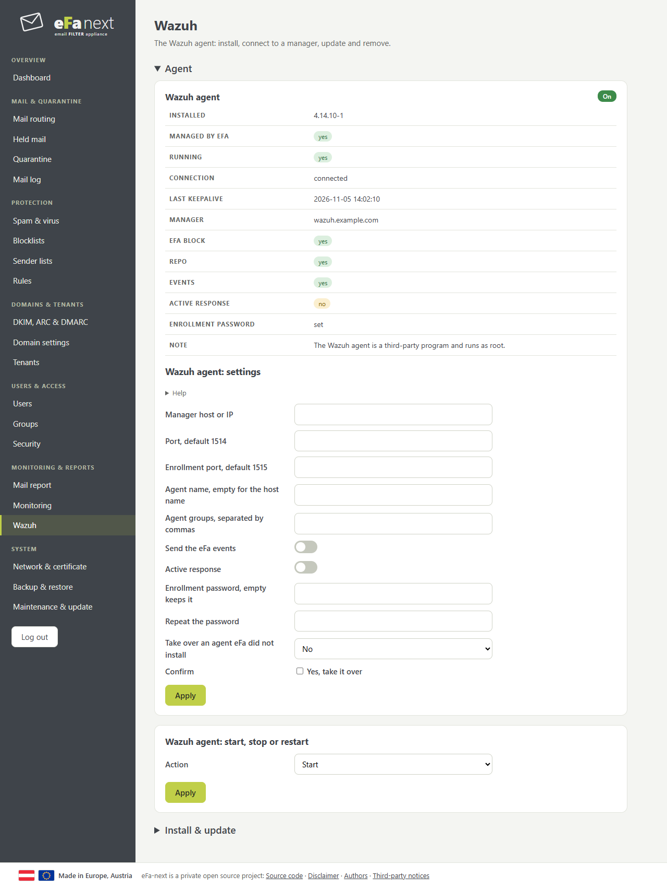

# Monitoring & reports

## Mail report

Mail flow and threats of today, yesterday and the last 7 days, updated once an hour. *Report: show or print* opens a page to print as PDF. *Reports by mail* sends the daily or weekly report to the admin; tenant admins with an address get the report of their tenant.

## Monitoring

- **SIEM export**: mail, audit, firewall, event and Fail2Ban lines through rsyslog, as RFC 5424 or JSON, only over TLS
  (RFC 5425, port 6514, the certificate of the SIEM checked by its name). A setup of before over plain TCP or UDP stops with
  the upgrade; the dashboard says how to switch it to TLS.
- **OTLP**: events, mail log and metrics to an OpenTelemetry collector over HTTPS, with a bearer token or an API key, a disk buffer and retries.
- **Prometheus**: reads `https://<host>/metrics` with an API token. Turn on the REST API and make the token under Users › API tokens.

## Wazuh

Install, connect, update and remove the Wazuh agent. An agent that eFa did not install is only read. Details: [WAZUH.md](WAZUH.md).

