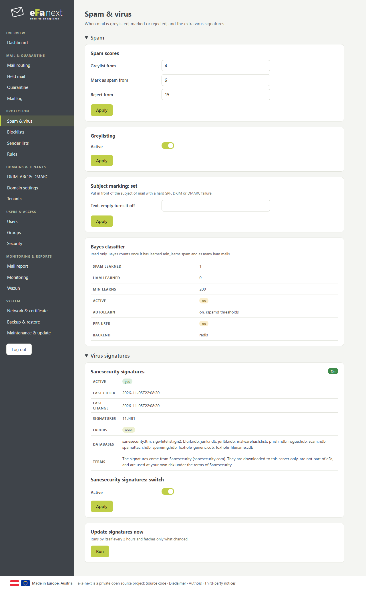
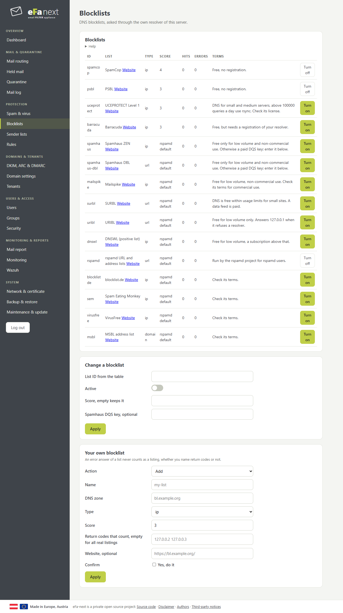
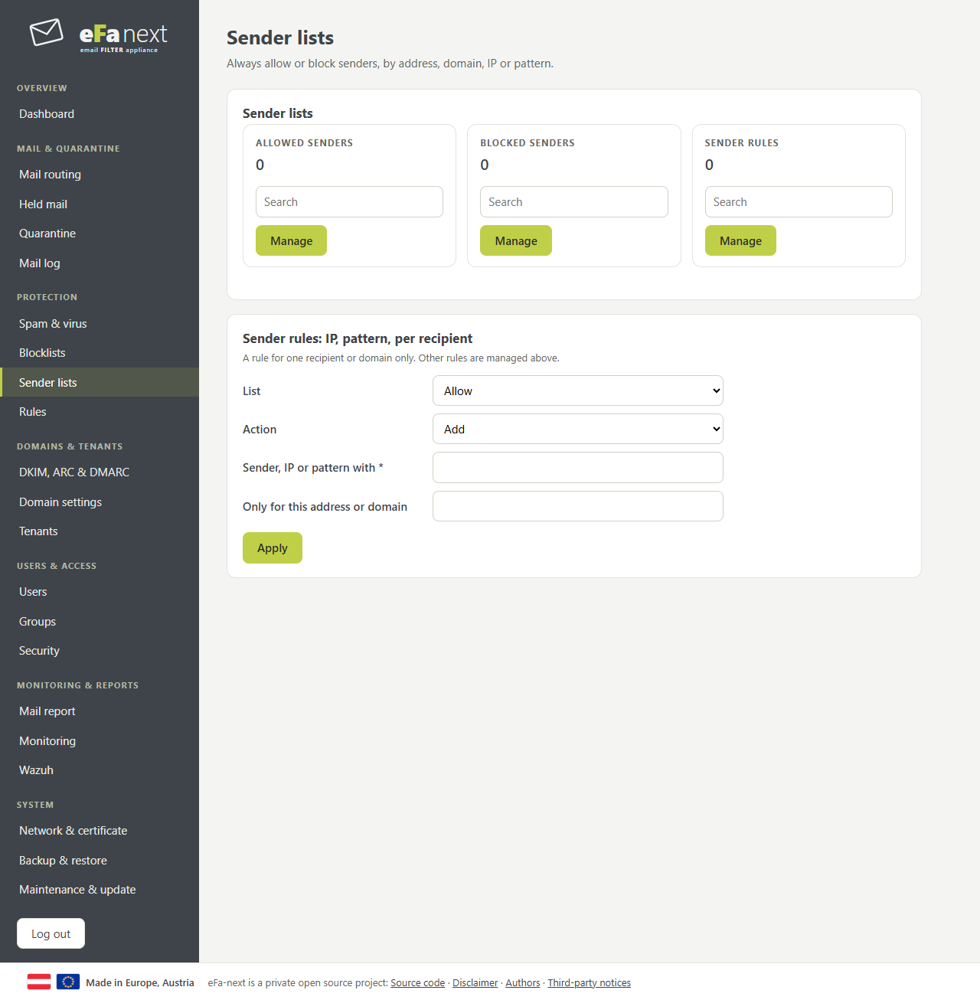
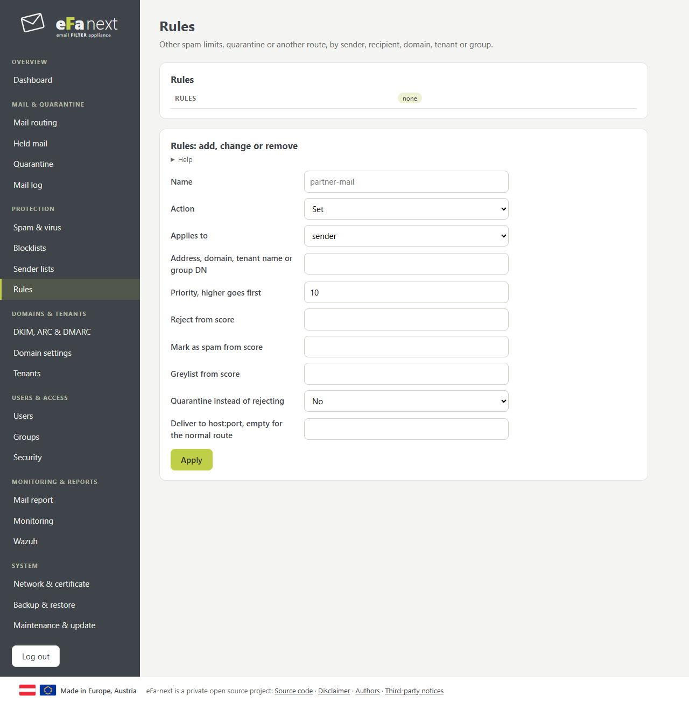

# Protection

## Spam & virus

When mail is greylisted, marked or rejected; subject marking for failed SPF, DKIM or DMARC; the Bayes classifier (read only); the extra Sanesecurity virus signatures.

## Blocklists

DNS blocklists, asked through the own resolver of eFa. Each with its terms: lists that are free only for low volume or non-commercial use stay off until you turn them on. *Your own blocklist* adds one more.

## Sender lists

Always allow or block senders, by address, domain, IP or pattern. *Manage* opens the list with search, import and export. A rule for one recipient or domain goes in *Sender rules*.

## Rules

Other spam limits, quarantine instead of rejecting, or another route, for a sender, a sender domain, a recipient, a domain, a tenant or a directory group. The highest priority that fits wins; with several recipients a rule counts if one of them fits.

Example: mail to `partner@example.com` is never rejected but quarantined.

| Field | Value |
|---|---|
| Name | partner-mail |
| Applies to | recipient |
| Address | partner@example.com |
| Quarantine instead of rejecting | Yes |

On the console: `efactl rule-set --name partner-mail --action set --kind recipient --value partner@example.com --quarantine on`.
