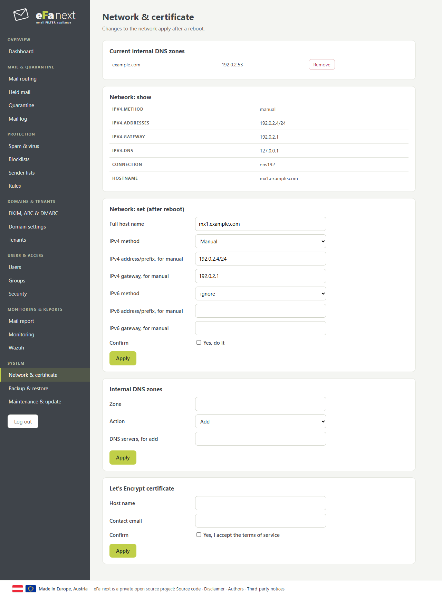
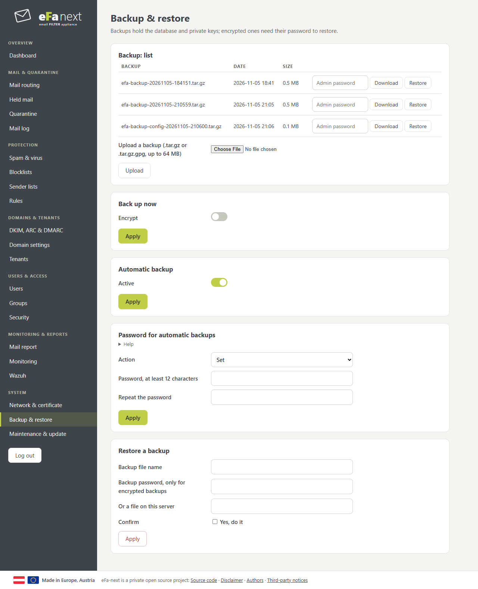
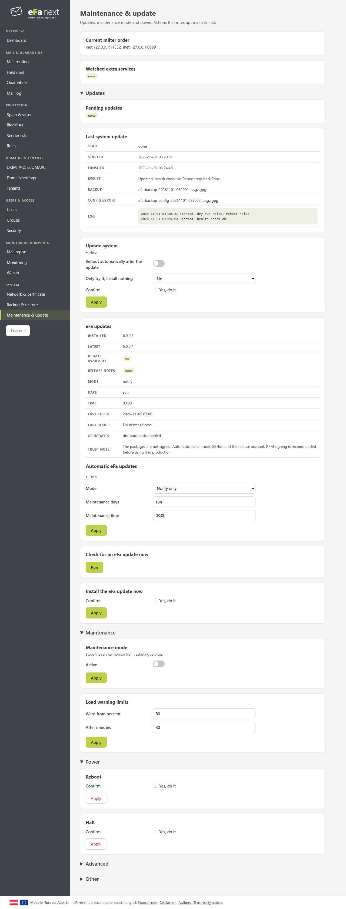

# System

## Network & certificate

Host name, IPv4 and IPv6 (apply after a reboot), internal DNS zones, and a Let's Encrypt certificate.

## Backup & restore

Backups hold the database and the private keys. Set a password for the automatic backups first: they are then encrypted, and the password is needed to restore them anywhere. *Back up now* makes one at once. *Download* asks for the admin password again.

On the console: `efactl backup-now`, `efactl backup-list`, `efactl restore --name <file> --confirm yes`.

## Maintenance & update

- **Update system**: first a backup and an export of the configuration, then the operating system and eFa-next. It starts only between minute 20 and 50 of an hour, and leaves out packages whose scripts reload or restart firewalld (it names them). *Only try it* installs nothing.
- **Release-Upgrade** (super admins, expert view): AlmaLinux 9 to 10 with ELevate, in the steps preflight, preupgrade and start, with a backup that must reach the external target first and checks after the first EL10 boot. See [Release upgrade](release-upgrade.md).
- **eFa-next updates**: notify, or install by itself in the maintenance window with a health check and a rollback if that fails.
- **Maintenance mode** stops the service monitor from restarting services.
- **Reboot** and **Halt** ask for a confirmation.

Operating system updates cannot be rolled back automatically; take a VM snapshot before big updates.

## Cloning a host

A copy of a virtual machine keeps the secrets of its origin: SSH host keys, the machine id, the keys that sign the sessions of
the web interface and the user portal, the key between nginx and them, the signing keys of backups and offline bundles. Run
this on the console of the copy, as root, before it takes mail:

    sudo efactl clone-reset --confirm yes --hostname mx2.example.org

It makes these new: SSH host keys (as `ssh-keygen -A`, checked with `sshd -t` before sshd restarts; keep the session open and
test a new login), the machine id (`systemd-machine-id-setup`; the rescue image of the old id goes from /boot, a new one comes
with the next kernel; the other boot entries take the new id in name and content, entries whose kernel is gone are dropped, the
one of the running kernel stays, and if grubby then no longer names the running kernel as the default the entries are put back
and the reset stops), the host name (as `hostname-set`, with the self-signed
certificate), the keys of the web interface and the portal (all logins end), the key between nginx and them, the SRS key, the key
of the link check. The backup and offline signing keys are removed and made again on first use; their old fingerprints are
shown, as backups and bundles of before need them.

It keeps, and names, what encrypts or names data that exists or belongs to the domains: the key of the 2FA secrets, the keys of
the strict audit log and its daily anchor, the pseudonym keys, the keys of held mail and emergency copies, S/MIME, PGP, DKIM and
ARC keys, the certificate of the provisioning API, the database passwords, the access to backup targets (point the copy at its
own folder or bucket), Let's Encrypt certificates (request new ones for a new name) and a Wazuh agent identity (enroll again).
API tokens of the origin work on the copy too and are counted, so they can be revoked.

It refuses on a member of a cluster: take the host out first (`efactl cluster-leave`). It is not offered in the web interface.
Every run is in the audit log.

