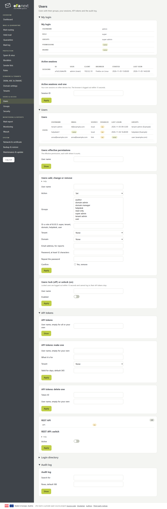
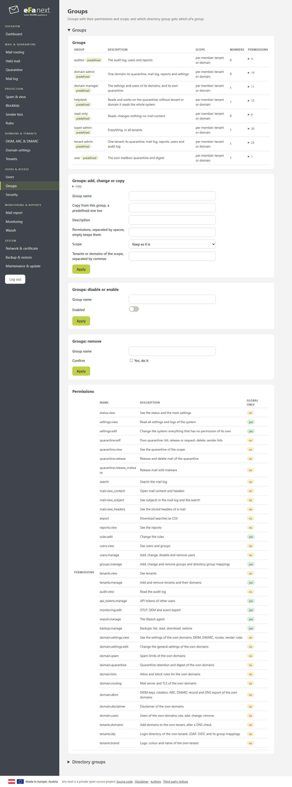
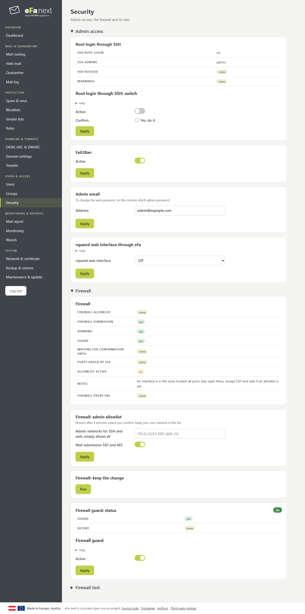

# Users & access

## Users

Local users (password twice, at least 12 characters), or users of LDAP/Active Directory or OIDC. A user can be in several groups; the permissions add up. *Lock* logs a user out within 15 seconds; their API tokens stop. *My login* lists your sessions, also on other devices, and ends them.

## Groups and permissions

Each action needs one permission, for example `quarantine.release` or `domain.dkim`. A group holds permissions and a scope: global, some tenants, or some domains.

| Predefined group | For |
|---|---|
| super admin | everything, in all tenants |
| tenant admin | one tenant: quarantine, mail log, reports, users, settings of its domains |
| domain admin | one domain: quarantine, mail log, reports, its settings and users |
| domain manager | the settings and users of its domains |
| helpdesk | reads and works on the quarantine; without tenant or domain for the whole system |
| read-only | reads, changes nothing, no mail content |
| auditor | the audit log, users and reports |
| user | the own mailbox: held mail and digest |

Predefined groups cannot be changed; copy one and change the copy. Nobody can hand out a permission or scope they do not have, change their own groups, or remove the last super admin. *Directory groups* map groups of LDAP or OIDC to eFa-next groups.

## Security

Root login through SSH (warns, and refuses to turn it off unless another admin can log in), Fail2Ban, the admin address, the rspamd web interface, the firewall allowlist for SSH and web (reverts after 5 minutes unless you confirm), the firewall guard and the firewall test.

